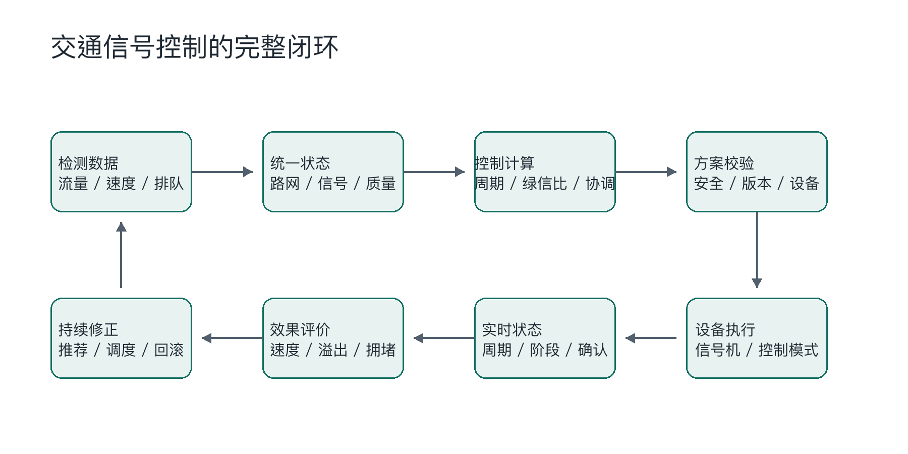

# 第 1 章 交通信号控制为什么是一个系统问题

早高峰的路口看起来秩序井然：东西向的车流在绿灯里成串通过，红灯前的队伍安静地排在停止线之后。支撑这种秩序的，是一组在一个周期内重复出现的时间分配——哪个方向走、走多久、中间留多少清空时间。信号控制的全部工作，就是在互相冲突的交通流之间分配这条时间轴。

这件事听起来像一道算术题：给定各方向的流量，算出每个方向该拿多少秒。真正进入工程现场，约束会一层层压上来：

- 不同的车在不同时间段到达，排队会跨周期延续。
- 检测器会缺失、漂移、重复计数或把相邻车道混淆。
- 行人过街需要最小绿，车辆需要清空时间。
- 多个路口需要协调，但道路长度、速度和排队条件不同。
- 信号机可能离线、拒绝命令或只执行部分方案。
- 优化结果可能提高局部通行能力，却增加另一方向的溢出风险。

导论里那次 08:12 的计算请求，分别落在链路上不同的环节。它们分属不同的层：排队和清空属于物理世界，漏检和漂移属于数据世界，离线、拒绝和部分执行属于设备与组织。公式只能处理其中一层；公式之外的部分，恰恰是现场事故的主要来源。

所以本书把信号控制当作一条持续运行的控制链来讨论：需求被检测，状态被形成，方案被计算，命令被执行，结果被观测，然后修正下一轮。本章先建立这条链的最小模型，再用一个故障把每个环节走一遍。

## 1.1 控制对象是时间资源

在物理空间中，车辆通过冲突点时占用不同的轨迹。在信号控制中，我们不直接移动车辆，而是决定何时允许某一组轨迹进入冲突区域。一个周期内可以分配给各阶段的总时间有限，控制器需要回答三个相互关联的问题：

1. 一个周期应该有多长。
2. 周期中的时间应该如何分配给各个阶段。
3. 相邻路口之间应该如何错开绿灯开始时刻。

周期越长，单位周期内的固定损失时间占比可能下降，但单次等待也更长；绿信比调整可以让需求更大的方向得到更多绿灯，却需要满足最小绿和清空时间；相位差可以形成绿波，却依赖公共周期、一致的速度和拓扑关系。

这三个问题不能完全分开求解。周期决定阶段时间分配的分母，阶段时间决定协调方案中的绿窗位置，相位差又会影响下游到达模式。实际工程会采用分层和近似方法，而不是一次求解所有变量。

## 1.2 一个最小控制系统

把一次控制过程拆成六个环节，可以得到：

```text
检测需求
  -> 形成状态
  -> 计算或选择方案
  -> 下发并执行
  -> 观测结果
  -> 修正状态
```

如图 1-1 所示。


下面把每个环节拆开。先看它做什么，再看它会把什么信息留在原地——后者才是工程事故的藏身处。

### 检测需求

输入通常来自视频、雷达、地磁或其他检测设备。原始事件需要经过断面匹配、时间聚合、车道映射和异常处理，才能形成方向级或转向级流量。这些转换本身就会引入误差，第二部分会逐章展开。

检测结果只是控制器状态的一部分。系统还需要知道当前方案、当前阶段、控制模式、设备在线状态和最近一次命令是否成功。只盯着流量做控制，会忽略状态的其他部分。

### 形成状态

控制状态至少包含三类信息：

- 静态配置：路口拓扑、车道流向、相位、阶段、方案库和调度。
- 动态交通：流量、速度、排队、占有率、预测需求和置信度。
- 运行控制：当前周期、阶段、相位差、控制模式、版本和执行结果。

这三类信息的更新频率完全不同：静态配置按月变，动态交通按分钟变，运行控制按秒变。它们需要能关联起来，关联的钥匙是来源和时间戳。没有来源和时间戳，算法拿到一个数字时，说不出它是实测值、历史值、补全值还是人工配置值。错误会在闭环中被放大。

### 计算或选择方案

控制器可以使用固定调度方案，也可以在候选方案库中筛选，还可以按流量重新计算周期和绿信比。无论采用哪一种方式，输出都应当是完整、可执行且满足硬约束的时间计划。

“完整”意味着周期、阶段顺序、绿信、绿闪、黄灯、全红和相位差都有明确值。只返回一个理想周期或一组比例，还不能直接下发。

### 下发并执行

方案需要经过版本校验、设备能力检查和命令状态跟踪。信号机接受命令、设备开始执行、运行状态与预期一致，是三件事。系统需要区分请求、接受、执行和确认；把其中一件当成全部，页面上的“已下发”就会掩盖一个没有生效的路口。

### 观测结果

运行结果不仅用于报表。延误、停车、速度、溢出和拥堵等信息应反馈到方案评价、异常识别和后续控制。评价指标需要区分相关性和因果关系：需求自己变了，指标也会跟着变；不看基线和外部事件，就容易把需求波动记成算法的功劳或过错。

### 1.2.1 一个故障如何穿过整个闭环

用一个可以完整复现的晚高峰场景，说明这六个环节为什么需要一起设计。S2 是四路口走廊中的关键路口。17:00 至 17:15，东进口实际到达流量是 900 veh/h；视频检测器因逆光漏检，平台只看到 540 veh/h，而 `Confidence` 字段还被上游错误地写成 1.0——数据看起来完好无损。接下来发生的事，按时间排开如下（见表 1-1）。

表 1-1 S2 东进口检测错误的事件序列
| 时刻 | 发生的事件 | 平台当时看到的状态 | 实际状态 |
|---|---|---|---|
| 17:00:00 | 东进口开始排队 | 东直流量偏低 | 需求已进入高峰 |
| 17:03:00 | 检测器漏检扩大 | 540 veh/h，质量正常 | 实际约 900 veh/h |
| 17:04:00 | 单点算法重算 | 东直流量比 0.30 | 真实流量比约 0.50 |
| 17:04:08 | 生成 90 s 方案 | 东直获得较少绿灯 | 东进口容量不足 |
| 17:04:20 | 方案下发 | 设备回复 accepted | 设备确实接受命令 |
| 17:04:35 | 运行状态改变 | 周期和阶段与新方案一致 | 执行成功，控制决策错误 |
| 17:12:00 | 排队回溢到上游 | 速度下降、占用率升高 | 排队已影响相邻路口 |
| 17:12:30 | 评价任务比较前后窗口 | 延误上升 | 若归因不当，会误判为算法无效 |

这条链中最危险的地方是 17:04:35：系统的局部检查都可能返回成功。设备在线，命令被接受，方案周期闭合，实时阶段与推荐方案一致。但“执行成功”只证明意图被执行，不能证明输入正确，也不能证明控制策略适合真实需求。

修复也不能只落在检测器上。检测器要修，平台还要在质量异常时降低 `Confidence`，算法要拒绝低置信度输入，命令层要记录方案建立在哪个数据版本上，评价层要把切换窗口和排队回溢纳入解释。只修一个环节，下一次同类故障仍会从其他入口进入。

这里还要提前说明一个现实差距：当前生产链路的 `Confidence` 在算法输入端恒为默认值，质量字段没有真正传下来（第 25.10 节）。本章描述的是应有状态，不是现状。

### 1.2.2 排队把时间决策变成状态递推

信号控制中的需求不能只看当前到达量。每个周期结束时仍有未放行的车辆，这些车辆会进入下一周期。对单个进口道，可以用离散排队模型描述：

\[
Q_{k+1}=\min\left(Q_{\max},\max\left(0,Q_k+A_k-D_k\right)\right)
\]

其中 \(Q_k\) 是第 \(k\) 个周期开始时的排队车辆数，\(A_k\) 是本周期到达车辆数，\(D_k\) 是本周期最大可放行车辆数，\(Q_{\max}\) 是物理排队容量。

这个递推用 \(Q_{\max}\) 截断，但没有单独记录被截掉的溢出车辆；它描述的是“排队不会超过车道容量”，不是“溢出的车消失了”。第 7 章会把溢出作为独立状态处理：超过 \(Q_{\max}\) 的到达会阻挡上游、影响相邻进口甚至路口通行。这里先记住方向，不要把 \(Q_{\max}\) 当成守恒边界。流量单位为 veh/h 时，一个周期内的到达量要先换算：

\[
A_k=\frac{q_k C}{3600}, \qquad
D_k=\frac{s\,g_{\mathrm{eff}}}{3600}
\]

这里 \(q_k\) 是到达流率，\(s\) 是饱和流率，\(g_{\mathrm{eff}}\) 是有效绿，\(C\) 是周期。回到 S2：

取 \(q_k=900\) veh/h、\(s=1800\) veh/h、\(C=90\) s、\(g_{\mathrm{eff}}=27\) s，代入得

\[
A_k=\frac{900\times90}{3600}=22.5\ \text{veh},
\qquad
D_k=\frac{1800\times27}{3600}=13.5\ \text{veh}
\]

因此 \(Q_{k+1}=Q_k+9\) veh。

如果检测错误只持续一个周期，排队增加 9 辆；持续八分钟，约 5.3 个周期，新增理论排队约 48 辆。真实排队不会无限增长，它会被上游到达、车道长度和溢出反馈改变。这个计算的价值是揭示方向：错误流量比不是报表偏差，它会改变队列状态，并进一步影响下一轮的检测和控制。

同样的递推也解释了为什么单周期指标会误导。某一周期“平均延误不高”，可能只是因为排队刚刚开始积累。评价窗口至少要覆盖排队形成、稳定和消散，不能只看方案生效后的第一分钟。

### 1.2.3 控制系统的状态空间

把六个环节写成状态变化，可以把“系统问题”与“单点公式”区分开。第 \(k\) 个决策周期开始时，系统状态至少包括：

\[
x_k=(q_k,\ell_k,c_k,u_k,d_k)
\]

其中 \(q_k\) 是各流向排队，\(\ell_k\) 是当前信号阶段及其已走时间，\(c_k\) 是控制模式和方案版本，\(u_k\) 是设备与通信状态，\(d_k\) 是检测数据的来源和质量。可观测状态并不是真实状态的全部。检测器只看到经过它的车辆，平台未必知道被遮挡的排队；数据库保存目标方案，设备却可能仍运行上一版本。

控制决策可以写成：

\[
a_k=\pi(o_k,h_k,\theta)
\]

\(o_k\) 是当前观测，\(h_k\) 是历史窗口，\(\theta\) 是配置或模型参数，\(a_k\) 是候选方案或保持命令。执行器的响应不是瞬时的：

\[
x_{k+1}=f(x_k,a_k,w_k)
\]

\(w_k\) 表示未观测到达、驾驶员反应、设备切换延迟和通信扰动。很多工程争议来自把 \(o_k\)、\(x_k\) 和 \(x_{k+1}\) 混为一体：用旧观测计算新方案，再用目标方案代表实际运行状态，最后用运行指标的短期变化证明控制有效。

这也说明，保持当前方案有价值。\(a_k\) 可以是不改变当前方案；在设备离线、输入质量不足或候选不可行时，保持已验证方案通常比输出一个看起来更优但无法确认的命令更安全。控制器不必每一步都改变系统——“不动”本身就是一个合法动作。

本章的排队实验实现了 \(q_{k+1}\) 的一个最小版本。它不模拟单车跟驰，只验证车辆守恒、容量不足和存储上限之间的关系。模型越小，越容易看见错误来自哪里；模型越大，越需要边界验证和数据校准。

## 1.3 硬约束和软目标

信号控制工程里代价最高的一类错误，是把约束和目标放进同一个评分函数，让算法拿一丁点安全违规去换一大块通行收益。本书从第一天起就把这两类条件分开。

### 硬约束

硬约束是不允许被交易的条件，例如：

- 冲突流向不能同时获得合法绿灯。
- 阶段切换需要包含清空时间。
- 每个方向达到规定的最小绿。
- 阶段时间之和等于周期。
- 参与协调的路口具有共同时间基准。
- 方案版本、下发对象和运行对象一致。

硬约束被违反时，方案只有两个去处：拒绝，或修复。给它一个较低的分、让它继续参赛，不在选项之内。

### 软目标

软目标是可以权衡的运行指标，例如：

- 平均延误
- 平均停车次数
- 最大排队长度
- 绿波带宽
- 各进口饱和度的均衡程度
- 下游溢出的持续时间

不同目标可能互相冲突。短周期通常降低等待，却可能增加单位时间损失；提高主干方向绿波带宽，可能牺牲交叉方向服务；追求路口均衡，可能降低某一关键方向的通行能力。

工程系统的任务是明确在什么场景下优先什么目标。

优化器最容易犯的错误，是把安全条件变成评分项。下面的写法看似灵活，实际没有定义“多违法才不能接受”：

```text
score = delay + 1000 * conflicts + 100 * min_green_shortage
```

如果延误项的数值量级变化，冲突可能被接受。安全条件应采用前置过滤或异常。下面是伪代码，不是可运行代码：

```text
candidate = build_candidate(...)
assert_no_conflicting_green(candidate)
assert_clearance_intervals(candidate)
validate_plan(candidate)
score = estimate_delay(candidate)
```

代码中的断言只是最后一道表达方式，工程约束还要有配置校验、设备能力检查和下发前复核。把条件写成异常，意味着调用者需要显式处理失败，不能把非法方案当成低分方案继续传播。

### 1.3.1 约束、目标和证据是三种对象

一次“优化成功”需要同时回答三个不同问题：

具体见表 1-2。
表 1-2 硬约束、软目标与证据的区分
| 对象 | 例子 | 判定方式 |
|---|---|---|
| 硬约束 | 周期闭合、清空时间、相同阶段序列 | 布尔值，失败即拒绝 |
| 软目标 | 延误、停车、最大排队、绿波带宽 | 数值比较，允许权衡 |
| 证据 | 流量完整率、命令确认、前后窗口、外部事件 | 说明结论能否成立 |

设备成功执行一个方案，只提供“执行证据”；运行速度改善，只提供“效果观测”；两者都成立，仍要考虑需求是否发生变化。书中的综合案例会持续区分这三种对象，避免把平台状态、交通状态和控制效果混成一句“控制成功”。

## 1.4 时间尺度和控制层级

同一套信号控制，同时活在好几个时间尺度上（见表 1-3）。

表 1-3 时间尺度和控制层级
| 时间尺度 | 典型工作 | 主要输出 |
|---|---|---|
| 月到年 | 渠化、方案库、控制策略设计 | 相位结构、方案模板、调度规则 |
| 日到周 | 时段划分、协调策略和参数评估 | 日计划、子区方案 |
| 15 分钟到 1 小时 | 方案推荐、周期和绿信比优化 | 下一时段控制方案 |
| 1 个周期 | 自适应调整、协调执行 | 周期、阶段时间、相位差 |
| 秒到分钟 | 设备控制、状态确认、故障处理 | 命令状态、运行状态、告警 |

算法输出的时间尺度与系统执行的时间尺度需要匹配。一个按 15 分钟周期计算的方案，不应该直接逐秒驱动信号机；一个秒级控制命令，也不能依赖人工审核 15 分钟才生效。

分层设计让不同时间尺度解耦，但也引入一致性问题。上层方案修改后，下层任务要重算；设备切到手动模式后，自动方案不能继续排队；通信中断时，当前周期按设备本地逻辑完成。这些问题属于系统设计，不会因为优化公式更复杂而自动消失。

时间尺度还决定数据新鲜度的门槛。一个 15 分钟流量窗口在第 14 分钟仍然可用，但一个 1 分钟自适应决策不能依赖已经滞后 20 分钟的检测值。设观测时间为 \(t_o\)，决策时间为 \(t_d\)，方案目标生效时间为 \(t_s\)，至少需要区分三个延迟：

\[
L_{\mathrm{data}}=t_d-t_o,\qquad
L_{\mathrm{compute}}=t_s-t_d,\qquad
L_{\mathrm{apply}}=t_{\mathrm{observed}}-t_s
\]

例如一次周期自适应请求在 17:04:00 发出，使用 16:49 至 17:04 的窗口，计算耗时 8 秒，设备在 17:04:20 确认。数据和计算延迟都还可以接受；如果设备直到 17:06 才应用，而算法已经按 90 秒周期设计，执行窗口相对输入状态已经错位。

延迟预算应写进接口，而不是留给人猜。至少声明：

```text
event_time          事件实际发生时间
observed_at         平台收到或生成观测的时间
window_start/end    输入数据时间窗
decision_time       算法完成时间
effective_time      方案计划生效时间
applied_at          设备确认的实际生效时间
timezone            时间和时段的时区语义
```

没有 `event_time` 和 `observed_at` 的区分，就无法处理乱序事件；没有 `timezone`，跨夏令时或跨区域部署时，17:00 可能对应不同的本地时钟；没有 `applied_at`，就无法确定评价窗口是否覆盖了控制变化。

## 1.5 为什么代码需要表达物理含义

考虑下面的接口：

```text
optimize(site, flow) -> seconds
```

签名干净，却没有回答几个关键问题：

- `seconds` 是周期、阶段时长还是纯绿灯时间？
- `flow` 是车道流量、方向流量还是转向流量？
- 阶段时间是否包含绿闪、黄灯和全红？
- 候选方案是否允许改变阶段顺序？
- 输出失败时返回零、异常还是保持原方案？

同一个函数，五个调用者可以给出五种解释。工程代码的第一步因此是把语义固定下来——建立一个不产生歧义的数据模型。

本书后续会使用如下时间关系：

```text
阶段总时长 = 纯绿 + 绿闪 + 黄灯 + 全红
周期 = 所有阶段总时长之和
```

公式进入代码前，需要先明确它操作的是哪一层时间。

可以用一个更严格的类型草图表达这种区别。下面省略 `dataclass` 导入，是字段示意：

```python
@dataclass(frozen=True)
class StageTiming:
    green_s: int
    green_flash_s: int
    yellow_s: int
    all_red_s: int

    @property
    def stage_total_s(self) -> int:
        return (
            self.green_s
            + self.green_flash_s
            + self.yellow_s
            + self.all_red_s
        )
```

调用者需要显式选择 `green_s` 或 `stage_total_s`，不能传一个裸的 `seconds`。这看起来比“简单接口”麻烦，但它把最容易发生的单位错误提前到代码编辑阶段。

## 1.6 可验证的控制过程

一个信号控制方案是否“正确”，至少需要在四个层次验证：

1. **模型正确**：对象关系和单位没有歧义。
2. **约束正确**：安全、时间和协调约束全部满足。
3. **执行正确**：命令被正确编码、发送、确认并可回滚。
4. **效果可解释**：指标变化能够与需求、方案和外部事件关联。

四层是阶梯关系：只到第一层，得到可读代码；到第二层，得到合法方案；到第三层，得到可运行系统；到第四层，才谈得上持续改进。各层要拿出的东西不同，失败方式也不同。可以用一张表管理：

具体见表 1-4。
表 1-4 四层验证的最低证据与典型失败
| 层次 | 最低证据 | 失败示例 |
|---|---|---|
| 模型 | 类型、单位、ID、引用测试 | 把阶段总时长当成纯绿 |
| 约束 | 周期、冲突、最小绿、相序测试 | 冲突流向同放 |
| 执行 | 命令批次、设备确认、实际状态 | 平台标记成功但设备仍运行旧方案 |
| 效果 | 基线窗口、需求变化、完整率、外部事件 | 把节假日前一天的低需求当作算法收益 |

这张表也说明了“测试全绿的代码不一定可靠”：单元测试可以证明一个函数按预期处理输入，却不能证明输入来自真实世界、命令被设备执行，或指标改善由方案造成。

## 1.7 本章实验

运行教学代码中的最小方案校验实验：

```bash
cd signal-lab
python3 -m unittest discover -s tests -v
```

实验要求：

1. 构造一个周期为 90 秒的三阶段方案。
2. 把其中一个阶段减少 10 秒，同时把另一个阶段增加 10 秒，验证周期不变。
3. 把总时长改成 100 秒，验证系统拒绝该方案。
4. 把某一阶段纯绿改为低于最小绿，观察修复函数如何重新分配时间。

再运行完整链路示例：

```bash
cd signal-lab
python3 -m examples.end_to_end_demo
python3 -m examples.queue_lab
```

第一个程序预期输出 `cycle`、`stage_flow_ratios`、`stage_green_s`、`common_cycle`、`downstream_offset_s` 和 `command_status`。第二个程序输出每个周期的开始排队、到达、服务、剩余排队和溢出。两类输出分别说明两段程序能接上，队列状态能对上。示例输出不是真实路口效果。

为了复现 S2 的检测错误，可以手工把东直流量从 `600` 改为 `360`，保持饱和流率不变，重新运行程序并比较：

1. 东直所属阶段的流量比是否下降。
2. 目标周期是否可能缩短。
3. 东直阶段绿灯是否减少。
4. 总周期和最小绿是否仍然闭合。
5. 算法结果在数据置信度下降时是否仍会被接受。

前四项应当能观察到数值变化，第五项在当前教学算法中未必会自动阻断。这个小缺口正是后续章节要补的工程边界。

## 1.8 小结

回到章标题的问题：为什么信号控制是一个系统问题？一条被违反的约束，往往能沿着“检测—状态—计算—执行—观测”这条链找到位置；单个环节单独看，可能都是对的。检测器漏检时，算法如实计算；设备接受命令时，协议如实回复；评价窗口对齐时，报表如实汇总——错误往往不在某个环节内部，而在环节之间：输入错了没人拦，语义变了没人知道，结果变了归因错了。

下一章把这个过程放大到系统架构：一个方案从计算到生效要经过哪些层，每一层各自维护什么状态。

## 练习

1. 为一个只考虑机动车直行的两相位路口列出至少五条硬约束。
2. 假设两个目标分别是“减少主干停车”和“降低支路最大排队”，说明它们在什么情况下冲突。
3. 设计一个状态对象，区分真实检测流量、补全流量和人工配置流量，并说明每种状态需要哪些元数据。
4. 画出一个从检测设备到方案执行的完整闭环，标出至少三个可能丢失状态的位置。
5. 使用排队递推计算：\(q=1080\) veh/h、\(s=1800\) veh/h、\(C=100\) s、\(g_{\mathrm{eff}}=30\) s，连续三个周期每周期排队增加多少。
6. 假设同一路口有两个检测源，一个报告 540 veh/h、置信度 0.9，另一个报告 880 veh/h、置信度 0.5。请写出至少三种融合策略，并说明各自的失效条件。
7. 为“设备反馈成功但运行状态仍是旧方案”设计一个状态记录，说明需要哪些时间、版本和观测字段。

