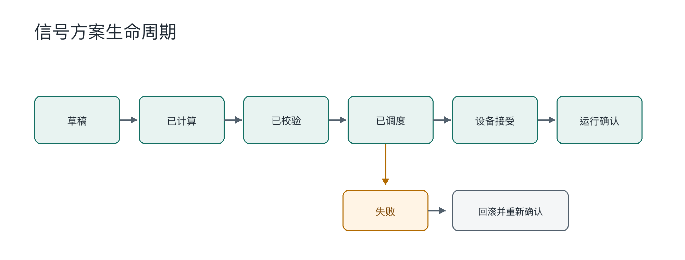

# 第 2 章 信号控制系统的架构与生命周期

第 1 章的故障沿着“检测—状态—计算—执行—观测”走了一遍，结论是错误往往发生在环节之间。这一章把这条链放回软件系统：它由哪些模块承载，每个模块记住什么，出了问题该找谁。

信号控制平台的最初版本，往往只有一张表和几个接口：保存路口，保存方案，点按钮下发。这套结构撑得起一次演示，撑不住一个真实路口。系统接入现场后，状态会自己长出来：同一路口有多个方案库，一个方案会被复制和编辑，调度引用某个版本，算法生成候选，设备可能拒绝命令，运营人员还要能撤销自动控制。到这一步，“保存一个方案”已经从一次数据库写入，变成一个跨越多层系统的生命周期。

架构的任务，是让关键状态变化有明确归属：谁产生的，依据什么，改变了哪一层的状态。本章先把系统抽象成六个平面，再沿着方案的一生走一遍。

## 2.1 六个平面

模块名称会干扰判断——同一个词，在不同系统里指的东西差得很远。所以本书先抛开名称，把系统抽象成六个平面。每个平面回答一个固定的问题，保管一类对象：

具体见表 2-1。
表 2-1 信号控制系统的六个平面
| 平面 | 回答的问题 | 典型对象 |
|---|---|---|
| 物理控制平面 | 路口由什么设备执行信号 | 信号机、检测器、控制模式、实时阶段 |
| 领域模型平面 | 系统如何描述道路和信号 | 路口、车道、相位、阶段、周期、方案 |
| 算法计算平面 | 如何从需求和约束得到候选方案 | 流量比、周期模型、Webster、MaxBand |
| 数据平面 | 状态如何到达计算和评价模块 | 检测事件、Kafka、Flink、时序库 |
| 命令平面 | 方案如何安全到达设备 | 校验、批次、命令、确认、重试、回滚 |
| 观测平面 | 系统如何知道方案是否生效 | 实时状态、日志、指标、控制评价 |

六个平面的分工，跟着一次真实的修改走一遍就清楚了。晚高峰将至，工程师把 S2 东直的绿灯从 22 秒改成 27 秒。这个改动先落在领域模型平面：某个方案版本里，一个阶段的时间字段变了。它是算法候选还是人工修改？答案是后者，这个出身必须被记录。改动要生效，得经过命令平面：生成批次、编码厂商协议、发送设备、等待确认；真正的执行发生在物理控制平面——信号机在 17:00:00 把东直切进新的绿时。整个过程的依据来自数据平面：用的是哪个时间窗的流量、补没补全、置信度多少；收尾由观测平面完成：设备实际在跑哪个版本，切换后速度和排队有没有变化。一次看似简单的改秒，六个平面都留下了痕迹。

同一个物理概念可以在多个平面出现，但表示的含义不完全相同。例如“周期”在领域模型中是方案字段，在设备上是运行变量，在评价中是比较维度。把这些层次混为一谈，是接口和状态错误的重要来源。

这个闭环中有两种完全不同的依赖。算法依赖道路、车辆和安全规则；命令链依赖设备能力、版本和确认。算法服务不可用时，系统应保持或回退到安全方案；设备离线时，再好的算法结果也不能被视为已经执行。

## 2.2 领域模型是共同语言

交通工程、算法和平台开发最容易产生分歧的地方，不是代码风格，而是对象口径。

例如“阶段饱和度”至少有三种可能含义：

- 阶段内某个关键流向的饱和度。
- 阶段内所有控制流向中最大的饱和度。
- 阶段获得绿灯后的整体通行能力与需求之比。

如果接口只发送 `saturation`，调用双方可能使用不同定义。领域模型不仅保存字段，还应固定每个字段的语义、单位、来源和时间。

在 WaySense 的现有实现中，路口与方案对象承担了共同语言的角色。`Phase` 描述可同时放行的流向，`PhaseStage` 描述阶段包含哪些相位，`SplitPlan` 描述周期和绿信比，`OffsetPlan` 描述协调相位差。算法层可以使用 DataFrame、字典或自定义模型进行内部计算，但跨越 Java 和 Python 边界时，必须回到这些稳定语义。

本书建立如下简化关系：

```text
Site
  has many Phase
  has many Stage
  has many SignalPlan

SignalPlan
  has one Cycle
  has ordered Stages
  may have OffsetPlan

Stage
  has many Phase
  has Green + Clearance

SplitPlan
  distributes Cycle across Stages
```

这不是完整数据库设计，而是阅读全书时需要保持的概念骨架。

## 2.3 从静态方案到可执行命令

方案在系统中有多个状态。一个用于阅读和算法计算的状态，不一定可以直接成为设备命令。

下面的状态机是本书采用的概念模型。生产系统可能使用不同字段和语言，但需要表达同样的信息（见图 2-1）。



这里有四条重要原则。

### 计算完成之后还有校验

算法可以输出阶段时间，但校验层仍需检查周期、最小绿、清空时间和设备支持能力。

### 调度之后还有发送

调度只说明未来某个时刻应该执行什么。命令是否已经到达设备，需要独立状态。

### 设备接受之后还有确认

设备协议中的“成功”可能只表示请求格式正确或命令已入队。系统需要通过实时阶段、周期或控制模式确认实际运行状态。

### 新方案生效后仍需保留旧版本

回滚需要知道恢复到什么。覆盖旧方案会让故障处置失去依据。

### 2.3.1 17:00 换方案时的版本竞争

把生命周期放进一个具体场景。S2 在 17:00 应从平峰方案 `v41` 切换到晚高峰方案 `v42`。16:56 算法根据新数据计算了候选 `calc-7`；16:58 交通工程师手工把 S2 东直绿灯从 22 秒改为 27 秒；16:59 调度任务准备下发 `v42`。如果系统不记录版本，17:00 可能出现三种相互矛盾的结果：

1. 算法结果覆盖人工修改。
2. 调度下发的是修改前版本。
3. 设备执行了 `v42`，数据库却保存了 `calc-7`。

这三种情况都不会被“接口返回 200”发现。系统需要把候选、人工修改、发布版本、调度引用和实际执行分成不同状态，并让每次状态变化引用父版本。

一个可审计的状态记录至少是：

```text
candidate_id: calc-7
base_version: site-S2-plan-v41
result_version: site-S2-plan-v42
data_version: flow-S2-20261110T1645
edited_by: operator-17
published_at: 2026-11-10T16:58:35+08:00
scheduled_for: 2026-11-10T17:00:00+08:00
dispatch_batch: batch-20261110-1700
observed_plan_version: site-S2-plan-v42
```

如果人工编辑发生在算法之后，`base_version` 必须更新。若算法任务仍使用旧父版本，结果只能作为“基于旧输入的候选”，不能自动覆盖已发布方案。这叫乐观并发控制：保存时不仅比较记录 ID，还比较版本号。数据库中的条件更新可以写成：

```sql
UPDATE control_plan
SET payload = :new_payload, version = version + 1
WHERE site_id = :site_id
  AND version = :expected_version;
```

影响行数为 0 时，系统应报告版本冲突，让调用者重新读取、合并或重新计算。把冲突当作普通数据库错误并重试旧写入，会把上一次人工修改悄悄抹掉。

### 2.3.2 生命周期必须回答的四个问题

不管状态名称如何设计，一个方案生命周期都需要回答：

具体见表 2-2。
表 2-2 生命周期必须回答的四个问题
| 问题 | 必须保存的证据 | 常见错误 |
|---|---|---|
| 它从哪里来 | 候选、来源数据、父版本、算法版本 | 只保存最终方案 |
| 它是否允许执行 | 校验结果、设备能力、审核记录 | 计算成功即下发 |
| 它被谁在何时要求执行 | 调度、命令批次、目标时间、时区 | 只保存“已发送” |
| 设备最终执行了什么 | 确认状态、实际周期、阶段、方案版本 | 把 accepted 当 applied |

这四个问题不可合并为一个 `status` 字段。`validated` 说明语义层允许执行，`scheduled` 说明时间计划存在，`accepted` 说明设备接受了协议请求，`observed` 说明运行状态符合预期。只要缺少其中一个维度，回滚和评价就没有可靠依据。

## 2.4 编排层与算法层的边界

WaySense 用 Java 服务组织信控业务，用 Python 服务实现大量配时和协调算法。这个边界不是为了区分语言，而是为了区分职责。

Java 侧主要完成：

- 校验路口、日期、方案和调度是否存在。
- 从业务数据库和实时数据接口获取输入。
- 将领域对象转换为算法请求。
- 调用 Python 路由。
- 转换算法阶段结果。
- 保存推荐结果、追踪任务和导出报告。

Python 侧主要完成：

- 流量比、饱和度和时段划分。
- 候选相序筛选。
- 周期和绿信比优化。
- 自适应调整。
- 子区划分、公共周期和相位差计算。
- 时空图带宽计算。

因此，Java 中的 DTO 转换不是优化算法。把阶段结果包装成控制方案，也不能替代周期选择和绿信比计算。

现有接口链路可以抽象为：

```text
AiComputeController
  -> IAiComputeService
  -> AiComputeServiceImpl
  -> IAiCommputeClient
  -> Python /get_site_pattern_lib
     or /get_region_pattern_lib
     or /gettimespace
  -> Java result conversion
  -> recommendation persistence and presentation
```

跨层追踪时以代码中的实际名称为准；本书正文统一使用正确术语，不逐一记录接口的拼写差异。

### 接口契约应当携带什么

一个算法请求至少需要说明：

- 请求的是哪一种任务：单点优化、子区优化、自适应还是时空图。
- 路口或子区的空间范围。
- 使用的时间窗口和时区。
- 当前方案和候选方案池。
- 流量、饱和流率、速度和拓扑。
- 周期上下限、流量周期模型和最小绿配置。
- 协调方向、关键路口、路段等级和非协调牺牲策略。
- 算法版本和输入数据版本。

算法响应至少需要说明：

- 结果对应的请求标识和版本。
- 每个路口、时段和阶段的完整时间。
- 使用的候选方案和关键阶段。
- 计算警告、不满足的软约束或降级原因。
- 是否可以直接进入校验，而不是隐含“无需校验”。

### 2.4.1 请求与响应的最小契约

单点优化请求可以用下面的概念对象表达。字段名称可以变化，语义不能省：

```python
@dataclass(frozen=True)
class OptimizationRequest:
    request_id: str
    site_id: str
    window_start_utc: datetime
    window_end_utc: datetime
    timezone: str
    current_plan_version: str
    data_version: str
    stage_demands: tuple[StageDemand, ...]
    candidate_plan_ids: tuple[str, ...]
    min_cycle_s: int
    max_cycle_s: int
    config_version: str
```

`request_id` 用于幂等和追踪，`window_start_utc` 与 `timezone` 共同说明输入时间，`current_plan_version` 防止旧结果覆盖新方案，`config_version` 区分不同周期的算法参数。若只发送一个本地时间字符串，接收方无法判断它对应哪个时区，也无法稳定处理夏令时和时间窗边界。

响应不能只有一个 `cycle_s`：

```python
@dataclass(frozen=True)
class OptimizationResponse:
    request_id: str
    site_id: str
    input_versions: tuple[str, ...]
    plan: CandidatePlan
    warnings: tuple[str, ...]
    objective_values: Mapping[str, float]
    solver_status: str
```

`warnings` 与 `solver_status` 是接口的一部分。求解器达到时间上限、输入存在低置信度补全值、候选方案全部不兼容，这些都不是“成功但结果为零”。调用者应根据明确的状态决定拒绝、重试或降级。

真实链路的 Java 代码承担路由编排和 DTO 转换，Python 代码承担数值计算。阅读实现时可以用以下顺序定位问题：

```text
Controller 参数与权限
  -> Service 业务前置检查
  -> Feign Client 的路由和请求体
  -> Python apiserver 输入适配
  -> 算法 service 的模型和求解
  -> Java 结果 DTO 转换
  -> recommendation 保存与响应
```

算法有误时，检查中间三个位置；接口字段缺失时，检查 Feign 与 apiserver；页面显示错误时，检查 DTO 转换和展示层。把问题都归因于“算法不准”，会让排查失去方向。

## 2.5 实时数据平面

实时数据平面承担两类任务：把外部事件转成统一时间序列，以及把控制状态反馈给算法和评价。

一个检测事件通常只描述某个时刻的车辆或某个检测器状态。配时算法需要的是某个路口、方向和转向在一段时间内的需求。转换链包括：

```text
车辆或检测事件
  -> 车道断面匹配
  -> 1 分钟或 5 分钟集计
  -> 车道到方向/转向映射
  -> 数据质量评估
  -> 缺失补全
  -> 15 分钟或自定义时窗聚合
```

信号状态则从设备侧进入：

```text
实时周期 / 阶段 / 控制模式
  -> 厂商协议解析
  -> 统一事件
  -> Kafka
  -> Flink 关联与指标计算
  -> Doris / Elasticsearch / 服务查询
```

这条链路需要处理事件时间与处理时间不一致。网络恢复后到达的旧事件不能覆盖更新的信号状态；同一命令的重复消息不能重复计入下发成功；缺失状态不能被静默解释成“无拥堵”或“方案正常”。

## 2.6 命令平面

命令平面要把“应该执行什么”变成“设备实际执行了什么”。最小命令对象应包含：

- 命令 ID 和批次 ID
- 路口和设备标识
- 方案版本
- 下发时间与生效时间
- 命令类型
- 操作人和来源
- 状态、重试次数和失败原因

状态变化必须可追踪。一个简化命令流程如下：

```text
接收请求
  -> 校验权限和方案
  -> 生成批次
  -> 编码厂商命令
  -> 发送设备
  -> 等待接受
  -> 观察运行状态
  -> 标记成功或失败
  -> 必要时回滚
```

命令平面不能依赖算法层直接判断是否成功。算法只知道推荐了什么，不知道设备是否执行。反过来，设备状态也不能证明某个推荐算法合理，它只能证明控制命令是否生效。

### 2.6.1 幂等、重试和批次

网络超时后，平台无法确定设备是否收到命令。直接生成新命令重试，可能让设备执行两次；如果不重试，又可能永久停在未知状态。

幂等键解决“同一请求重复到达”的问题：

```text
idempotency_key = hash(
    site_id,
    target_plan_version,
    command_type,
    intended_effective_time
)
```

相同键再次进入时，返回原命令状态；目标方案版本变化时，生成新键并明确取代关系。重试次数、最近发送时间和最后一次设备回复分开保存，不能每重试一次就覆盖历史。

批量下发需要两个层级：批次状态和单个命令状态。假设 S1、S2、S3 成功，S4 超时。批次不能只写“失败”，因为 S1 至 S3 可能已经执行，协调关系已经局部改变。至少需要记录：

```text
batch: partially_applied
  S1: observed
  S2: observed
  S3: observed
  S4: accepted_not_observed
```

此时可选择的策略包括整体回滚、对 S4 单独重试、把已成功路口退回原方案的“拆链”策略，或按已生效方案重新计算协调。策略必须由业务和交通安全规则决定，不能由 HTTP 框架的批量返回码自动推断。

### 2.6.2 运行状态与命令状态，各回答各的问题

运行状态描述设备当前在做什么，命令状态描述平台要求它做什么。两者需要按时间、路口、版本和控制模式关联：

\[
\begin{aligned}
\mathrm{consistent}
= (\mathrm{site}= \mathrm{target})
\land(\mathrm{plan\ version}= \mathrm{target})\\
\quad \land(\mathrm{observed\ time}\ge\mathrm{effective\ time})
\land(\mathrm{state\ is\ fresh})
\end{aligned}
\]

假设命令目标生效时间是 17:00:00，设备在 16:59:58 仍运行旧方案是正常的；17:00:05 的状态若仍显示旧版本，就需要继续等待；17:00:30 仍显示旧版本，应进入不一致告警。判断不能只看“设备在线”或“最新状态时间比命令创建时间晚”。

## 2.7 观测平面

观测平面有三种不同职责：

### 运行监控

显示设备是否在线、当前控制模式和实际阶段，回答“设备正在做什么”。

### 方案追踪

显示方案是否计算、审核、调度、下发和生效，回答“我们的意图有没有执行”。

### 效果评价

比较控制策略实施前后的速度、流量、饱和、溢出、拥堵或停车，回答“执行后产生了什么变化”。

三者不能互相替代。设备在线不等于方案生效；方案生效不等于交通改善；流量增加也不一定是控制失败。

## 2.8 架构的失败边界

系统不仅要在正常路径上工作，还要在边界条件下保持可解释。

### 算法超时

保留当前方案，返回可识别超时状态。不能把空结果转成零周期或全红方案。

### 数据缺失

区分真实零流量、检测器离线、数据补全和预测值。一个为零的补全结果与一个真实零需求代表完全不同的系统状态。

### 设备拒绝

记录拒绝原因，阻止把同一方案标为成功，并在必要时回滚。

### 版本冲突

人工编辑后，旧算法结果不能继续覆盖新方案。下发命令必须引用明确版本。

### 多路口部分成功

子区方案可能出现部分路口成功、部分失败。系统需要决定整体回滚、保持部分协调还是重新计算，不能只返回一个笼统的“批量下发完成”。

把这些边界整理成责任表，可以帮助定位故障归属：

具体见表 2-3。
表 2-3 多路口部分成功
| 失败 | 首要证据 | 正确状态 |
|---|---|---|
| 算法超时 | 求解器截止时间和输入版本 | 保持当前方案，任务失败可重试 |
| 数据过期 | 观测时间、窗口和新鲜度阈值 | 阻止新决策或明确降级 |
| 设备离线 | 心跳、最近状态、协议错误 | 命令未执行，保留原版本 |
| 命令接受但未观察 | accepted 与 observed 事件 | 执行待确认，不标成功 |
| 人工修改冲突 | 父版本和条件更新结果 | 拒绝旧写入，重新合并 |
| 部分路口成功 | 单路口状态向量 | 执行部分完成，按策略恢复 |

这张表和代码模块没有一一对应关系。一个边界可能同时需要 Java 校验、Python 响应字段、消息队列时间戳和前端状态展示。架构图的作用就是防止某一层认为“这不是我的问题”。

### 2.8.1 一条方案变化的证据链

以 S2 从 `v41` 切换到 `v42` 为例，完整证据链应当可以把下面的事件连接起来：

```text
flow-S2-20261110T1645
  -> candidate calc-7
  -> validation result pass
  -> published plan v42
  -> schedule slot 17:00 Asia/Shanghai
  -> batch batch-20261110-1700
  -> command for S2
  -> device accepted
  -> state observed v42 at 17:00:37
  -> evaluation window starts 17:01
```

如果某个箭头断开，后续结论就要降级。没有数据版本，无法判断推荐是否基于旧需求；没有验证结果，无法区分人工导入和算法生成；没有 observed 状态，无法确认控制已经改变；没有评价窗口，无法把它和效果指标关联。

架构放在算法之前，原因也在这里。掌握 Webster 或 MaxBand 只能解释一个数值如何产生；只有证据链完整，数值才可能成为可执行、可追踪、可评价的控制方案。

## 2.9 本章实验

为最小 SignalPlan 增加一个概念上的生命周期字段，并实现以下校验：

1. 只有 `Validated` 方案可以进入 `Scheduled`。
2. `Draft` 和 `Calculated` 方案不能下发。
3. `Superseded` 方案不能回滚为目标方案。
4. 同一批次重复下发相同版本时，返回原批次状态，不创建重复命令。

可以使用教学代码中的命令状态机逐步推进：

```python
command = command.apply(CommandEvent.ACCEPT)
command = command.apply(CommandEvent.DISPATCH)
command = command.apply(CommandEvent.OBSERVE)
```

然后故意重复 `ACCEPT`，或先发送 `OBSERVE` 再发送 `DISPATCH`，记录抛出的异常。实验要求：

1. 画出所有合法状态迁移。
2. 证明重复事件不会增加成功命令数。
3. 给非法迁移记录命令 ID、当前状态和目标事件。
4. 在批次层聚合四个单路口状态，执行一次部分失败场景。
5. 为“重试后最终成功”写一条完整事件日志，保留第一次超时证据。

实验不要求复刻生产状态表。重点是把每个状态变化的条件和后果表达清楚。

## 2.10 小结

这一章的关键词是“归属”。第 1 章的故障发生在环节之间，这一章的答案是：环节之间的每一步，都要有人负责记账。六个平面各自保管自己的状态；方案生命周期用四个问题留下四份证据；命令状态与运行状态各回答各的问题；失败边界的责任表把每一类故障指给具体的一层。17:00 的版本竞争、设备超时、设备接受与运行观测之间的差距，都是记账缺席时的样子。

判断一套信号控制系统架构好不好，可以问一个朴素的问题：随便挑一次方案变化，系统能否在五分钟内说清它从哪里来、经过了什么、设备执行了什么、效果如何。能，架构就立得住；不能，后面每一章的算法都建在沙上。下一章从领域模型的第一个对象开始：一个路口如何从道路几何和车道流向，变成可计算的相位与阶段。

## 练习

1. 为一个子区方案设计从计算到生效的状态机，并标出“部分路口失败”时的分支。
2. 列出算法请求中必须包含的版本字段，说明缺少每个字段会导致什么问题。
3. 区分实时运行状态、方案执行状态和控制效果指标，各给出三个例子。
4. 设计一个命令幂等规则，说明相同请求与不同版本的重复请求分别如何处理。
5. 假设算法在 16:58 完成，人工在 16:59 修改同一方案，调度在 17:00 下发。用父版本和条件更新设计一次写入流程，并说明哪个操作应当失败。
6. 解释为什么“设备在线”和“实时状态时间很新”仍然不能证明新方案已经生效。
7. 为子区批量下发设计一个判定函数，输入四个路口的命令状态和观测状态，输出“全部生效、等待、部分生效、整体失败”之一。说明每类状态需要的超时条件。

