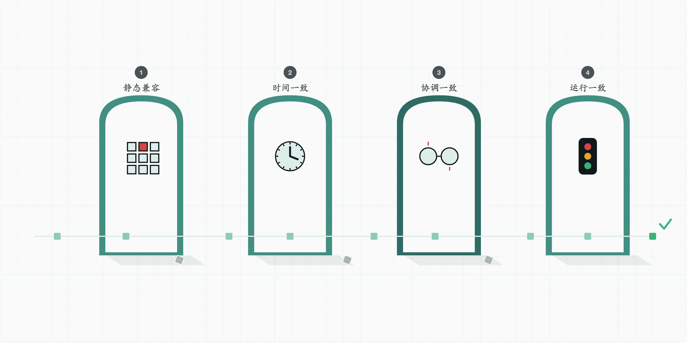

# 第 4 章 信号控制系统的正确性不变量

设想一个方案走完了全部流程：周期总和正确，每个阶段都拿到非零绿灯，流量比算得干干净净，各项数值测试一路绿灯。它被下发到路口，然后——两个冲突方向在同一秒亮起绿灯。数字看上去都对，方案却会撞车。问题出在通行权语义：数值检查只看得见数量，看不见“谁和谁被允许同时走”。

本章把“正确的信号方案”拆成可检验的层次，并说明如何把安全要求转换成代码里的不变量——用谓词表达，用异常拦截，用测试看住。

本章的相位和清空约束可参考 [13][14]；具体参数仍以项目适用规范、设备手册和现场设计为准。

## 4.1 从“正确”到四条不变量

第 1 章把方案的“正确”拆成四层验证：模型正确、约束正确、执行正确、效果可解释。本章深入其中的约束层与执行层。“约束正确”落到一个具体方案上，是三条信号控制特有的不变量：静态兼容、时间一致、协调一致；“执行正确”的前半段，是第四条：运行一致。四条不变量全部成立，一个方案才有资格走完第 2 章的生命周期，进入设备。

### 静态兼容

同一阶段内被允许同时放行的交通流不能存在冲突。阶段顺序和环结构必须符合路口渠化。

### 时间一致

阶段时长、周期、最小绿、绿闪、黄灯和全红必须形成完整时间轴。

### 协调一致

参与协调的路口必须具有公共时间基准，关键阶段和相位差能够映射到实际方案。

### 运行一致

设备接受并实际执行了预期版本的方案，失败后能够回滚。

四层中只要有一层失败，就不能用“综合评分较高”抵消。四层之间的关系如图 4-1 所示。



把四层写成谓词更便于实现和测试：

\[
\mathrm{SafePlan}
=
P_{\mathrm{compatible}}
\land P_{\mathrm{time}}
\land P_{\mathrm{coordination}}
\land P_{\mathrm{execution}}
\]

四个谓词不是同一个时间点的检查。静态兼容在方案设计时确定，时间一致在每次周期修改后重算，协调一致在子区方案发布时检查，运行一致则要等设备产生带版本和时间戳的实时状态。试图只在下发函数里完成全部检查，会缺乏设备观测；只做离线仿真，又无法证明设备执行。

### 4.1.1 两层故障的区分

“红灯时车辆仍然进入路口”和“两个冲突方向同时显示绿灯”都属于交通风险，但代码处置方式不同。前者可能来自黄灯闯红灯、清空距离不足或检测事件；后者是相位配置直接违约。信号控制软件必须在自己的责任边界内拒绝后者，并对前者提供清空时间、监控和审计能力。软件不能承诺消除道路风险，但可以保证自己不主动制造已知冲突绿灯。

## 4.2 冲突图

把每个交通流看作图中的一个顶点。两条交通流如果不能在无清空交互的情况下同时获得通行权，就在它们之间建立一条边。

```text
movement A -------- movement B
```

一个合法相位必须是冲突图中的独立集：集合内任意两个顶点之间都没有冲突边。

```text
Phase E-W = {east-through, west-through}
Phase N-L = {north-left}
```

如果 `north-left` 与东西直行冲突，则：

```text
Stage A = {Phase E-W, Phase N-L}
```

不合法，因为合并后的流向集合中出现冲突边。

SignalLab 用 `ConflictMatrix` 表示冲突关系：

```python
conflicts = ConflictMatrix.from_pairs([
    (("east", "straight"), ("north", "left")),
    (("west", "straight"), ("north", "left")),
])
```

检查一个阶段：

```python
validate_stage_phases(
    "A",
    ("east-west", "north-left"),
    phases,
    conflicts,
)
```

该调用会抛出 `InvariantViolation`，而不是返回一个较低的合法性分数。

### 4.2.1 为什么独立集条件是必要的

设阶段内所有流向为集合 \(M_s\)。如果存在 \(u,v\in M_s\)，且 \((u,v)\in E\)，那么两股车流被配置为同时拥有通行权。由冲突边的定义，这在正常情况下可能导致轨迹交叉。因此合法阶段必须满足：

\[
\forall u,v\in M_s,\quad (u,v)\notin E
\]

这正是图 \(G=(V,E)\) 的独立集条件。证明没有更复杂：只要找到一条冲突边，阶段就包含了一个不允许的组合，因此不是合法阶段。

代码先把每个相位自身的流向集验证为独立集，再把阶段内多个相位的流向并集验证一次。两步缺一不可。假设相位 A 合法、相位 B 也合法，但 A 中某流向与 B 中某流向冲突；只检查单体相位会漏掉跨相位冲突。

### 4.2.2 一个完整冲突矩阵的构造顺序

建立实战冲突矩阵时，推荐按以下顺序而不是从设备灯组直接猜矩阵：

1. 枚举每个进口的允许流向，包括直行、左转、右转、掉头、行人过街和非机动车。
2. 把流向规范化到有向边或稳定 ID。
3. 根据几何轨迹、路权和适用规则建立冲突边。
4. 标记“永不同放”和“需要特殊清空或信号指示”的区别。
5. 由冲突图生成候选相位，而不是手工为每个设备建立不可读的位图。
6. 用已知事故、渠化和规范案例做人工复核。

右转与行人、左转与对向直行、掉头与相邻流向等特殊情况必须显式建模。一个简单的两车直行冲突表无法替代完整安全设计。

## 4.3 冲突图是必要条件

冲突矩阵描述的是几何和流向层面的静态冲突，真实安全还依赖：

- 黄灯期间驶入的车辆
- 清空距离和速度
- 大型车辆启动与通过时间
- 行人和非机动车
- 右转特殊规则
- 公交优先和紧急控制
- 信号机灯组配置

因此，冲突图是必要条件，不是充分条件。它回答“能不能同时放行”，不能单独回答“切换需要多长清空时间”。

可以用反例看出必要与充分的差别。某个相位集合不包含冲突边，所以通过了冲突图，但左转保护相位绿灯只有 6 秒，车队最后两辆车无法在黄灯和全红内离开冲突区。这个阶段的冲突图合法，时间轴却不安全。安全校验必须同时包含图和时。

## 4.4 清空时间属于时间轴

假设阶段 A 结束、阶段 B 开始。安全过程不是 A 绿灯结束后 B 立刻变绿，而是：

```text
A green
  -> A green flash
  -> A yellow
  -> all red
  -> B green
```

绿闪、黄灯和全红是否属于阶段 A 的 `phasestageTime`，不同系统和设备可能有不同配置口径。代码必须先确定口径，再校验周期。

本书采用：

```text
stage duration = green + green flash + yellow + all red
```

这使清空时间始终留在阶段总时长中，不容易在比例分配时被遗漏。

对于阶段 \(i\)，每个时间分量都有非负约束：

\[
g_i,f_i,y_i,r_i\ge 0
\]

其中 \(g_i\) 是纯绿，\(f_i\) 是绿闪，\(y_i\) 是黄灯，\(r_i\) 是全红。整个周期为：

\[
C=\sum_i(g_i+f_i+y_i+r_i)
\]

纯绿总和和清空时间总和可以分别统计：

\[
G=\sum_i g_i,\qquad L=\sum_i(f_i+y_i+r_i),\qquad C=G+L
\]

这组关系在优化前后都必须成立。很多算法输出“有效绿总和 + 损失时间 = 周期”，而设备配置保存“阶段总时间 = 周期”。两种表述只有在损失时间口径明确时才能互转。第 10 章会详细讨论。

## 4.5 相序是一个离散约束

周期和绿信比是连续或整数数值，阶段顺序是离散结构。对既有方案调整时间时，保持相序不变通常比重新设计相序安全。

若原方案阶段顺序为：

```text
A -> B -> C -> D
```

候选方案：

```text
A -> C -> B -> D
```

即使每个阶段时长都合法，也可能改变冲突清空关系、关键阶段含义和路口标线预期。因此候选方案需要与当前方案比较阶段序列，而不是只比较周期。

WaySense 的自适应单点实现会在方案池中选择与原方案具有相同阶段顺序的候选，再进一步比较饱和度。这个约束应被视为方案选择的前置条件。

可以把相序兼容写成：

```python
def same_stage_sequence(current, candidate):
    return tuple(s.stage_id for s in current.stages) == tuple(
        s.stage_id for s in candidate.stages
    )
```

只比较 `stage_id` 也可能不够。如果同一阶段 ID 的真实内容在新版本中改变，旧比较会误判兼容。因此更严格的条件是阶段 ID、阶段包含的相位集合和清空配置都一致。教学代码用 ID 表达最小检查，生产校验还应比较配置版本和内容摘要。

## 4.6 最小绿是硬约束

最小绿可能来自：

- 行人过街需求
- 车辆排队消散
- 设备或规范要求
- 特殊流向的服务需求

按比例分配后，如果某一阶段低于最小绿，系统必须：

1. 识别缺口。
2. 从仍有可减空间的阶段获得时间。
3. 保持清空时间不变。
4. 保持周期总和不变。
5. 重新执行全部约束检查。

若其他阶段没有足够空间，就不存在合法修复，应拒绝方案或提高周期。不能把其他阶段也压到最小绿以下。

### 4.6.1 最小绿修复的守恒证明

设阶段 \(i\) 的纯绿为 \(g_i\)，最小绿为 \(m_i\)。初始缺口为：

\[
d_i=\max(0,m_i-g_i)
\]

需要从满足 \(g_j>m_j\) 的捐赠阶段移走时间。可捐赠总量为：

\[
S=\sum_{j:g_j>m_j}(g_j-m_j)
\]

如果 \(\sum_i d_i>S\)，任何只改变纯绿、同时保持周期和清空时间不变的修复都无法满足所有最小绿。原因是纯绿总预算没有增加，捐赠阶段扣除后也会触及其最小绿边界。此时合法选择只有：

1. 提高周期并给不足阶段补绿。
2. 修改方案结构，例如合并阶段或改变相序。
3. 明确业务允许改变设备清空配置，并重新进行安全校验。
4. 拒绝该候选方案。

若 \(\sum_i d_i\le S\)，每次移动后不使任何接受阶段低于最小绿，并让捐赠总量等于缺口，就能得到合法修复。SignalLab 的 `repair_min_green` 按确定性顺序从有余量的阶段扣除，最后再次调用 `validate_plan`。最后验证不是多余步骤，因为分配代码可能有整数误差或顺序缺陷。

一个可修复的三阶段例子：

```text
stage A: green 8,  min 12, spare 0
stage B: green 30, min 15, spare 15
stage C: green 26, min 12, spare 14
cycle: 90, clearance total: 20
```

纯绿总和为 64，周期减去清空时间为 70，尚有 6 秒纯绿余量。A 缺 4 秒，从 B 或 C 扣除后，A 可以达到 12 秒，同时周期和清空时间不变。

一个不可修复的例子：

```text
stage A: green 8,  min 12, deficit 4
stage B: green 15, min 15, spare 0
stage C: green 18, min 18, spare 0
```

即使把 B、C 全部压到最小绿，也没有时间可以转移。修复函数应抛出异常，而不是把 A 留在 8 秒或把 B、C 降到最小绿以下。正确的上层决策是提高周期、调整阶段结构或拒绝方案。

## 4.7 周期一致性

对于同一套时间口径，必须满足：

\[
\sum_i \left(g_i + f_i + y_i + r_i\right) = C
\]

其中：

- \(g_i\) 是阶段纯绿
- \(f_i\) 是绿闪
- \(y_i\) 是黄灯
- \(r_i\) 是全红
- \(C\) 是周期

百分比绿信比容易出现舍入误差。系统可以保留百分比作为显示值，但下发前必须转换成秒并执行周期一致性检查。

还有一个常见口径错误：把“有效绿”与“纯绿”相加。有效绿通常包含部分黄灯或起步损失修正，是容量计算里的等效通行时间，不是灯色显示的纯绿。容量公式可以使用有效绿，阶段时间轴必须保存纯绿、绿闪、黄灯和全红。两个量名称相近，但不能在一个等式里混用。

周期校验还要能解释误差来源。两类常见误差分别是：

\[
\epsilon_{\mathrm{round}}=C-\sum_i \operatorname{round}(T_i)
\]

\[
\epsilon_{\mathrm{config}}=\sum_i T_i-C_{\mathrm{device}}
\]

第一类是同一语义表示转换后的整数误差，可以通过最大余数法或确定性补差修复。第二类是配置和运行周期真的不一致，必须重新生成或拒绝，不能把差值塞进最后一个阶段。

## 4.8 公共周期是协调前置条件

若两个路口分别使用 80 秒和 100 秒周期，即使计算出 15 秒相位差，这个相位差也不能稳定保持。每次周期长度不同，相对绿窗都会漂移。

协调方案需要：

- 相同公共周期
- 或明确的半周期、倍率关系
- 可定位的关键阶段
- 一致的时间基准

相位差计算之后再分配绿信比时，如果阶段时长发生大幅变化，也要重新检查协调阶段是否仍覆盖预期绿窗。

## 4.9 运行不变量

方案进入设备后，系统需要维护版本和命令一致性。

### 单次命令必须可追踪

每次下发应有唯一批次或命令标识，记录方案版本、设备、目标时间和结果。

### 重试必须幂等

同一命令因超时重试时，不应在统计中变成多次独立成功。

### 执行必须确认

设备接受命令后，系统应读取实时控制模式、周期或阶段状态，确认实际生效。

### 失败必须可恢复

部分路口失败时，需要明确是保持原方案、整体回滚还是重新协调。不能只返回“部分成功”。

实现层还有一个约束缺口：现有实现没有独立的方案版本字段，版本由策略库 `scope`、月份位图和 `status` 组合表达（3.8.1）。因此“版本一致性”不变量必须落到这组条件上，而不是比较一个 `plan_version` 整数。新接口若只传 `planId`，接收方无法判断这是哪个版本，也就无法证明下发的是同一个方案。

## 4.10 用测试表达不变量

一个有用测试不只验证正常数据，还应主动构造非法方案。

SignalLab 的测试包括：

```python
with self.assertRaises(InvariantViolation):
    validate_stage_phases(
        "A",
        ("east-west", "north-left"),
        phases,
        conflicts,
    )
```

对于时间模型：

```python
with self.assertRaises(InvariantViolation):
    validate_plan(plan_with_wrong_cycle)
```

这些测试的价值不是证明整个系统安全，而是确保已知错误不会悄悄进入后续计算。

## 4.11 约束的代码分层

建议把约束放在三个不同位置。

### 领域对象构造

拒绝空 ID、负时长、重复阶段等无法解释的数据。

### 算法结果校验

检查周期、最小绿、相序和协调条件。

### 下发前校验

检查目标设备能力、版本、权限、控制模式和命令状态。

如果只在最后一步校验，算法会把时间浪费在非法候选上；如果只在算法内校验，人工编辑和外部导入仍可能绕过。多个层次共同保证边界，而不是重复同一段代码。

### 4.11.1 从约束到生产代码

在 WaySense 中，相位配置、阶段顺序和候选方案筛选分别进入不同处理位置：

```text
Phase / PhaseStage 配置
  -> 位图与相位关系解码
  -> 当前方案与候选方案池
  -> 相同阶段顺序筛选
  -> 周期和绿信比计算
  -> 最小绿修复与周期一致性检查
  -> Java DTO 转换
  -> 设备下发前能力检查
```

在 Python 自适应路径中，先由 `flow_switch` 把方向/转向流量映射到阶段，再由 `cycle_opt` 选择候选周期。`pattern_selected` 负责相序兼容，`split_opt_saturation` 和 `split_assign` 只应在兼容候选上工作。Java 侧的 `AiComputeServiceImpl` 和 DTO 转换负责业务编排与返回结构，不负责证明周期闭合或冲突安全。把职责放错层，会导致算法测试通过但接口可以绕过约束。

生产代码还存在历史入口和不同算法版本。本书使用当前 Java 编排到 Python 的单点、子区和时空图路径说明原理；旧接口、拼写变体和实验 SDK 只在附录中作为追踪线索。代码位置不能替代运行验证，最终仍要检查输入版本、设备配置和实际执行状态。

### 4.11.2 性质测试

示例测试只能覆盖作者想到的输入。对安全约束，性质测试可以生成大量阶段和方案，检查不变量是否被保持。一个简单的测试生成器如下：

```python
for movements in random_movement_sets(...):
    plan = build_plan(movements)
    try:
        validate_stage_phases(...)
    except InvariantViolation:
        assert has_conflict_edge(movements)
    else:
        assert not has_conflict_edge(movements)
```

这里检查的是双向性质：任何通过验证的阶段都不含冲突边；任何失败的阶段都有一个可以指出的冲突或未知流向。还应加入时间性质：

```text
forall legal input:
  validate_plan(repair_min_green(plan))
  total_green(repaired) + total_clearance(repaired) == cycle
  each repaired green >= minimum green
```

生成器应包含零绿、单阶段、全部到达最小绿、无捐赠者和最低余量恰好为 0 的边界。只生成“三阶段、每阶段 30 秒”的随机测试，几乎无法发现周期和修复缺陷。

## 4.12 本章实验

1. 为一个四相位路口定义冲突关系。
2. 验证东西直行和西向北左转是否可以同放。
3. 构造一个周期正确但最小绿不足的方案，执行修复。
4. 构造一个周期和阶段都合法、但相序与原方案不一致的候选方案，把“相序兼容”作为额外约束拒绝它。
5. 给方案生命周期增加“下发前校验”，确保未校验方案不能进入调度。
6. 用同一组阶段数据分别构造可修复和不可修复的最小绿案例，记录 `deficit`、`spare` 和最终异常。
7. 对 1000 个随机合法阶段集合执行冲突性质测试，统计通过、冲突拒绝和未知流向拒绝的数量。

## 4.13 小结

这一章把“约束正确”和“执行正确”两层验证，落成了四条可检验的不变量：静态兼容拦住冲突同放，时间一致拦住周期与清空的漏洞，协调一致拦住对不上的时间基准，运行一致拦住“发了但没生效”。四条都写成谓词、抛出异常、进入测试——安全要求的归宿是代码，评审人的直觉只是第一道筛子。优化目标的复杂度可以慢慢加，四条不变量不能让：约束稳定了，优化结果才有工程意义。

至此，第一部分回答了三个问题：路口是什么（第 1、2 章），方案如何被数据表达（第 3 章），怎样才算正确（本章）。损失时间的完整口径留给第 10 章。下一部分从交通检测开始，给这套静态模型喂会呼吸的数据。

## 练习

1. 为一个有行人相位和右转特殊规则的路口说明冲突矩阵还缺哪些信息。
2. 为什么“周期正确”不能证明方案正确？
3. 当最小绿修复没有可用时间来源时，系统有哪些合法选择？
4. 设计一条性质测试，随机生成阶段集合并验证任何通过检验的阶段都不包含冲突流向。
5. 证明：如果周期和清空时间固定，最小绿缺口大于全部可捐赠余量，则不存在只改变纯绿的可行修复。
6. 解释为什么“有效绿总和等于周期”与“纯绿、绿闪、黄灯、全红总和等于周期”不是同一个命题。
7. 设计一个下发前检查器，输入设备能力、方案版本、实时状态版本和当前控制模式，输出允许、等待、拒绝和需要人工处理四种结果。

