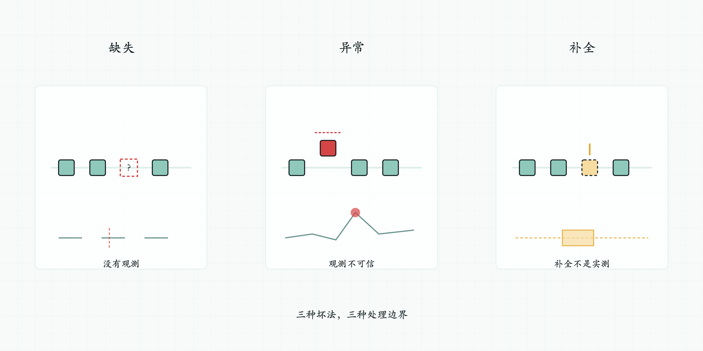

# 第 6 章 数据质量、补全与预测

第 5 章的结尾留了一个更棘手的情形：数据没有缺席，而是错的。这一章就从这个情形开始。交通控制系统的输入很难完整——检测器会离线，视频跟踪会漏计，网络可能延迟，车道映射可能配置错误；即使设备都在线，流量本身也会出现正常波动和真实突变。所以系统需要把四种情况分开：真实异常、检测造成的瞬时尖峰（spike，指数据序列中的短时异常抬升，不是交通高峰）、设备离线造成的缺失、需求变化造成的持续增长。

错误处理的目标，是让下游知道数据的可信程度和来源；把每个数都修成“完整”，反而会掩盖问题。

## 6.1 三类质量检查

WaySense 的流量处理实现同时使用时间序列、机器学习规则和交通流理论：

- 以历史变化趋势检查时间异常
- 以孤立森林等方法识别多特征异常
- 以“低流量但高排队”等规则检查物理矛盾

三类方法互补。时间异常可以发现突然的数据尖峰，但可能把真实事故流量判为异常；物理规则能发现流量和排队冲突，但难以处理各种模式；机器学习可以发现复杂关联，却需要足够样本和可解释验证。三类问题在数据上的表现不同，处理边界也不同，如图 6-1 所示。



### 6.1.1 异常处理的决策顺序

质量处理不应按“发现异常就修复”的单一规则运行。推荐顺序是：

```text
识别异常
  -> 判断异常类型
  -> 判断是否为真实事件
  -> 判断是否可补全
  -> 传播估计标记和置信度
  -> 根据下游权限决定保持、建议或阻断
```

真实事故可能产生低流量、高排队和速度下降，这组数据在物理上完全一致，不应因为“与历史均值不同”就被抹平。检测器故障可能表现为长时间零流量、心跳丢失或同一车辆重复事件。两类问题在数据上都可能“异常”，处理目标却相反。

因此，系统至少分开保存：

```text
observed_value
quality_flags
is_real_event_known
imputed_value
imputation_method
confidence
control_eligible
```

`observed_value` 是原始观测，`imputed_value` 是派生值。用补全值覆盖原始值会永久丢失证据。

## 6.2 指数移动平均

指数移动平均适合在线检测短时变化。给定平滑系数 `α`：

\[
\hat{x}_t = \alpha x_t + (1-\alpha)\hat{x}_{t-1}
\]

它与最近观测更相关，又能抑制单点噪声。SignalLab 使用 span 参数计算：

\[
\alpha = \frac{2}{\text{span}+1}
\]

```python
baseline = exponential_moving_average(values, span=4)
```

平滑序列不是真实流量，它只代表短期正常水平。检测到偏差后，不能把偏差一概替换为平滑值，否则真实事故或需求突变会被抹掉。

取序列 `[100, 105, 98, 102, 500, 101]`，`span=4` 时：

\[
\alpha=\frac{2}{4+1}=0.4
\]

前几项的基线依次为：

```text
100.00
0.4*105 + 0.6*100.00 = 102.00
0.4*98  + 0.6*102.00 = 100.40
0.4*102 + 0.6*100.40 = 101.04
0.4*500 + 0.6*101.04 = 260.62
0.4*101 + 0.6*260.62 = 196.77
```

这个数据尖峰把后续基线也抬高了，因此单点检测不能只看当前基线。更常见的是用当前观测与前一时刻基线或平滑残差比较。SignalLab 先计算完整残差序列，再用残差的标准差确定阈值。阈值至少设为 1，避免稳定序列方差接近零时把极小变化全部标为异常。

`span` 越小，基线越快跟踪变化，却更容易把噪声当作异常；`span` 越大，越稳定，却更慢响应真实高峰。span 是检测灵敏度和响应延迟的工程选择。

## 6.3 时间异常与物理异常

时间异常可以定义为观测值和短期基线之差超过阈值：

\[
|x_t-\hat{x}_t| > 3\sigma
\]

生产实现会为每条车道计算平滑残差，并使用方差阈值。代码中的“3 sigma”是经验规则，实际 σ 的估计方法需要明确。

普通标准差会被异常值放大。若残差序列被一个 500 veh/h 的数据尖峰主导，阈值会变大，反而漏掉更小的持续偏差。更稳健的工程实现可以使用中位数和中位绝对偏差：

\[
\mathrm{MAD}=\operatorname{median}\left(|x_i-\operatorname{median}(x)|\right)
\]

并以 \(1.4826\,\mathrm{MAD}\) 近似标准差。它不是唯一可选的方法，但它说明了为什么阈值计算本身需要版本和验证。现有实现中的 EWMA、IsolationForest 和物理规则是三条互相独立的判断，不是三个可以互相替代的模型。

物理规则则直接利用交通含义，例如：

```text
流量 <= 3 veh/h
且排队 >= 20
```

在一个检测窗口内，这通常意味着检测结果、单位或车道映射存在问题。它不是严格的交通物理定律，而是一条工程经验规则。

SignalLab 把两类标记保存在独立字段：

```python
QualityFlag(
    time_anomaly=True,
    physical_inconsistency=False,
)
```

使用者可以决定哪类异常触发补全、告警或人工审核。

### 6.3.1 一次异常分类

设 S2 东直连续 6 个 5 分钟窗口为：

```text
window  volume  queue
  1       400      8
  2       420      9
  3       390     10
  4         3     28
  5       410     12
  6       405     11
```

第 4 个窗口同时触发物理矛盾和相对历史的时间偏差。它不是正常低峰，而是“低流量、高排队”的矛盾组合。系统可选择用相邻窗口短时补全，但至少要告警并降低置信度。

若第 4 个窗口的数据是事故后道路封闭，`volume=3` 与 `queue=28` 可能解释为入口关闭但排队尚未清空。此时不应直接把补全值用于提高远处方向绿灯。异常分类需要结合事件、控制模式和拓扑，而不是只看一个二变量规则。

## 6.4 短期补全

短时缺失最常见的做法是使用指数平滑估计：

```text
estimated_volume = EWMA(previous observations)
```

生产实现会为异常车道使用平滑值，并把数据标记为：

```text
Estimated = true
Confidence = 0.85
```

数字 0.85 是系统中的人工可靠性设定。它表达“我们愿意把这个值用于哪些下游计算”，不是“真实值有 85% 概率落在这个范围”。

置信度在系统里是一份使用许可：它决定这个数能进入自动优化、只能进入推荐，还是只能留在报表里。0.85 表示系统愿意把它用于常规推荐，不表示真实值有 85% 的概率落在某个区间；当它随缺失窗口衰减到门槛以下，自动重算需要停下，交回人工或保持方案。把置信度只当显示颜色，等于把一段风险藏进界面。

短时补全还要限制可补全的长度。设连续缺失窗口数为 \(m\)，补全置信度为 \(c_0\)，一种简单衰减模型是：

\[
c(m)=c_0\lambda^m,\qquad 0<\lambda<1
\]

例如 \(c_0=0.9\)、\(\lambda=0.8\)，缺失 1、2、3 个窗口后的置信度分别为 0.72、0.576、0.461。这个模型不是通用定律，只是把“缺失越久越不可信”写成可配置规则。达到控制门槛以下后，系统应停止用补全值自动重算方案。

## 6.5 空间补全

当某个方向缺少检测，可以利用上下游车流关系估计。最基本的守恒思想为：

\[
q_{\text{missing}} =
q_{\text{upstream inflow}}
- q_{\text{known exits}}
+ q_{\text{known entrances}}
\]

实际道路存在未观测出入口、停车和检测误差。WaySense 在无法直接补全时，会使用同类流向或路网均值作为下界，并将空间补全置信度设为约 0.7。

空间补全需要拓扑方向一致：上游的哪个流向进入本路口哪个进口，不能只凭道路名称或几何距离猜测。

## 6.6 置信度传播

数据从车道到方向、从路口到子区，会经历多次聚合。输出置信度不应高于最弱的关键输入。

一个简单规则是：

\[
confidence_{output} = \min_i confidence_i
\]

更复杂的系统可以使用加权置信度，但需要保证缺失数据不会被高置信度均值抵消。

加权平均可以表达为：

\[
\hat{q}=\frac{\sum_i w_i q_i}{\sum_i w_i},\qquad
w_i=c_i n_i
\]

其中 \(c_i\) 是质量置信度，\(n_i\) 是样本或车道数量。这个公式适合合并多个等价、可互相替代的观测；它不适合把上游守恒值与下游观测值简单平均，因为两者误差结构不同。即使采用加权平均，也要同时返回最低关键输入置信度，而不只返回平均置信度。

控制流程还应设置使用门槛。例如：

```text
高置信度：可用于自动优化和自动下发
中置信度：可生成推荐，但要求人工确认
低置信度或缺失：保持原方案并发出数据质量告警
```

门槛应绑定具体动作，而不是只写“低置信度不可用”：

具体见表 6-1。
表 6-1 置信度传播
| 动作 | 对关键输入的最低要求 | 失败后的行为 |
|---|---|---|
| 离线报告 | 可展示低置信度值 | 标记估计和建议 |
| 生成推荐 | 完整率、置信度和异常审查通过 | 保留候选但不自动执行 |
| 自动下发 | 更严格的置信度和新鲜度 | 保持当前方案并告警 |
| 事故或应急控制 | 人工确认和独立安全校验 | 不依赖自动补全 |

同一个数值可以用于报告，却不足以触发设备命令。能不能自动下发，取决于数据质量，不应该藏在算法分数里。

实现现状要单独说明：WaySense 当前生产链路在组装 `DirectionFlow` 时不传 `Confidence` 和 `Estimated`，算法输入端恒为默认值 `1` 和 `False`（第 25.10 节）。也就是说，上面这套门槛在当前系统里没有可用的输入。要让门控真正生效，需要先修通字段传播，而不是只改阈值。

## 6.7 预测值与实测值：分开保存，分开使用

短时预测可以改善控制提前量，但预测值需要与实测值分开。

WaySense 的流量处理包含两类预测：

- 车道级短期预测：指数平滑
- 方向级预测：STL 分解后对趋势、残差分别使用 ARIMA，并叠加季节性模板

生产代码在周五午夜附近更新模型，并用历史方向流量维持预测更新。这个训练周期是特定实现选择，其他系统未必适用。

工程上需要特别关注：

- 预测窗口和训练数据的时间对齐
- 历史模型是否能处理节假日和事故
- 预测误差是否反馈
- 预测值是否允许直接触发自动控制
- 离线训练版本与在线推理版本是否一致

### 6.7.1 预测误差和因果边界

对未来窗口 \(t\) 的预测记为 \(\hat{y}_t\)，实际值到达后计算：

\[
e_t=\hat{y}_t-y_t
\]

常用汇总指标包括平均绝对误差和均方根误差：

\[
\mathrm{MAE}=\frac{1}{N}\sum_t|e_t|,\qquad
\mathrm{RMSE}=\sqrt{\frac{1}{N}\sum_t e_t^2}
\]

MAE 更容易解释为平均误差量级，RMSE 对大误差更敏感。二者都不能单独说明预测能否改善控制。一个预测在总体 MAE 上更好，却可能在峰值前半小时系统性低估，导致关键阶段长期缺绿。评价时应按方向、时段、拥堵等级和数据完整率分层。

预测值可以用在“提前增加关键阶段绿时”的决策中，但需要记录它是预测、模型版本和目标时间。事故、封路和临时交通组织不在历史模式中，模型不能因为见过类似波形就声称能够预知这些事件。

## 6.8 预测结果的回填与检查

一个完整预测系统需要记录：

```text
forecast_time
target_time
model_version
input_version
predicted_volume
actual_volume
error
```

没有实际值回填，就无法知道预测是否改善控制。只看模型输出曲线，不足以证明预测有效。

回填后还可以做误差分解：

\[
e_t=(\hat{y}_t-y_t^{\mathrm{baseline}})
+(y_t^{\mathrm{baseline}}-y_t)
\]

第一项表示模型相对简单基线多预测或少预测了多少，第二项表示真实值偏离基线的部分。如果简单基线是上周同时段均值，预测系统在这项上没有改善，就不能把收益归因于复杂模型。

预测闭环还应保存“当次是否影响控制”：

```text
forecast_id
target_window
input_version
model_version
predicted_value
actual_value
published_to_control
accepted_by_algorithm
control_plan_version
```

没有最后三个字段，只能评价预测准确性，不能评价预测对信号控制的实际贡献。

## 6.9 本章实验

1. 构造一段稳定流量，再加入一个数据尖峰，运行 `assess_series`。
2. 构造“低流量、高排队”的数据，比较时间异常和物理异常标记。
3. 修改 `span`，观察基线对突变的响应速度。
4. 设计一个控制策略：当关键阶段输入置信度低于 0.7 时，保持原方案并告警。
5. 对 `[100, 100, 100, 100, 900]` 分别使用 span 2、4、8，比较基线响应速度。
6. 构造一个真实事故导致的流量下降，再构造一个检测器离线；设计至少三个能区分两者的证据字段。
7. 让短时补全连续持续 5 个窗口，计算置信度衰减结果，并决定何时停止自动控制。

## 6.10 小结

这一章把“数据不完美”从一句抱怨变成了一套机制：三类检查各管一类问题，原始值与补全值分字段保存，置信度从车道一路传到控制门槛，预测值与实测值分开保存、分开评价，再把结果写回记录。数据质量在这里正式成为控制安全性的一部分——低置信度时约束自动控制，与绿信比约束、最小绿约束一样，都是方案生效的前置条件。下一章把这些带质量标记的流量，转换为容量、饱和流率和饱和度，交通检测与配时计算从此接上头。

## 练习

1. 为什么异常检测不能自动删除所有数据尖峰？
2. 说明时间异常、物理矛盾和需求突变之间的区别。
3. 设计一个置信度传播规则，处理“两个高置信度输入、一个低置信度输入”的情况。
4. 给预测结果增加模型版本和输入版本后，如何判断误差来自数据还是模型？
5. 证明 EWMA 的平滑系数在 span 为正数时满足 \(0<\alpha\le1\)。
6. 为什么“平均置信度较高”不能证明关键阶段输入可靠？给出一个三输入反例。
7. 设计一个预测回填表，使它能够同时回答预测是否准确、预测是否被控制采用、采用后效果是否改善。

