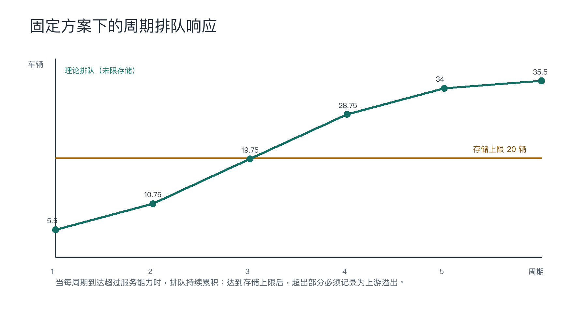

# 第 7 章 容量、饱和流率和流量比

同样一句“东进口 800 veh/h”，落在三车道直行上轻轻松松，落在单车道左转上就是排队预警；同一条车道，27 秒绿灯和 9 秒绿灯能放走的车也差着三倍。流量只回答“有多少车想走”，容量才回答“现有的绿灯时间最多放多少”。把两者分开，是配时计算的第一课。

本章建立从饱和流率到平均容量的关系，并解释流量比、饱和度和过饱和的工程意义——这正是第 6 章结尾交接过来的任务：把带质量标记的流量，变成配时算法能用的供给尺度。

容量、饱和度和服务水平的定义可参考 [11]。具体参数与现场标定方法需要和项目采用的版次一致。

## 7.1 饱和流率

当车辆持续排队并在一个方向连续获得绿灯时，车头时距会接近稳定值。若饱和车头时距为 `h_sat` 秒/辆，则饱和流率为：

\[
S=\frac{3600}{h_{sat}}
\]

例如：

```text
h_sat = 2.0 s/veh
S = 3600 / 2.0 = 1800 veh/h
```

WaySense 的单点优化配置为直行、左转和右转提供可调整的饱和流率表。代码中的初始值只是默认参数，不能代替现场标定。

### 7.1.1 饱和车头时距为什么能换算成流率

如果车辆以固定车头时距 \(h\) 秒通过停止线，则一小时最多可通过：

\[
N=\left\lfloor\frac{3600}{h}\right\rfloor
\]

连续流近似下可以忽略取整，写成 \(S=3600/h\)。若 10 辆排队车通过停止线用了 20 秒，平均车头时距为 2 秒，饱和流率为 1800 veh/h。这里需要说明测量的是哪一段，以及是否扣除前三辆车的启动损失。

一个实测窗口常包含车辆启动阶段。设第 \(i\) 辆车到达停止线的时间为 \(t_i\)，则：

\[
h_i=t_i-t_{i-1}
\]

若从稳定车队开始取第 4 到第 10 辆车，平均车头时距为：

\[
\bar h=\frac{t_{10}-t_3}{7}
\]

选择不同车辆区间会改变 \(\bar h\)。因此，饱和流率不是从任意路口随便量几分钟就能得到的常数，它需要排队长队、无干扰和可解释的样本。

启动损失时间可以概念化为理想连续放行与实际启动过程之间的时间差。它通常进入有效绿或损失时间的计算，而不是从饱和流率中偷偷扣除。采用哪种定义要与后续容量公式一致。

### 7.1.2 容量参数的三种来源

同一个饱和流率，可以来自三个地方，代价完全不同：

具体见表 7-1。
表 7-1 容量参数的三种来源
| 来源 | 获取方式 | 优点 | 失效条件 |
|---|---|---|---|
| 规范查表 | HCM、CJJ 或地方指南 | 快、可比较、可审计 | 与本地车流、坡度、转弯半径不符 |
| 现场实测 | 排队车头时距、视频轨迹 | 最贴近实际 | 需要长队、无干扰样本；季节和天气会变 |
| 代码默认 | 配置缺失时的默认值 | 永远有值 | 静默生效，没人知道用的是默认值 |

第三种最危险。它不会报错，只会让方案“看起来算出来了”。WaySense 里同时存在 1550/1450/1450（`settings.py`）、1500/3600 veh/s（`enum__init__.py`）和示例值 1750（`apiserver.py`）三套数值，量纲和用途都不同（附录 L）。读结果时如果不知道用的是哪一套，周期和绿灯就无法复算。

工程上可行的顺序是：**先查规范得到初值，再用实测校核，最后把采用的来源写进方案记录。** 默认值只能用于演示，或在确实缺数据时临时补位，不能作为验收依据。

## 7.2 有效绿与平均容量

一个流向在周期中只获得部分绿灯。平均容量可以写成：

\[
c=S\frac{g_{eff}}{C}
\]

其中 \(g_{\mathrm{eff}}\) 是可用于通行的有效绿，\(C\) 是周期。

如果饱和流率为 1800 veh/h，周期 90 秒，有效绿 27 秒：

```text
capacity = 1800 × 27 / 90 = 540 veh/h
```

SignalLab 提供：

```python
lane_capacity_vph(
    saturation_vph=1800,
    effective_green_s=27,
    cycle_s=90,
)
```

有效绿不总等于显示绿灯。车辆启动和清空过程可能使有效通行时间短于灯色时间。具体修正应依据设备参数和现场标定。

### 不同绿灯比例下的容量

保持 `S=1800 veh/h`、`C=90s`，可以得到：

具体见表 7-2。
表 7-2 不同绿灯比例下的容量
| 有效绿/s | 容量/[veh/h] |
|---:|---:|
| 18 | 360 |
| 27 | 540 |
| 36 | 720 |
| 45 | 900 |

容量随有效绿线性变化。注意这里的有效绿是周期中的通行有效时间，不是简单把阶段总时长全部算入。

### 7.2.1 有效绿、显示绿和阶段总时长

设阶段显示纯绿为 \(g\)，启动损失为 \(l_1\)，清空期间可继续被后续车辆利用的修正为 \(e\)，有效绿可以概念化为：

\[
g_{\mathrm{eff}}=g+e-l_1
\]

不同方法的 \(e\) 和 \(l_1\) 定义可能不同。本书只要求系统在代码中固定定义，并让容量、饱和度和延误使用同一个 \(g_{\mathrm{eff}}\)。阶段总时长还包含绿闪、黄灯和全红，不能直接把阶段总时长当作有效绿。

若设备只报告纯绿 36 秒、清空 8 秒，而模型的有效绿修正为 30 秒，那么容量应按 30 秒计算。`36`、`30`、`44` 三个数分别可能表示纯绿、有效绿和阶段总时长。接口字段应带上单位与语义，而不是都叫 `green_time`。

## 7.3 流量比

流量比是：

\[
y=\frac{q}{S}
\]

它也可以理解为“若长期持续该需求，一个周期至少需要多少比例作为该流向的有效绿”。

阶段流量比取阶段内关键流向的最大值：

\[
y_j=\max_{m\in M_j}\frac{q_m}{S_m}
\]

所有阶段流量比之和 \(Y\) 表示路口的时间需求比例。\(Y\) 接近 1 时，路口接近容量。

### 一个关键阶段的例子

一个阶段同时放行东直和东左：

```text
东直：q=720, S=1800, y=0.40
东左：q=210, S=1400, y=0.15
```

阶段关键流量比为 `max(0.40,0.15)=0.40`。左转只需要 0.15 的有效周期比例，但它需要在该阶段拥有最小绿。

最小值选择把“时间分配需求”和“安全服务需求”叠加在一起：安全需求不是零，即使流量很低也不能被容量比例吞掉。

### 7.3.1 阶段流量比的定义差异

阶段内多个流向共享同一段绿灯，但每个流向的车道数、饱和流率和需求不同。阶段流量比取关键流向，是因为该流向先达到容量边界。设流向 \(m\) 的需求为 \(q_m\)，饱和流率为 \(s_m\)，若两个流向都不允许超过各自容量，阶段需要的有效绿比例为：

\[
\frac{g}{C}\ge\max_{m\in M_j}\frac{q_m}{s_m}
\]

如果取平均值，一个方向过饱和的缺口会被另一个空闲方向抵消。例如东直 \(y=1.2\)、东左 \(y=0.1\)，平均为 0.65，看起来仍有余量，实际东直已经无法在本周期内完全消散。

阶段流量比也没有包含行人和最小绿。低需求阶段仍可能需要 12 秒行人过街或 8 秒排队清空。流量比是容量需求，最小绿是安全和服务约束，两者不能互相替代。

用 S2 的晚高峰数据：

具体见表 7-3。
表 7-3 阶段流量比的定义差异
| 流向 | q veh/h | S veh/h | y |
|---|---:|---:|---:|
| 东直 | 900 | 1800 | 0.500 |
| 东左 | 210 | 1400 | 0.150 |
| 西直 | 720 | 1800 | 0.400 |
| 北左 | 300 | 1450 | 0.207 |

若东直和东左属于阶段 A，阶段 A 的流量比为 0.50；西直属于阶段 B，为 0.40；北左属于阶段 C，为 0.207。`Y=1.107` 已经超过 1。即使总周期放大，周期中的清空时间和最小绿仍会占用时间，路口没有足够的稳定服务能力同时吸收三股需求。

## 7.4 饱和度

饱和度通常定义为需求与容量之比：

\[
x=\frac{q}{c}
\]

代入容量：

\[
x=\frac{q}{S g_{eff}/C}
=y\frac{C}{g_{eff}}
\]

这意味着饱和度同时受需求、饱和流率和绿信比影响。改变周期或绿灯分配后，饱和度会发生变化。

工程系统需要固定饱和度定义：

- 单流向、阶段还是路口
- 平均周期容量还是短时容量
- 是否包含右侧、行人或车道宽度修正

SignalLab 的 `degree_of_saturation` 只实现最基础定义：

```python
degree_of_saturation(demand_vph=486, capacity_vph=540)
# 0.9
```

### 7.4.1 从流量比推到饱和度

把 \(c_j=S_j g_{\mathrm{eff},j}/C\) 代入 \(x_j=q_j/c_j\)：

\[
x_j=\frac{q_j}{S_j}\cdot\frac{C}{g_{\mathrm{eff},j}}
\]

所以流量比只有 0.5 时，若阶段只获得周期中 0.4 的有效绿，饱和度就是：

\[
x=0.5\cdot\frac{1}{0.4}=1.25
\]

流量比描述长期需求，饱和度描述在给定绿灯分配下的供需比。同一个 900 veh/h 需求，得到 30 秒有效绿时容量为 \(1800\times30/90=600\) veh/h，饱和度为 1.5；得到 45 秒有效绿时容量为 900 veh/h，饱和度为 1.0。

因此不能把阶段流量比直接报成饱和度，也不能用阶段流量比替代绿灯分配后的复核。

## 7.5 过饱和

当 `x > 1` 时，到达需求超过本周期平均容量，排队可能跨周期增长。此时：

- 延误不再只由随机到达决定
- 短周期可能因损失时间占比过高而进一步降低容量
- 单纯增加周期只是延后溢出，不能无限提高容量
- 下游排队可能反过来阻塞路口

因此，过饱和控制需要排队管理、边界控制、协调或交通组织，而不是只换一个更大的周期。

### 7.5.1 过饱和排队的递推后果

设第 \(k\) 周期到达车辆为 \(a_k=qC/3600\)，可放行车辆为 \(d_k=cC/3600\)，则未受限排队近似为：

\[
Q_{k+1}=Q_k+a_k-d_k
\]

当 \(q=1080\) veh/h、\(C=90\) s、\(d_k=18\) 辆时：

```text
a_k = 1080 * 90 / 3600 = 27 veh
Q_{k+1} = Q_k + 9 veh
```

五个周期增加 45 辆，尚未考虑车道最大容纳量。达到上游或下游阻塞后，排队不再按同一递推增长，而会改变到达率和相邻路口状态。这就是为什么过饱和评价需要看排队、溢出和上下游一起变化，而不能只看路口内剩余绿灯。

取 `q=800`、`S=1800`、`C=90`、`g_eff=27`，容量 540 veh/h，饱和度约为 1.48；这就是与 S2 类似的失败边界。

若把周期提高到 120 秒、有效绿 36 秒，容量仍为 `1800*36/120=540`，饱和度不变。提高周期如果没有同步提高有效绿占比，不会增加长期容量。它甚至可能增加单次等待和排队峰值（见图 7-1）。



### 7.5.2 排队守恒与存储上限

把每周期到达量记为 \(A_k=q_kC/3600\)，服务量上限记为 \(D_k=S g_{\mathrm{eff},k}/3600\)。在没有上游溢出限制时，本周期实际服务量为：

\[
P_k=\min(Q_k+A_k,D_k)
\]

周期结束队列为：

\[
Q_{k+1}=Q_k+A_k-P_k
\]

这个递推满足车辆守恒：上一周期剩余、本周期到达、本周期服务和本周期剩余之间存在一一对应。若车道只能容纳 \(Q_{\max}\) 辆车，排队的理论值超过 \(Q_{\max}\) 时，超出部分会向上游溢出：

\[
O_k=\max(0,Q_k+A_k-P_k-Q_{\max})
\]

\[
Q_{k+1}=\min(Q_{\max},Q_k+A_k-P_k)
\]

此时普通守恒式应写成：

\[
Q_k+A_k=P_k+Q_{k+1}+O_k
\]

把溢出量删除会让报表看起来“车辆消失”，把本地队列继续按理论值增长又会虚构并不存在的存储空间。`queue_lab` 因此分别返回本地队列和累计溢出车辆。

本章的简化模型每个周期将所有到达与服务放在一个总量中处理。它适合观察容量、守恒和溢出，不描述车辆在一个绿灯内逐辆到达的顺序，也不描述排队回溢如何降低上游通行能力。扩展模型时需要继续保留守恒式，否则仿真越复杂，只是越难发现车辆被复制或丢失。

### 7.5.3 周期容量与单周期容量

长期平均容量 \(c=S g_{\mathrm{eff}}/C\) 把一个周期的服务能力摊到整个周期，但一个具体周期内的瞬时供给仍由饱和流率决定。若当前有效绿为 27 秒，单周期最多服务约 \(1800\times27/3600=13.5\) 辆；90 秒周期平均容量为 540 veh/h，相当于每周期平均 13.5 辆。

如果排队不足 13.5 辆，本周期放行量由实际排队和到达决定，不能为了“达到容量”凭空产生车辆。容量是上限，不是需要完成的吞吐量。评价程序把容量当成实际放行量，会高估通过车辆并低估排队。

这个区分也影响溢出判断。某周期需求低于容量，不代表平台可以宣布路口没有拥堵；如果周期开始时已有长期排队，即使本周期新增需求较低，队列仍可能持续存在。

## 7.6 饱和流率：一组需要标定的参数

饱和流率会受到：

- 车道宽度和坡度
- 大型车比例
- 转弯半径
- 行人和非机动车干扰
- 公交停靠
- 车道功能
- 上下游排队

系统无法只依赖一个城市级默认值。生产配置需要支持按路口、流向或时段标定，并保留参数版本。

### 标定记录

一个可审计的饱和流率配置至少应记录：

具体见表 7-4。
表 7-4 标定记录
| 字段 | 示例含义 |
|---|---|
| 路口/进口/流向 | 参数适用位置 |
| 参数值 | `S` 或饱和车头时距 |
| 来源 | 实测、规范、厂商或经验 |
| 时间范围 | 全天、高峰或施工期 |
| 版本 | 何时替换旧参数 |
| 置信度 | 是否适合自动优化 |

没有这些元数据，系统在优化结果异常时无法判断是算法还是参数造成的。

### 7.6.1 饱和流率的不确定性传播

设需求 \(q\) 的置信区间为 \(q\pm\delta_q\)，饱和流率为 \(S\pm\delta_S\)。流量比的相对误差不是简单相加，但在一阶近似下可以写成：

\[
\frac{\delta_y}{y}\approx
\sqrt{\left(\frac{\delta_q}{q}\right)^2+
\left(\frac{\delta_S}{S}\right)^2}
\]

这个式子假设两个误差独立、量级较小。真实误差可能相关，例如同一施工同时降低需求和饱和流率。它提醒我们：即使检测流量很准，饱和流率未标定也会让流量比偏离。

以一个 0.2 的流量比为例，若流量误差 10%、饱和流率误差 20%，一阶相对误差约为 \(\sqrt{0.1^2+0.2^2}\approx0.224\)，流量比可能在 0.155 至 0.245 之间。这个范围可能改变周期和阶段分配。工程代码应保留参数来源和置信度，而不是只保存一个整数配置。

现场标定需要记录采样时间、车道、排队长度、天气和干扰。一次雨后数据不能直接代表干燥高峰；一条受公交停靠影响的车道也不能推导其他路口。参数表和方案一样需要版本、有效期和适用范围。

### 7.6.2 从排队长度估算存储容量

现场常给出排队长度而不是车辆数。设每条车道可用排队长度为 \(L\) 米、车道数为 \(n\)、平均排队车辆间距为 \(h_q\) 米，则粗略存储车辆数为：

\[
Q_{\max}\approx\left\lfloor\frac{nL}{h_q}\right\rfloor
\]

若 \(L=120\) 米、\(n=2\)、\(h_q=7\) 米，得到约 34 辆。这个值只用于容量预算，不能代替现场渠化和车辆类型调查。公交车、货车、渠化岛、斑马线和出入口都会改变有效存储长度。

排队长度指标与存储容量需要使用同一套定义。摄像头测得 70 米排队，并不自动意味着已经达到 120 米存储上限；但若下游路段只有 80 米有效存储，70 米已经接近危险边界。评价报告应同时给出“米”“辆”和容量比例，而不是只给一个看似精确的排队长度。

## 7.7 本章实验

1. 把饱和车头时距从 2.0 秒改为 2.5 秒，比较饱和流率。
2. 在 90 秒周期中给同一流向 20、30、40 秒有效绿，比较容量。
3. 保持需求 500 veh/h，观察容量下降到多少时进入过饱和。
4. 修改一个阶段的流量比，观察关键流量比之和如何变化。
5. 用 10 辆车的通过时间序列计算平均饱和车头时距，并比较包含和不包含前 3 辆启动车辆的结果。
6. 给定 \(q=720\)、\(S=1800\)、\(C=90\)、\(g_{\mathrm{eff}}=20\)，计算容量、饱和度和达到饱和所需的最小有效绿。
7. 为 S2 构造一个流量比小于 1、饱和度大于 1 的阶段，并解释两者为什么同时成立。

运行周期级排队实验：

```bash
cd signal-lab
python3 -m examples.queue_lab
```

先手算前三个周期的到达、服务、剩余和饱和度，再与程序比较。然后把存储容量设为 20 辆，检查本地队列达到上限后的累计溢出量。实验最后应能用守恒式解释普通情况和溢出情况的两组数字。

## 7.8 小结

这一章把供需关系串了起来：流量描述需求，饱和流率描述供给上限，有效绿决定供给在周期中的占比，容量把三者连接成一个数；流量比和饱和度分别从需求和分配两侧刻画紧张程度，过饱和时排队递推和守恒式则把后果算到逐个周期。记住关键数字的来源——饱和流率来自标定而非默认配置，饱和度是控制计算的结果而非原始检测字段——参数的版本与定义，与流量数据本身同等重要。

供给的尺度有了，还差最后一件事：系统怎么知道当前方案是否真正在执行。下一章进入实时信号状态与信号机接口。

## 练习

1. 推导流量比与饱和度之间的关系。
2. 为什么过饱和时继续增大周期不一定改善拥堵？
3. 列出三个需要现场标定饱和流率的场景。
4. 解释同一阶段包含多流向时，为什么阶段关键流量比取最大值而不是平均值。
5. 证明 \(x=yC/g_{\mathrm{eff}}\)，并说明该式在 \(g_{\mathrm{eff}}=0\) 时的边界。
6. 说明为什么提高周期可能增加排队峰值，却不增加长期容量。
7. 写一个参数校验函数，拒绝负饱和流率、有效绿大于周期和未标定参数用于自动控制的组合。

