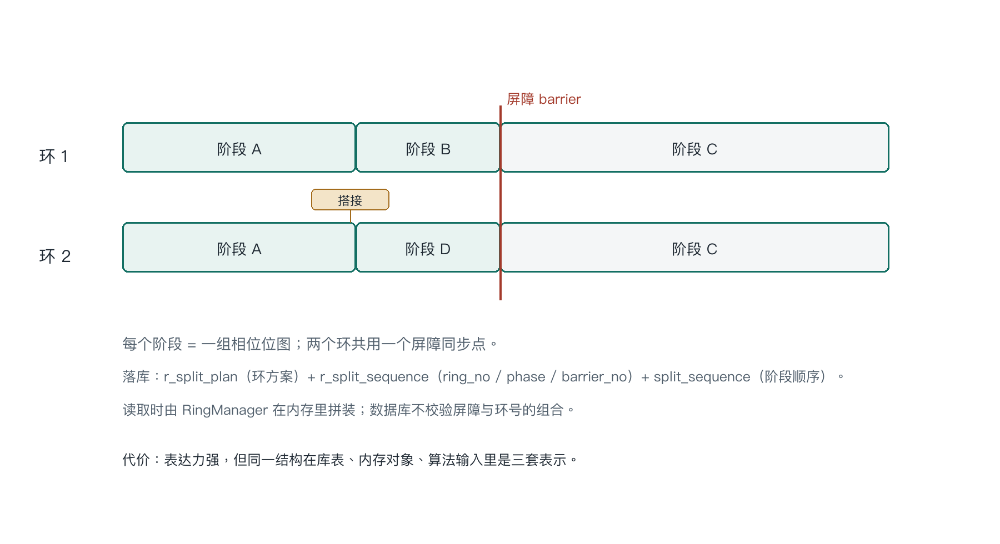

# 第 9 章 相位、阶段、环与相序

第 8 章结尾把话头交给了这里：进入单点信号控制，先拆开路口的时间骨架。把这张骨架放到一个真实的交接现场：早高峰前的方案评审会上，工程师桌上摊着一张相位图，东西直行对放、南北直行对放、两个左转单独放行，箭头和斑马线画得清清楚楚；而屏幕那头，算法服务能读到的只是一份字段表。图上的箭头读不进代码——哪些流向允许同时放行、哪些阶段允许相邻、哪些阶段组合能拼出一个完整周期，这些信息必须先被显式地写成数据结构，周期和绿信比的计算才有落脚点。这个离散结构决定了后续一切计算的可行空间：结构错一步，后面算得再精也白算。

围绕这张骨架，本章把相位图转换成冲突图、阶段集合和相序约束：先定义相位——一组同时通行的流向；再定义阶段——许可集合，及其必须满足的冲突图独立集约束；然后把相序写成切换边与闭环路径；接着讨论环、屏障与搭接这类控制结构如何保存；最后给出候选方案过滤器，并处理协调关键阶段。贯穿全书的一条原则在这里成形：调整绿灯秒数和改变阶段顺序是两类操作——绿灯秒数在结构不变的前提下分配时间，阶段顺序一动，清空关系、协调基准、设备支持全部跟着变，必须走单独的重设计流程。

## 9.1 相位是同时通行关系

一个相位可以包含多个流向，只要它们在给定的清空模型中不冲突：

```text
Phase E-W = {east-through, west-through}
```

相位对象还要保存最小绿、最大绿和过渡灯色。WaySense 的 `Phase` 使用并发相位位图描述哪些相位可同时处于同一阶段，并保存绿闪、黄灯和全红等配置。

从算法视角，可以先把它转换为：

```text
phase_id -> movement set
```

这使冲突检查和流量聚合不依赖位图格式。

### 9.1.1 相位、通道和灯具是三个不同对象

一个相位可能控制多个通道，一个通道也可能由多个相位在不同条件下使用。信号灯的颜色状态则来自设备协议。三者关系可以抽象为：

```text
Phase -> set[Channel] -> set[SignalGroup/Lamp]
```

例如“东直放行”相位可能控制东进口直行机动车灯和对应的行人禁止灯。把它们都简单归入一个 `phaseId`，设备下发时就会缺少必要的映射；反过来，把每个灯组都当成相位，阶段冲突又会被重复枚举。

生产模型的 `Phase.controlChannel` 位图表达相位对通道的控制关系，`PhaseStage` 再聚合相位。适配到本书的概念模型时，应保留三层：

```text
movement requirement
  -> phase right-of-way
  -> channel and lamp command
```

交通需求只需要理解第一层，安全冲突需要第二层，设备协议需要第三层。阅读代码时，如果某一层同时承担另外两层的职责，后续扩展多厂商设备会很困难。

## 9.2 阶段是许可集合

阶段包含一个或多个相位。它决定一个连续时间区间内哪些流向拥有通行许可。

```text
Stage A = {Phase E-W}
Stage B = {Phase W-Left}
Stage C = {Phase N-S}
```

若两个相位合并后包含冲突流向，该阶段非法。SignalLab 使用：

```python
validate_stage_phases(
    "StageA",
    ("east-west", "north-left"),
    phases,
    conflicts,
)
```

通过校验只会抛出异常或正常返回，不提供“冲突分数”。冲突属于硬约束。

### 四相位例子的拆解

考虑东西直行、西向左转、南北直行和南向左转四个流向。一个典型阶段划分是：

具体见表 9-1。
表 9-1 四相位例子的拆解
| 阶段 | 放行内容 |
|---|---|
| A | 东西直行 |
| B | 西向左转 |
| C | 南北直行 |
| D | 南向左转 |

每个阶段是否能够成立，取决于冲突矩阵以及行人、右转和特殊渠化。A 和 C 在普通十字路口不能同时放行；B 和 C 可能共享东西向直行保护，具体取决于相位设计。

这张表还不是方案。完整方案还需要给 A、B、C、D 分配时间、清空时间和顺序。

### 9.2.1 阶段合法性是一个集合约束

设阶段 \(s\) 包含相位集合 \(P_s\)，每个相位对应流向集合 \(M(p)\)，则阶段流向为：

\[
M_s=\bigcup_{p\in P_s} M(p)
\]

阶段合法要求 \(M_s\) 在冲突图中是独立集。只检查每个相位自身合法并不够，因为冲突可能只发生在两个相位之间。

对于 S2 的十字路口，可以先用一个简化表表达：

具体见表 9-2。
表 9-2 阶段合法性是一个集合约束
| 流向 | 东直 | 西直 | 北左 | 南左 | 东人过街 |
|---|---:|---:|---:|---:|---:|
| 东直 | - | 兼容 | 冲突 | 兼容? | 冲突? |
| 西直 | 兼容 | - | 兼容? | 冲突 | 兼容? |

问号表示必须由具体渠化、信号指示、右转规则和行人相位决定，不能根据这张表自动推断。正式冲突矩阵必须来自现场设计和规范审查。表格的作用是说明“兼容”不是语言判断，而是一个需要逐边确认的图关系。

如果把一个含有冲突边的阶段交给优化器，优化器输出的周期再漂亮也没有意义。因此阶段过滤在周期计算之前，且不能因为阶段已经存在于历史方案库就跳过验证。历史方案也可能来自错误导入或旧渠化。

## 9.3 相序是时间上的排列

阶段集合相同不代表方案相同。以下两个阶段集合可能完全相同，但顺序不同：

```text
A -> B -> C -> D
A -> C -> B -> D
```

相序改变会影响：

- 上一阶段到下一阶段的清空关系
- 协调阶段的起始位置
- 搭接相位的持续区间
- 行人与车辆的服务先后
- 路口标线向驾驶员传递的预期

所以，优化前必须比较阶段序列：

```python
if not same_stage_sequence(current_plan, candidate_plan):
    reject_or_require_explicit_redesign()
```

`same_stage_sequence` 只比较有序阶段 ID。若两个阶段的 ID 相同但内部相位组成被人工修改，仍需要额外的版本和结构校验。

### 9.3.1 相序的邻接约束

一个阶段序列不仅是 ID 的有序列表，还定义了阶段之间的切换边：

\[
s_1\to s_2\to\cdots\to s_n\to s_1
\]

每条边都需要一个清空配置。若系统只保存阶段列表，没有保存切换关系，就无法判断 `B -> C` 和 `C -> B` 是否使用相同的黄灯与全红，也无法识别某些相序需要额外安全间隔。

可以把合法相序表达为有向图。阶段是顶点，允许的安全切换是边。一个周期方案必须存在闭环路径，且路径覆盖业务要求的阶段。简单的全连接序列图并不安全，因为它默认任意阶段都能直接切换。

对于固定方案，算法只需验证当前路径仍然闭合。对于相序重设计，系统需要生成新路径并执行：

```text
每个阶段内容合法
每条切换边有清空配置
闭环覆盖必需阶段
关键阶段位置明确
设备支持所有阶段和切换
```

这五项中有一项失败，就不能通过降低目标分数来接受。

### 9.3.2 从安全切换到周期可行性

把阶段看作顶点，把存在合法清空配置的阶段切换看作有向边。对一个要求阶段集合 \(R\) 的固定周期，候选序列 \(v_1,\dots,v_n\) 可行，当且仅当：

1. 每个 \(M(v_i)\) 都是冲突图独立集；
2. 每条切换边 \(v_i\to v_{i+1}\) 以及 \(v_n\to v_1\) 都有设备支持的安全清空配置；
3. 每个必需阶段 \(r\in R\) 至少被序列覆盖；
4. 序列中每个阶段都能从原方案或被人工确认的新设计中定位其内容和版本；
5. 序列总时长能够闭合为设备周期。

前两项证明结构安全，第三项证明功能完整，第四项证明语义稳定，第五项证明时间可执行。缺少任一项都可能得到“看起来像周期”的对象：例如 A 到 C 的切换没有清空配置，数值上仍可给 A、C 分配时长并凑满 90 秒，但设备不能安全地从 A 切到 C。

候选过滤因此有明确顺序：先检查身份和内容，再检查阶段和切换安全，然后检查必需阶段与时间完整性，最后才比较流量、延误和带宽。顺序的好处是计算便宜、语义强的检查先执行。对每个候选都先做完整时空优化，再把非法结果丢掉，既浪费资源，也让拒绝原因难以追溯。

固定周期通常要求每个阶段恰好覆盖一次；感应或跳相控制可能允许某阶段在本周期不出现。系统必须从控制类型读取“覆盖一次”还是“至少一次”，不能把固定配时的检查强加给所有设备。

## 9.4 环与控制结构

多环结构允许某个阶段只在特定环中出现，或通过搭接相位跨阶段连续放行。它的价值是提高绿灯利用率，代价是结构更复杂。

生产系统使用环、阶段序列和搭接关系保存这些约束。算法可以选择：

1. 保持现有环和相序，只调整时间。
2. 在同相序候选方案池中选择。
3. 进行相序重设计并创建新方案。

三种任务的风险和审批要求不同，不能共用一个隐式路径。

### 9.4.1 环约束的伪代码

一个多环控制器可能允许两个环同时前进，但每个环内阶段顺序固定。可以用下面的伪代码表达最小结构：

```python
for tick in controller_steps:
    active = [ring.current_stage for ring in rings]
    validate_compatible_combination(active)
    for ring in rings:
        if ring.can_advance():
            ring.advance_to_next_declared_stage()
    if all(ring.at_barrier()):
        synchronize_barrier()
```

真实控制器还要处理感应请求、相位跳过、最大绿和搭接。这里的关键是：组合合法性按“当前活动集合”验证，单个环内部合法并不保证两个环组合后没有冲突。

搭接阶段的持续时间可能横跨多个普通阶段。若把搭接拆成两个独立阶段，最小绿、最大绿和清空时间会被重复计算；若把它看成一个无限延长阶段，又会让其他环无法推进。代码模型必须明确搭接的开始、结束和跨阶段时间归属。

从计算模型看，多环控制器是在做局部状态机的同步乘积。每个环有自己的当前位置和推进条件，系统同时观察所有环的活动集合。若共有 \(k\) 个环，每个环最多 \(m\) 个位置，完整状态空间上界为 \(O(m^k)\)。生产实现不会真的枚举全部组合，而是用阶段结构、阻车和屏障关系裁剪状态；这个复杂度上界解释了为什么随意增加环或搭接会让验证迅速变难。

最小可验证做法不是证明控制器不会进入非法组合，而是保证每个可观测活动组合都通过冲突校验，并且所有允许的推进事件在模型和测试中都有定义。未定义事件应停在当前状态或进入安全降级，不能落到某个默认阶段。

### 9.4.2 环在现有实现里怎么存

“环”在 WaySense 里不是一个实体类。现有实现只有 `RingManager` 编排器，结构落在三张表：

- `r_split_plan`：环方案，含 `tpa`（允许同一相位一个周期内用两次）；
- `r_split_sequence`：环内序列，字段有 `ring_no`、`phase`（位图）、`barrier_no`、`phase_sequence`；
- `split_sequence`：阶段顺序。

如图 9-1 所示。


读取时由 `RingManager` 在内存里把三张表拼成环结构。这带来两个代价：

1. 结构合法性靠装配逻辑保证，数据库没有外键或约束检查屏障与环号的组合。
2. 同一份结构在库表、内存对象和算法输入里是三套表示，改一处必须同步三处。

三种组织方式的对比：

具体见表 9-3。
表 9-3 环在现有实现里怎么存
| 方案 | 表达力 | 校验难度 | 迁移成本 |
|---|---|---|---|
| 平坦阶段列表 | 低：无法表达搭接和多环 | 低 | 低 |
| 环 + 屏障（本系统） | 高：支持搭接、双环、屏障同步 | 高 | 中 |
| 相位级状态机（NEMA 风格） | 最高 | 最高 | 高 |

选择环 + 屏障的理由很实际：设备本身按环和阶段执行，算法如果换成平坦列表，就无法表达设备已经支持的搭接结构。代价是装配、校验和序列化都更复杂，这也是 9.4.1 那套组合校验必须存在的原因。

## 9.5 候选阶段过滤器

候选方案至少要经过以下过滤：

```text
方案属于同一步行/车辆控制结构
阶段顺序与原方案兼容
关键阶段存在
设备支持该阶段组合
最小绿和清空时间已知
```

过滤之后再比较周期、延误、饱和度或绿波带宽。若候选方案在第一层就不兼容，后续评价没有意义。

候选过滤可以写成有优先级的函数：

```python
def candidate_filter(current, candidate, site):
    checks = (
        ("site", candidate.site_id == current.site_id),
        ("active", candidate.status == "active"),
        ("sequence", same_stage_sequence(current, candidate)),
        ("conflicts", stage_contents_are_safe(candidate, site)),
        ("timing", plan_time_is_complete(candidate)),
        ("device", device_supports(candidate, site.device)),
    )
    reasons = [name for name, ok in checks if not ok]
    return (not reasons, tuple(reasons))
```

返回原因比只返回布尔值更有用。运营人员需要知道候选为什么不能使用，日志也需要区分“相序不兼容”和“设备不支持”。如果一次请求的全部候选都失败，响应应包含每个候选的原因，而不是只返回空列表。

## 9.6 协调关键阶段

干线协调需要一个可定位的关键阶段。相位差通常相对于关键阶段的绿灯开始或结束时刻计算。

如果候选方案改变了关键阶段或阶段顺序，原相位差不能再直接复用。系统必须重新计算：

- 关键阶段位置
- 协调方向绿窗
- 相位差
- 上下行带宽

### 9.6.1 关键阶段改变后的数值影响

设 S1、S2 的公共周期为 90 秒，S1 的关键阶段从周期 0 秒开始，S2 与原关键阶段对应的偏移为 24 秒。若新方案把 S2 的关键阶段在周期中移动了 10 秒，原来的 24 秒偏移不能继续使用。新的相对关系至少需要修正为：

\[
o'_{\mathrm{S2}}=o_{\mathrm{S2}}+\Delta t_{\mathrm{key\ shift}}
\]

再按周期取模。实际计算还要区分相位差是相对绿灯开始、绿灯结束还是某个协调点。不同系统使用的零点不同，所以不能只保存一个没有基准的 `offset`。

如果 S1 和 S2 的阶段时长均改变，相邻路段行程时间不变，理论偏移仍由行程时间决定，但实际绿窗位置会改变。协调评估应重新生成时空图，而不是只比较相位差是否相同。

## 9.7 本章实验

1. 构造三相位路口和冲突矩阵。
2. 将一个冲突相位加入阶段，验证拒绝。
3. 构造两个合法阶段方案，仅交换后两个阶段，验证相序比较返回不兼容。
4. 为一个协调路口指定关键阶段，交换其位置后重新计算相位差。

运行：

```bash
cd signal-lab
python3 -m unittest tests.test_safety_mapping -v
```

实验重点是拒绝：冲突阶段必须抛出错误，交换相序必须被识别为不兼容。系统不能通过调低评分掩盖结构错误。

再做一个结构化实验：把四个阶段的相位内容写成集合，枚举所有两两组合，统计哪些组合包含冲突边。对每个候选阶段依次执行：

```python
validate_stage_phases(...)
same_stage_sequence(...)
```

输出应包含合法阶段数、冲突拒绝数和相序拒绝数。若交换两个中间阶段后程序仍返回“相容”，说明相序比较退化为集合比较或只比较了首尾。

## 9.8 小结

第 8 章交下来的问题是“设备此刻在执行什么”，这一章往前走了一步，回答“结构允许执行什么”：相位把同时通行的流向写进冲突图，阶段把相位聚成许可集合并要求独立集成立，相序把阶段排成带清空边的闭环，环、屏障与搭接承担复杂控制结构并在现有实现里各有其表，候选过滤器在算时间之前先挡住结构非法的方案，关键阶段则给干线协调一个可定位的锚点。

时间优化与结构优化从此分成两条操作线：调绿灯秒数走配时，动阶段顺序走重设计；保持相序是安全默认值，这是工程上的成熟选择，和算法能力无关。骨架已经立好，每一段该分多少秒——周期多长、绿信比怎么分、损失时间记在哪，第 10 章接着算。

## 练习

1. 为什么“阶段内容相同”仍可能代表不同方案？
2. 搭接相位如何影响阶段最小绿和最大绿？
3. 设计一个候选方案过滤器，按优先级列出过滤条件。
4. 说明协调方案中关键阶段改变会带来哪些连锁影响。
5. 为什么一个合法的相位集合不一定能与另一个合法相位集合组成合法阶段？
6. 为一段包含 A、B、C 的闭环相序写出所有切换边，并说明需要哪些清空字段。
7. 解释搭接相位会如何改变“阶段总时长”和“周期内纯绿总和”的计算。
8. 设计一个候选过滤器，要求返回每个候选被拒绝的稳定原因码，而不是只返回总数。
