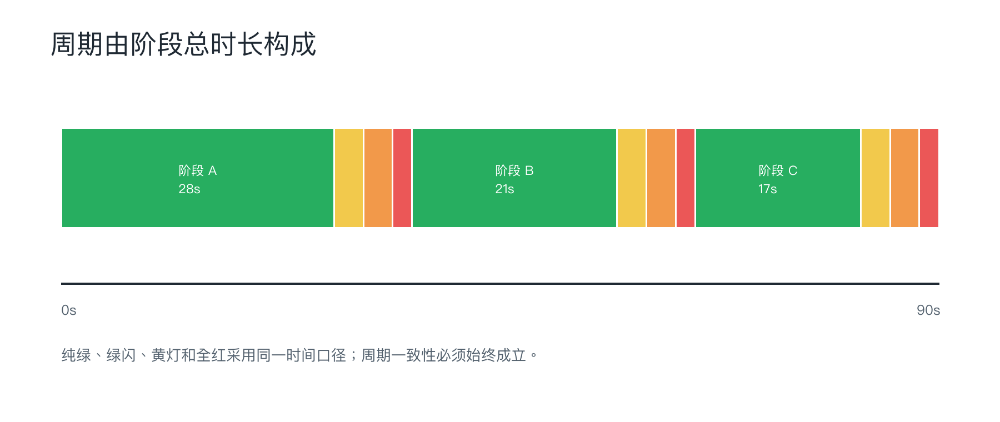

# 第 10 章 周期、绿信比与损失时间

第 9 章结尾把话头交给了这里：骨架已经立好，每一段该分多少秒——周期多长、绿信比怎么分、损失时间记在哪，这一章接着算。开场先看一个真实的下发现场：一个 90 秒周期运行稳定，运营人员把其中一个阶段增加 10 秒，却没有修改其他阶段。信号机可能拒绝新方案，也可能按照自身规则压缩末阶段，最终执行一个与算法输出不同的时间计划。10 秒从哪一段出、落到哪一段，牵动的其实是整个周期的闭合方式；方案库里那一行“90”的背后，是一整套必须同时成立的时间关系。

这类问题说明：周期不是单字段最大值，绿信比也不是一组互不相关的秒数；阶段纯绿、绿闪、黄灯、全红、周期和方案版本必须同时成立。本章把这些量之间的关系一层层建立起来：先分清一个阶段的三种时间口径，再看周期如何由阶段总时长闭合；然后从流量比出发，权衡周期长短并给出上下限的算法；接着讨论 Webster 周期公式在本书中的位置和可配置的周期曲线；最后逐级落到绿灯分配、整数化、最小绿修复，并用一个从流量到方案的完整例子把全章串起来。

## 10.1 三种“时间”

同一个阶段在系统里至少有三种时间口径。

### 纯绿时间

车辆获得基本通行许可的时间。它是流量比和容量计算中最常使用的部分。

### 过渡时间

包括绿闪、黄灯和全红。不同设备对绿闪和清空的定义可能不同，但切换阶段时不能丢失。

### 阶段总时长

```text
stage_time = green + green_flash + yellow + all_red
```

完整方案满足：

```text
cycle = sum(stage_time)
```

某些系统把清空时间单独放在阶段外，某些系统把清空时间包含在阶段字段内。无论采用哪一种，算法和下发必须使用同一口径（见图 10-1）。



## 10.2 为什么周期不等于绿灯总和

如果三个阶段的纯绿为 28、21、17 秒，周期不能直接写作 66 秒，因为每个阶段还需要清空时间。

假设每阶段：

```text
green_flash = 3s
yellow = 3s
all_red = 2s
```

每阶段总时长为：

```text
28 + 3 + 3 + 2 = 36
21 + 3 + 3 + 2 = 29
17 + 3 + 3 + 2 = 25
```

周期：

```text
36 + 29 + 25 = 90s
```

周期中的纯绿总量为 66 秒，清空时间为 24 秒。比例分配需要先明确它操作的是 66、90 还是其他有效绿口径。

## 10.3 流量比是时间需求

某流向的到达流量为 `q`，饱和流率为 `S`：

```text
y = q / S
```

若 `q=720 veh/h`，`S=1800 veh/h`，则 `y=0.40`。含义是：为了持续消化该到达需求，平均每个周期至少需要 40% 的有效绿。

一个阶段服务多个兼容流向：

```text
stage_ratio = max(direction_flow_ratio)
```

如果东直为 0.40、东左为 0.15，则阶段需求由 0.40 决定。原因是两个流向共享同一段绿灯，而东直是最先形成容量的方向。

低需求流向仍可能有最小绿。阶段时间最终要同时满足容量需求和最低服务约束。

## 10.4 周期长短的权衡

短周期优点：

- 单次红灯等待较短
- 需求变化更容易快速响应
- 排队长度通常更小

长周期优点：

- 固定损失时间占比下降
- 可分配有效绿更多
- 协调方向和绿波更稳定

长周期代价：

- 单次红灯等待更长
- 排队可能在绿灯前积累更多车辆
- 下游溢出影响更大
- 对行人和非机动车不友好

短周期的主要代价是固定损失时间占比更高。把周期总损失记为 \(L\)，可用于通行的有效时间比例为：

\[
\eta_{\mathrm{eff}}=\frac{C-L}{C}=1-\frac{L}{C}
\]

若 \(L=24\) 秒，60 秒周期的有效率是 60%，90 秒周期是 73.3%，120 秒周期是 80%。容量 \(c=Sg_{\mathrm{eff}}/C\) 取决于有效绿占整周期的比例，而不只是周期大小。周期延长后，如果新增时间全部用于目标阶段，容量可能增加；如果新增时间被更多清空、最大绿或协调等待抵消，交通效果未必改善。

不存在脱离流量、路口几何、行人和协调需求的统一最佳周期。

### 10.4.1 周期下限与上限都是硬边界

三个阶段清空时间总和为 24 秒，最小绿分别为 12、10、10 秒时，任何合法周期至少需要：

\[
C_{\min}=24+12+10+10=56\text{ s}
\]

低于 56 秒时，即使所有阶段只拿最小绿也无法闭合。反过来，设备最大周期 120 秒是硬上限；一个需求模型输出 150 秒，不能因为带宽更大就直接下发。

周期从 60 增加到 90 秒，固定损失在周期中的占比从：

\[
24/60=40\%
\]

降到：

\[
24/90=26.7\%
\]

这是长周期可能提高通行效率的来源。但 90 秒下一次红灯等待也更长，行人等待和队峰都需要单独评价。周期选择必须同时报告下限、上限、损失占比和需求边界。

### 10.4.2 把周期选择写成带惩罚的多目标

仅用“损失占比最低”选周期会不断趋向设备上限，因为 \(L/C\) 随 \(C\) 增大而下降；仅用“等待最短”选周期又会趋向设备下限，并可能让高需求方向缺少容量。一个透明的工程目标可以写成：

\[
J(C)=w_1\overline{d}(C)+w_2R_{\max}(C)+w_3P_{\mathrm{spill}}(C)
\]

其中 \(\overline d\) 是模型或历史估计的平均延误，\(R_{\max}\) 是最大排队，\(P_{\mathrm{spill}}\) 是溢出惩罚。约束仍是容量、最小绿、行人等待、设备范围与协调关系。

这个目标不声称能精确预测现场，只是把取舍写清楚。若权重的变化会让方案从“少量延误改善”跳到“严重溢出”，说明评价模型没有覆盖尾部风险。周期选择应同时输出平均指标和失败指标，不能只展示一个加权分数。

## 10.5 Webster 周期在本书中的位置

经典 Webster 周期可写成：

```text
C0 = (1.5 * L + 5) / (1 - Y)
```

其中：

- `L` 是周期损失时间
- `Y` 是各关键阶段流量比之和

该式说明：

- 损失时间增加，周期增加
- `Y` 增加，周期增加
- `Y` 接近 1，周期快速增大
- `Y >= 1`，模型不再给出有限非负解

`Y>=1` 表示平均需求达到或超过容量，不能通过给公式加一个周期上限而宣布问题解决。周期上限只能限制设备运行范围，不能创造被需求占满之外的容量。

下一章将从周期公式和流量覆盖约束出发，完整推导约束优化。

## 10.6 可配置周期曲线

生产系统可以根据现场标定点决定目标周期，而不总是使用同一组 Webster 经验系数。

WaySense 支持多种流量比—周期关系：

- 分段线性
- Sigmoid
- 反比例

分段线性模型的优点是可解释。给定两个标定点：

```text
(0.3, 80s), (0.9, 200s)
```

在两点之间存在线性关系，超出范围时按上下限限幅。缺点是现场需求关系并非总能由有限标定点描述。

反比例模型更接近 `C=L/(1-Y)` 的增长形式，但在近饱和区同样会急剧增大。Sigmoid 模型更适合表达平滑过渡，却更难解释单个参数。

工程选择应回答：

1. 标定点来自哪里？
2. 曲线在近饱和区是否合理？
3. 外推如何限制？
4. 周期上限由谁决定？
5. 模型版本如何记录？

### 10.6.1 生产主路径用的是 Sigmoid

书里从 Webster 讲起，但生产模型路径并不用它。模型路径的周期函数如下：

```python
cycle = min_cycle + (max_cycle - min_cycle) / math.pow(
    (1 + math.exp((-sum_flow_ratio + critical_status) / theta_1)), theta_2
)
return round(cycle)
```

出处：`signal_optimizer/main.py` 的 Sigmoid 周期函数。

这个函数单调、有界：流量比越大，周期越接近 `max_cycle`，不会像 `C = L/(1-Y)` 那样在 `Y→1` 时发散。代价是参数 `theta_1`、`theta_2`、`critical_status` 不如“损失时间”“流量比”直观，现场很难解释“为什么是这条曲线”。

三种周期模型的对比：

具体见表 10-1。
表 10-1 生产主路径用的是 Sigmoid
| 模型 | 形式 | 近饱和行为 | 参数来源 | 当前状态 |
|---|---|---|---|---|
| Webster 有理式 | `(1.5L+5)/(1-Y)`，`Y` 钳 0.97 | 封顶，靠限幅 | 教科书 | 未接线（11.11） |
| 五点折线 | 分段线性插值 | 线性增长到上限 | 路口级配置 | 平台路径使用（`flow_cycle_labels`） |
| Sigmoid | 上下限之间的平滑曲线 | 渐近到上限 | 相位数 + `theta` | 模型路径使用 |

三条曲线在低饱和区差别不大，差别集中在 `Y>0.8`：Webster 会发散或撞限幅，折线直接撞上限，Sigmoid 平滑逼近上限。周期上限由设备和策略决定，模型不能替设备做决定。

### 10.6.2 同一组输入，六套周期答案

设 Y=0.6、L=12 秒、4 个相位，反比例与分段线性的锚点都取 (0.3, 80) 和 (0.9, 200)。直接代入现有实现里的六处实现：

具体见表 10-2。
表 10-2 同一组输入，六套周期答案
| 来源 | 公式或机制 | 结果 |
|---|---|---|
| Webster（`webster.py`） | (1.5L+5)/(1-Y) | 57.5 |
| Webster 变体（`is_cycle_irrational.py`） | (3L+5)/(1-Y) | 102.5 |
| 反比例（`cycle_model.py`） | l0/(1-Y)+b0 | 95.0 |
| 分段线性（`cycle_model.py`） | 锚点插值 | 140.0 |
| Sigmoid（`main.py`） | 界 74～180、θ1=0.1、θ2=1 | 127.0 |
| 稳健 Sigmoid（`single_node_robust_optimizer/controller.py`） | 界 74～210、×1.02 | 143.4 |

最小 57.5、最大 143.4，差 85.9 秒，接近 2.5 倍。它们回答的都是“这个路口该用多长周期”。

这不是谁算错了。各套方法都在回答一个略有不同的问题：教科书周期、评测器的“不合理周期”判据、用标定锚点表达本地经验的插值、按相位数设界的平滑曲线、带 2% 放大的稳健版本。问题是这些答案在系统里没有统一登记：接口只返回一个 `Cycle` 整数，调用方不知道它来自哪一套。

更具体的一处冲突是界表。`settings.py` 给 4 相位 74～180 秒，`single_node_robust_optimizer/controller.py` 给 74～210 秒。同一组输入，仅上限就差 30 秒。周期是 180 还是 210，取决于走哪条代码路径，而不是取决于路口。

工程上的处置不是“选出唯一正确公式”，而是把来源显式化：方案记录里带 `cycle_model`、界表版本和锚点；评价时按同一套重算；跨路径比较前先对齐界表。这正是本书反复强调的“同一概念多种表示必须登记”的具体例子。

## 10.7 从周期到绿灯

得到周期后，扣除阶段清空时间：

```text
available_green = cycle - sum(clearance)
```

如果三阶段周期 90 秒，每阶段清空 8 秒：

```text
available_green = 90 - 24 = 66s
```

这才是在纯绿层面可以按阶段需求分配的总量。

最简单的流量比例分配：

```text
weight_A = 0.5
weight_B = 0.3
weight_C = 0.2
```

理想增量为：

```text
18, 10.8, 7.2
```

最小绿都是 10 秒时，先满足最小绿会得到：

```text
minimum_total = 30
extra = 66 - 30 = 36
```

按比例分剩余时间，再整数化：

```text
A = 10 + 18 = 28
B = 10 + 11 = 21
C = 10 + 7  = 17
```

总和正好 66。这个算例说明“先扣最小绿、再分剩余时间”比“先乘比例、后修补”更容易保持周期闭合。

## 10.8 整数化和最大余数

阶段时间通常按秒或设备步长下发。浮点比例直接四舍五入可能产生：

```text
28.2 + 20.4 + 17.4 = 66.0
round -> 28 + 20 + 17 = 65
```

总时间少了 1 秒。最大余数法先向下取整，再按小数部分排序补齐：

```text
base = 28,20,17
remaining = 1
largest fractional remainder -> one stage +1
```

最终结果可能为 `28,21,17`。算法必须执行周期闭合检查，而不是只对每个阶段独立四舍五入。

### 10.8.1 最大余数法为什么保持总量

把每个阶段的理想增量写成 \(v_i=b_i+r_i\)，其中 \(b_i=\lfloor v_i\rfloor\)，\(0\le r_i<1\)。总和为 \(E\)。先分配全部整数部分，定义：

\[
R=E-\sum_i b_i
\]

由于 \(E=\sum_i v_i\)，有：

\[
R=\sum_i r_i
\]

\(R\) 必为非负整数。把 \(R\) 个一分配给余数最大的 \(R\) 个阶段后，所有增量仍然满足：

\[
b_i\le x_i\le b_i+1
\]

且 \(\sum_i x_i=E\)。这证明了最大余数法在整数步长为 1 时既闭合总量，又尽量不让任一阶段偏离理想值超过 1 秒。若设备要求 5 秒步长，问题变为按共同步长取整，不能直接套用 1 秒证明，必须重新检查余数和设备边界。

最大余数法只解决“比例如何变成整数”，不解决“整数后是否满足最小绿”。若按比例分给某阶段的整数低于最小绿，仍需修复；修复后还要重新执行总量守恒。

### 10.8.2 三套整数化在现有实现里并存

最大余数法不是现有实现的唯一做法。不同算法路径各自整数化，是否保持周期闭合也不同：

具体见表 10-3。
表 10-3 三套整数化在现有实现里并存
| 路径 | 方法 | 周期是否闭合 |
|---|---|---|
| 双环 QP、备份方案 | `round_sum_fixed`（最大余数） | 是 |
| OR 求解 | 逐阶段 `round()` | 否，周期由重新求和得到 |
| Webster | 逐阶段 `round()` | 否 |
| 梯度绿灯 | `int()` 截断 | 否，且系统性偏低 |
| althms 自适应 | `int()` 截断 + 末阶段吃残差 | 是，但残差全落在最后一个阶段 |

实现（`lightflow/utils/math.py`）：

```python
def round_sum_fixed(iterable):
    rounded = np.round(iterable)
    amount = round(sum(iterable))
    if np.sum(rounded) == amount:
        return list(rounded)
    part = [item - np.floor(item) for item in iterable]
    remain = amount - np.sum(np.floor(iterable))
    ...
```

这带来一个验收要求：看到“周期 90 秒”时，必须知道它是哪条路径产出的。逐阶段舍入的路径可能让阶段之和与目标周期差 1～2 秒，再由上层重新求和；最大余数路径保证和相等，但可能把余数集中到某一阶段。两种结果都能“看起来正常”，差别在设备端是否闭合。

## 10.9 最小绿修复

最小绿可能来自：

- 行人过街
- 排队消散
- 右转或左转安全
- 规范与设备参数

修复逻辑：

```text
find deficit stages
find stages with spare green
move green from donors to deficit stages
preserve clearance
validate cycle and min green
```

若缺陷总量大于可转移余量，不存在合法修复。继续下发会破坏安全边界。

SignalLab 的 `repair_min_green` 采用确定性修复，并在总量不足时抛出 `InvariantViolation`。

## 10.10 一个从流量到方案的完整例子

输入流量：

```text
东直 = 720 veh/h, S=1800, y=0.40
东左 = 210 veh/h, S=1400, y=0.15
西直 = 500 veh/h, S=1800, y=0.28
北左 = 140 veh/h, S=1400, y=0.10
```

阶段结构：

```text
A = {东直, 东左}
B = {西直}
C = {北左}
```

阶段关键流量比：

```text
A = 0.40
B = 0.28
C = 0.10
Y = 0.78
```

使用现场周期曲线，假设得到目标周期 100 秒。每阶段清空 8 秒：

```text
available_green = 100 - 24 = 76s
```

三个阶段最小绿为 `12, 10, 10`，剩余 44 秒按 0.40、0.28、0.10 分配。归一化后约为：

```text
rho = 0.5128, 0.3590, 0.1282
```

新增绿约为：

```text
22.6, 15.8, 5.6
```

整数化后完整纯绿可能为：

```text
A = 34
B = 26
C = 16
```

加上清空时间：

```text
42 + 34 + 24 = 100s
```

最终方案仍要检查阶段 B/C 的最小绿、最大绿和设备周期范围。

这个例子还说明中间值不能被丢掉。若最终只发布 `34/26/16`，现场无法判断 34 秒是理想分配、最小绿修复还是人工修改后的结果。推荐记录应保留：

```text
stage_ratios = 0.40, 0.28, 0.10
minimum_green = 12, 10, 10
ideal_extra = 22.59, 15.81, 5.65
integer_green = 34, 26, 16
repair_delta = 0, 0, 0
```

这些字段让审计人员能够复算每个秒数，也能区分输入变化和修复规则变化。

## 10.11 理想值先平滑再下发

如果每 15 分钟都用当前测量的理想方案覆盖原方案，交通需求的小波动会造成：

- 周期频繁变化
- 阶段时间抖动
- 设备切换次数增加
- 下游车队到达模式不稳定

生产实现会对原方案和目标方案加权。例如：

```text
new_ratio = 0.7 * original_ratio + 0.3 * target_ratio
```

0.7/0.3 是工程平滑参数，不是固定交通规律。权重决定系统响应速度和稳定性。

平滑后仍需：

1. 重新归一化比例。
2. 转成整数秒。
3. 修复最小绿。
4. 重建完整周期。
5. 检查相序和设备范围。

## 10.12 代码与实验

周期模型：

```python
from signal_lab import PiecewiseLinearCycleModel

model = PiecewiseLinearCycleModel(
    ((0.3, 80), (0.6, 110), (0.9, 180))
)
model.predict(0.75)
```

绿灯分配：

```python
from signal_lab import allocate_green_by_ratio

plan = allocate_green_by_ratio(
    stages=stages,
    stage_ratios={"A": 0.40, "B": 0.28, "C": 0.10},
    cycle=100,
)
```

运行：

```bash
cd signal-lab
python3 -m examples.experiment_cycle
```

实验输出包括：

- 周期模型变化
- Webster 理论周期变化
- 绿灯整数分布
- 靠近饱和区后的差异

## 10.13 常见错误

### 只加最后一个阶段补齐周期

最后一个阶段会承担全部舍入和修复误差，容易超过最大绿。

### 把周期损失和阶段清空重复扣除

如果周期模型已经使用阶段总时长，再扣一次清空时间会低估有效绿。

### 把百分比直接发给设备

设备需要明确的时长或步进值。百分比必须先转换和校验。

### 只比较周期，不比较相序

两个 100 秒方案可能阶段顺序完全不同，不能视为同一方案的时间微调。

## 10.14 小结

第 9 章立起了时间骨架，这一章往骨架里填秒数：周期解决“多久重复一次”，绿信比解决“这个周期怎么分配”。流量比描述需求，损失时间解释那部分用不到有效放行里的时间，最小绿和清空时间是硬约束，整数化与修复决定结果能否形成完整方案。一个可解释的配时结果必须同时保留原始需求、周期模型、可分配时间、阶段权重、整数化过程、约束修复和最终完整方案。

还剩一步没有走完：周期和阶段时长都齐了，多阶段的时间需求怎么写成一组可求解的约束、Webster 公式在优化里扮演什么角色，第 11 章从周期公式和流量覆盖约束出发完整推导。

## 练习

1. 用四个阶段构造一个周期闭合算例，并写出所有时间分量。
2. 当最小绿修复空间不足时，列出三种合法处置方式。
3. 证明最大余数法仍可能产生设备不支持的时间步长，并设计后处理。
4. 解释为什么短周期在高流量路口可能降低容量。
5. 设计一个自适应周期防抖策略，要求连续满足条件才切换。
6. 证明在固定清空时间和阶段流量比不变时，周期增加但绿灯比例不变，不会提高长期容量。
7. 设一个理想增量序列为 `10.49, 8.49, 6.02`，分别用独立四舍五入和最大余数法分配总和 25 秒，比较结果与误差界。
8. 为一个 150 秒公共周期构造两个单点方案，使每个方案自身合法，但关键阶段位置不同导致原偏移失效。

