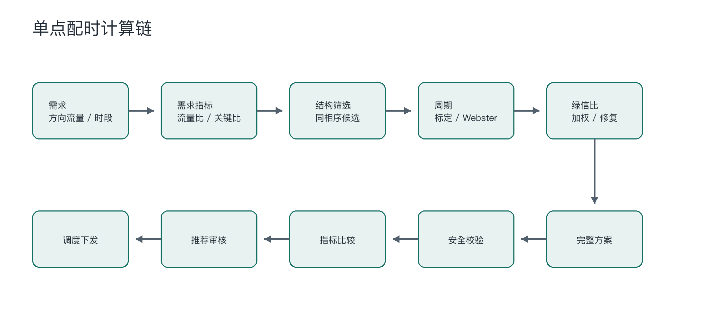

# 第 11 章 Webster 配时与约束优化

第 10 章结尾把最后一步留给了这里：周期和阶段时长都齐了，多阶段的时间需求怎么写成一组可求解的约束、Webster 公式在优化里扮演什么角色，这一章从周期公式和流量覆盖约束出发完整推导。开场先看一个正在发生的场景：晚高峰，一个运行四阶段方案的路口排队持续增长，东直的车队快要顶到上游路口；运营人员在终端上敲下“把周期调大”，指令只有这五个字，算法要给出的，是下面这组相互约束的答案：

- 当前需求是否还有周期可行性
- 哪个阶段才是关键阶段
- 周期增加后时间应该给谁
- 最小绿和清空时间是否仍满足
- 候选方案是否保持原有阶段顺序
- 算法无解或超时时设备继续运行什么

Webster 模型提供理解周期需求的起点，约束优化提供多阶段时间分配的方法。本章从最基本的流量需求推到完整方案，再回到 WaySense 的实际实现。

理论背景见 [1] 与 [2]，周期和最小绿还要结合 [13] 与 [14] 的适用版本（见图 11-1）。



## 11.1 从车辆间隔到时间需求

假设连续车辆以稳定车头时距通过停止线。若一辆车平均间隔 `h` 秒，则一小时内最多通过：

```text
S = 3600 / h
```

当 `h=2.0s`，饱和流率是 1800 veh/h。这个数描述的是连续排队且持续绿灯时的供给能力，不是任意绿灯比例下的平均通行能力。

若某流向每小时到达 `q` 辆车，那么：

```text
y = q / S
```

表示该流向需要的最小有效绿比例。例如：

```text
q = 720 veh/h
S = 1800 veh/h
y = 0.40
```

如果周期为 100 秒，该流向在平均需求下至少需要 40 秒有效绿。车流波动、随机到达和下游约束并不意味着把 40 秒平均切碎就能获得同样容量。

## 11.2 阶段为什么取最大流量比

一个阶段可以同时放行多个兼容流向。它们共享同一段绿灯，所以阶段的时间需求由最苛刻的流向决定。

```text
Stage A:
  东直 q=720, S=1800, y=0.40
  东左 q=210, S=1400, y=0.15

stage_ratio(A) = max(0.40, 0.15) = 0.40
```

东左只要求 0.15 的周期比例，但它和东直共享绿灯。这个阶段仍需要 0.40 的时间，因为东直是限制方向。

最小绿属于另一类约束。低需求左转仍可能因为行人或安全原因需要有 10 秒以上绿灯。最大流量比决定“容量需要多少时间”，最小绿决定“服务至少需要多少时间”，最终取二者能够同时满足的方案。

## 11.3 损失时间从哪里来

一个阶段并非全部时间都用于让排队车辆连续通过。启动时车辆需要反应和加速；结束时需要绿闪、黄灯和全红完成清空。

设阶段 `j` 的损失时间为 `l_j`，整个周期的损失时间为：

```text
L = sum(l_j)
```

若四个阶段各有约 3 秒损失，周期损失时间约为 12 秒。这个数不是简单把所有绿闪、黄灯和全红相加，具体还要看有效绿的定义与规范要求。

因此，周期中真正能用于满足需求的时间约为：

```text
effective_green_total = C - L
```

如果各阶段关键流量比之和为 `Y`，有：

```text
C - L >= C * Y
```

整理后得到容量可行的必要关系：

```text
C >= L / (1 - Y)
```

这是 Webster 周期公式的物理直觉。实际 Webster 公式还加入经验和拟合项：

```text
C0 = (1.5 * L + 5) / (1 - Y)
```

其中 1.5 和 5 是经典模型中的经验参数。

## 11.4 一个需求逐步增长的算例

设损失时间 `L=12s`，三个阶段的关键流量比分别为：

```text
A = 0.28
B = 0.24
C = 0.18
Y = 0.70
```

Webster 理论周期：

```text
C0 = (1.5 * 12 + 5) / (1 - 0.70)
   = 23 / 0.30
   = 76.7
```

如果进入高峰后阶段流量比变为：

具体见表 11-1。
表 11-1 一个需求逐步增长的算例
| 情况 | A | B | C | Y | Webster 周期/s |
|---|---:|---:|---:|---:|---:|
| 平峰 | 0.20 | 0.15 | 0.10 | 0.45 | 41.8 |
| 过渡 | 0.28 | 0.24 | 0.18 | 0.70 | 76.7s |
| 高峰 | 0.40 | 0.32 | 0.20 | 0.92 | 287.5 |
| 饱和边界 | 0.40 | 0.32 | 0.28 | 1.00 | 无有限解 |

高峰结果不是建议把周期直接设为 287 秒。设备、行人等待、协调周期和非协调方向通常会把周期限制在 180 秒或更低。结果是：

这意味着三件事：现有道路容量仍然不够；周期只能压在上限内；系统只能进入过饱和管理，或者限制需求、人工处置。

工程系统要同时保存理论结果和限幅结果，避免把“被上限截断”误认为需求已经解决。

### 为什么接近饱和时周期增长很快

对固定损失时间，Webster 周期对 `Y` 的局部变化率为：

```text
dC0/dY = (1.5L + 5) / (1 - Y)^2
```

当 `L=12`：

具体见表 11-2。
表 11-2 为什么接近饱和时周期增长很快（L=12 s）
| Y | 周期对 Y 的斜率（s/单位 Y） | Y 增加 0.01 时的近似增量（s） |
|---:|---:|---:|
| 0.5 | 92 | 约 0.9 |
| 0.7 | 256 | 约 2.6 |
| 0.9 | 2300 | 约 23 |
| 0.99 | 230000 | 约 2300 |

第二列是 \(dC_0/dY\)，单位是秒；它只描述局部斜率，第三列把这个斜率换算成 \(Y\) 增加 0.01 时的一阶近似增量。0.99 行只用于说明敏感性：\(Y+0.01=1.0\) 时公式没有有限值，2300 秒不是可执行周期。

工程上不能只把公式限幅后继续自动下发。系统还应检测：

- 连续多个 15 分钟窗口的流量比 \(Y\) 都接近 1
- 关键流向饱和度超过阈值
- 下游排队是否限制放行
- 周期是否长期贴着设备上限
- 输入置信度是否足够

在这些状态下，需求管理、边界控制、协调策略或人工处置可能比继续修改绿信比更有效。

## 11.5 周期的上下限

计算得到理论周期后，需要把它压回设备和运营允许的区间。这个动作在控制工程里叫限幅（clamp）：低于下限取最小值，高于上限取最大值。

```text
C = clip(C0, Cmin, Cmax)
```

周期上限来源可能包括：

- 设备允许范围
- 行人最大等待
- 相邻路口公共周期
- 下游存储能力
- 运营规则

周期下限来源可能包括：

- 各阶段最小绿总和
- 清空时间总和
- 行人过街
- 协调半周期关系

SignalLab 保留两个值：

```python
result = webster_cycle(
    {"A": 0.3, "B": 0.4},
    lost_time_s=12,
    min_cycle_s=45,
    max_cycle_s=180,
)

result.theoretical_cycle_s  # 76.666...
result.bounded_cycle_s      # 77
```

如果代码只返回限幅后的整数，诊断时无法知道原本是 77 秒、200 秒还是无穷大。

## 11.6 从周期到多阶段覆盖

周期确定后，需要把可分配有效绿分给各阶段。比例不能简单依赖阶段内最大流量比，因为同一流向可能被多个阶段服务。

设：

- `M_j`：阶段 `j` 服务的流向集合
- `y_m`：流向 `m` 的流量比
- `z_j`：阶段 `j` 的相对时间权重

对每个流向，所有服务它的阶段权重之和需要覆盖其流量比：

```text
sum(z_j for j where m in M_j) >= y_m
```

目标是最小化总权重：

```text
minimize sum(z_j)
```

这是一组线性约束。它允许一个流向在多个阶段中获得绿灯，例如直行出现在两个搭接阶段。

WaySense 的 `Webster.solve` 使用 OR-Tools 线性规划求解类似结构。它先枚举能够覆盖全部阶段的可行路线，再通过多次线性优化和结果汇总分配阶段比例，避免单一极值解过度偏向某个阶段。

## 11.7 两阶段覆盖算例

假设三个标准流向的流量比：

```text
m1 = 0.30
m2 = 0.40
m3 = 0.20
```

阶段结构：

```text
S1 = {m1, m2}
S2 = {m2, m3}
```

覆盖约束：

```text
z1       >= 0.30
z1 + z2  >= 0.40
       z2 >= 0.20
```

目标为最小化 `z1+z2`。由第一和第三条约束，最小可行解是：

```text
z1 = 0.30
z2 = 0.20
```

虽然 `m2` 在 S1 和 S2 中都得到绿灯，总覆盖达到 0.50，超过它的 0.40 需求。这说明共享流向的时间不能直接累加成“双倍容量”，而是由具体绿灯时段和到达时间共同决定。

归一化为阶段比例：

```text
rho_S1 = 0.30 / 0.50 = 0.60
rho_S2 = 0.20 / 0.50 = 0.40
```

如果直接按“每阶段取自身最大流量比”计算，S1 为 0.30、S2 为 0.20，恰好与 LP 解相同。这个例子太简单，因此还需要一个更有区分度的结构。

假设四个阶段：

```text
S1 = {E, W, SouthRight}
S2 = {W, N}
S3 = {N, EastLeft}
S4 = {SouthLeft}
```

流量比：

```text
E=0.30, W=0.24, N=0.28
EastLeft=0.12, SouthLeft=0.10, SouthRight=0.05
```

覆盖约束中，W 同时被 S1 与 S2 服务，N 同时被 S2 与 S3 服务。单独按每阶段最大值会忽略共享服务提供的额外覆盖，也可能在需要保证某阶段最大绿时产生不同解。

线性规划应根据阶段结构建立约束，而不是固定为“第 i 阶段全部时间归某个流向”。这也是代码中需要保留 `phase_info` 的原因。

### 11.7.1 覆盖模型的解释和对偶

把阶段有效绿比例记为 \(z_j\)，把流向 \(m\) 的流量比记为 \(y_m\)。阶段覆盖模型可以严格写成：

\[
\begin{aligned}
\min\;&\sum_j z_j\\
\text{s.t.}\;&\sum_{j:\,m\in M_j}z_j\ge y_m && \forall m\\
&z_j\ge0 && \forall j
\end{aligned}
\]

模型只要求每个流向获得足够覆盖。一个流向被多个阶段服务时，它的右侧约束可以由多个 \(z_j\) 共同满足。

这个原问题的对偶是：

\[
\begin{aligned}
\max\;&\sum_m y_m\lambda_m\\
\text{s.t.}\;&\sum_{m\in M_j}\lambda_m\le1 && \forall j\\
&\lambda_m\ge0 && \forall m
\end{aligned}
\]

对偶变量 \(\lambda_m\) 可以理解为该流向需求对总权重的边际影响：需求越大，目标越希望提高该流向的价格；但每个阶段内所有流向价格之和不能超过 1，因为同一秒绿灯不能被重复出售。强对偶成立时，原问题最小总覆盖与对偶最大加权价格相同。这个解释能帮助检查模型：若一个阶段内的对偶价格和超过 1，说明代码在重复使用同一阶段时间。

覆盖问题可能有多个同样最优的分配。例如两个流向完全对称，求解器可以把 0.01 秒从 A 阶段移到 B 阶段而不改变目标。生产结果需要确定性 tie-break，或者加入极小的比例偏差正则项，避免同一输入在不同求解器版本下得到不同方案。正则项不能大到改变主目标，否则会掩盖真实容量差异。

覆盖模型中的 \(z_j\) 不是最终设备时长。它需要乘可分配时间、加回清空时间、整数化和修复最小绿。若把对偶价格或原始向量直接写入设备方案，单位语义就丢失了。

归一化是另一个容易漏掉的边界。若 \(\sum_j z_j\) 大于可分配绿灯比例，按总和缩放会让每个流向的实际覆盖低于 \(y_m\)；缩放前需要检查预算，缩放后需要回代。生产实现里 `splits / sum(splits)` 只做了缩放，没有回代检查，这是需要在方案验收里补的一步。

### 11.7.2 不可行判断取决于约束集合

把上面的模型写成“对每个流向 \(m\) 都建约束”时，未覆盖流向会直接导致 \(0\ge y_m\)，LP 不可行。但生产代码不是这样建约束的：`webster.solve` 遍历的是**阶段里的流向**，只给出现过的流向建约束（`webster.py`）。一个没有出现在任何阶段里的流向不会产生约束，LP 不会报不可行，它会静默消失；如果所有约束都缺失，阶段变量全为 0，后续归一化还会除以 0。

因此“LP 不可行”这句话只在“约束对全部关键流向建立”的前提下成立。工程实现需要补三件事：

1. 建立约束前，检查关键流向集合是否被阶段集合覆盖；未覆盖的流向直接拒绝，而不是交给求解器。
2. 检查 \(\sum_j z_j\) 是否超过可用绿灯预算；超过时不能靠归一化硬压。
3. 归一化之后，把每个流向的覆盖量重新代回约束；不满足就拒绝该解，并记录是哪个流向、差多少。

这三步都不做，就会出现“求解成功、方案看起来合理、实际某流向从未获得绿灯”的假成功。

工程响应应区分：

具体见表 11-3。
表 11-3 模型不可行不是求解器故障
| 状态 | 含义 | 设备动作 |
|---|---|---|
| 模型无解 | 约束本身冲突 | 保持已验证方案并告警 |
| 求解超时 | 未证明可行或最优 | 使用已缓存安全方案 |
| 结果未通过校验 | 求解器输出或转换有误 | 拒绝下发并保留诊断 |
| 容量过载 | 存在解但需求超过服务能力 | 进入过饱和或需求管理策略 |

这四类状态的根因不同。把失败统一显示为“AI 计算失败”，会让运营人员无法知道是改参数、等待、扩容还是保持原方案。

## 11.8 从权重到完整方案

求解得到的比例还不是可以下发的阶段时长。一个安全转换过程是：

```text
1. 确定周期定义
2. 固定各阶段清空时间
3. 计算可分配总时间
4. 应用阶段权重
5. 整数化
6. 修复最小绿
7. 重建时间轴
8. 重新校验周期
```

设周期 77 秒，三个阶段共损失 12 秒，则总有效绿约 65 秒。比例若为 0.50、0.30、0.20，理想有效绿为：

```text
32.5s, 19.5s, 13.0s
```

整数化可以变为：

```text
33s, 19s, 13s
```

总和仍为 65 秒。再把各阶段清空时间加回，得到完整阶段总时长。

如果最小绿需要 15 秒，而第三阶段只有 13 秒有效绿，就需要从有剩余时间的阶段转移 2 秒。若各阶段都没有可转移空间，则当前周期和设备边界下不存在可行方案。

## 11.9 约束修复以周期闭合为前提

常见错误是：

1. 先按流量比例分配。
2. 发现某阶段低于最小绿。
3. 直接把缺失时间加到该阶段。
4. 忘记从其他阶段扣除。

这会使总周期变大，设备可能拒绝或运行周期与方案不一致。

正确修复需要同时满足：

```text
sum(stage_duration) = cycle
stage.green >= stage.min_green
clearance unchanged
stage order unchanged
```

如果无法满足，应拒绝方案或增加周期后重新优化，而不是输出一个“近似合法”的方案。

## 11.10 代码实现

SignalLab 的 Webster 周期函数拒绝 `Y>=1`，因为此时经典公式没有有限非负解：

```python
from signal_lab import webster_cycle

result = webster_cycle(
    {"A": 0.28, "B": 0.24, "C": 0.18},
    lost_time_s=12,
    min_cycle_s=45,
    max_cycle_s=180,
)

assert result.bounded_cycle_s == 77
```

周期之后使用 `allocate_green_by_ratio` 进行整数化分配：

```python
from signal_lab import allocate_green_by_ratio

plan = allocate_green_by_ratio(
    stages=stages,
    stage_ratios={"A": 0.5, "B": 0.3, "C": 0.2},
    cycle=77,
)
```

这个教学实现用最大余数法保证整数总和；生产实现还要处理设备步长、最大绿、特殊阶段和对偶环约束。

生产 `flowinfra.algorithms.webster.Webster.get_cycle` 的行为不同：当 \(Y\ge0.97\) 时，它把 \(Y\) 的上限设为 0.97，而不是报告不可行。这个限幅防止分母为零，但并不证明路口仍有容量。本书因此保留两种结果：SignalLab 的“无有限解”用于揭示容量边界，生产函数的“有限限幅周期”用于解释当前系统实际输出。第 26 章给出完整函数和边界分析。

### 一个完整的运行轨迹

假设三个阶段初始都只有最小绿 10 秒，清空时间各 8 秒，目标周期 77 秒。输入比例为 `0.6/0.4` 时，两阶段模型的可用纯绿为：

```text
77 - 2 * 8 = 61s
```

按权重得到约 `36.6/24.4`，整数化后为 `37/24`，总纯绿 61，完整阶段总时长 45/32，周期 77。

核对顺序如下：

1. 61 是纯绿还是阶段总时长。
2. 77 是否包含绿闪、黄灯与全红。
3. 37 和 24 是否仍高于最小绿。
4. 设备是否接受 2 秒级或 1 秒级步长。

只凭变量名猜单位，容易造成错误。

## 11.11 生产代码走读

WaySense 的 `flowinfra/algorithms/webster.py` 由几个相互连接的步骤组成。

### `get_flow_rate`

把方向/流向流量转换为每秒车辆率，并按 `Direction_Movement` 解析标准流向。单位处理错误会直接放大或缩小流量比。

### `get_routes`

在给定阶段与流向关系下搜索能够覆盖所有阶段的路线。路线代表可能的通道组合，决定哪些阶段约束需要同时满足。

### `solve`

为每个阶段建立非负变量，为每个流向建立覆盖约束，以阶段权重和为优化目标。实现还会针对阶段先后加入轻微偏好后多次求解，再平均结果。

### `get_cycle`

对可行路线计算关键流量比和损失时间，再根据 Webster 公式估计周期。

当前实现先对每个流向使用 `y / x_p`，再求和，并在 `Y>=0.97` 时按 0.97 计算。`x_p` 默认为 0.9，表示按目标饱和度修正。若 `Y` 被限幅，返回值不能作为容量已经恢复的证据。

### `optimize`

把线性规划得到的比例应用到目标周期，修复最小绿、整数化并返回新的 `StagePlan`。

当前 `WebsterAdapter.fix_min_green` 只给不足阶段增加绿灯，随后调用 `_update_cycle()` 重新求和，没有从其他阶段扣除等量时间。因此修复后的周期可能大于 `cycle_lim` 内的目标周期。上层需要读取新周期并重新检查，不能继续使用修复前的周期。

### Webster 在现有实现里没有进入调用链

`WebsterAdapter.optimize` 的签名（`webster.py`）是：

```python
def optimize(plan: StagePlan, volume, saturated_flow_rate,
             cycle_lim=[45, 180], x_p=0.9) -> StagePlan:
    ...  # 函数体省略
```

全仓唯一的调用点在 `rosea_songjiang/modules/evaluator/diff.py`：

```python
webster_plan = WebsterAdapter.optimize(
    segment, data[0]['DirectionFlow'], self._lane, orig_plan)
```

第四个位置参数本应是 `cycle_lim`，实际传的是 `orig_plan`；第一个参数本应是 `StagePlan`，实际是 `segment`。进入函数后 `cycle_lim[0]` 会对 `BasePlan` 取下标，第一步就会失败。

结论：这套 Webster 实现当前没有接入有效路径。生产单点的周期来自 `SingleNodeOptModel` 的分段周期模型和 `signal_robust_optimize`，不是 Webster。

这个事实改变了本章的读法：Webster 在这里是**参考模型和对照实现**，不是线上算法。保留它，是因为它解释了周期与流量比的关系；但“生产用 Webster 算周期”的说法不成立。

### 四处偏离教科书

即便把它当参考实现，也要看清它和教科书公式的差别：

1. 分母里的 `Y` 不是原始流量比，而是 `y / x_p`（默认 `x_p=0.9`），即按目标饱和度归一化后的需求。
2. `Y` 的上限取 0.97：过饱和时周期不再增长，`1/(1-0.97)` 成为上限。
3. `L` 只含黄灯和全红，不含启动损失（`flowinfra/models/signal/plan.py`），比教科书少 `2s × 相位数`。
4. 缺失流向用 `mean(y.values())` 作为默认值，不是 0，也不是跳过；缺数据时 `Y` 会被系统性抬高。

另外，`cycle_lim=[45, 180]` 是可变默认参数，函数里就地修改 `cycle_lim[0]`，同一进程内后续调用会继承被改过的下限。这是跨请求状态泄漏，不是算法问题。

阅读这段代码时，不要把 `solve` 返回的值直接当阶段秒数。它先得到相对权重，之后才与周期和损失时间结合。

## 11.12 生产实现的边界

当前实现存在需要理解的适用范围：

- 右转在部分求解路径中被跳过
- 相位结构由输入 `phase_info` 固定
- 饱和流率需要由外部提供
- 周期上下限有默认范围
- 线性规划无解时需要上层回退
- 计算出的周期是候选，不自动等于设备可执行方案

这些限制不说明实现不可用，而说明算法输出需要经过领域校验和设备适配。

### 复杂度

若候选相序数量为 `K`，每次线性规划包含 `P` 个阶段和 `M` 个覆盖约束，则整体复杂度至少受到：

```text
O(K * solve_time(P, M))
```

影响。生产实现还会遍历周期候选并计算延误等软指标，因此请求超时不能只看一次 LP。

性能优化应优先减少不兼容候选和重复 LP，而不是跳过安全校验。把非法候选也算出来再过滤，会浪费计算，并增加错误路径。

## 11.13 软件正确性测试

Webster 相关工作至少需要测试：

具体见表 11-4。
表 11-4 软件正确性测试
| 测试 | 目的 |
|---|---|
| `Y<1` 正常求解 | 验证基本公式 |
| `Y=1` 拒绝或显式限幅 | 区分教学边界与生产行为 |
| `Y=0.97` | 验证生产限幅生效 |
| 最小绿修复 | 验证修复后的周期是否被上层重新采用 |
| 周期上下限 | 验证限幅 |
| 比例总和 | 验证归一化 |
| 整数总和 | 验证周期闭合 |
| 最小绿 | 验证修复 |
| 相同输入重复运行 | 验证确定性 |
| 未知流向 | 验证输入错误 |
| 线性规划无解 | 验证回退 |

SignalLab 的 `test_optimizer.py` 覆盖 Webster 周期、比例平滑、完整方案重建和自动控制门控；生产代码还需要覆盖 OR-Tools 无解、超时和阶段结构特例。

## 11.14 本章实验

运行：

```bash
cd signal-lab
python3 -m examples.experiment_cycle
```

实验会输出需求、周期模型和阶段绿灯。需要记录：

1. 哪个需求点开始接近周期上限。
2. 分段线性模型和 Webster 模型为什么产生不同周期。
3. 哪些阶段在整数分配时得到舍入余数。
4. 最小绿何时成为主导约束。

随后把周期模型的标定点改成现场数据，比较结果是否仍符合设备和协调要求。

### 敏感性实验

保持阶段结构不变，每次只改一个变量：

具体见表 11-5。
表 11-5 敏感性实验
| 变量 | 改变方式 | 预期观察 |
|---|---|---|
| 直行流量 | +20% | 关键流量比和周期增加 |
| 左转饱和流率 | -15% | 左转流量比增加 |
| 周期上限 | 180 降到 120 | 理论值可能不变，采用值被限幅 |
| 最小绿 | 10 增到 20 | 可行空间缩小 |
| 目标权重 | 0.1 增到 1.0 | 方案更快跟随流量 |

若一次修改多个变量，无法判断结果变化来自需求、约束还是求解器。

## 11.15 本章结论

第 10 章把周期、绿信比、损失时间的账算到了单阶段，这一章把账合并成一组约束：Webster 公式连接流量比、损失时间和周期，线性规划把多阶段覆盖转成可求解约束。完整工程路径还要处理相序、最小绿、整数化、周期边界和设备能力。

读本章要先记住一个限定：这里的 Webster 是参考模型，现有实现尚未接入调用链，生产单点走的是分段周期模型加约束优化。把“教科书公式”“现有实现”“线上算法”三者分开，是本章最重要的结论。可信的优化器要同时输出理论值、限幅值、采用模型、约束状态和失败原因——“为什么选择这个周期”答得完整，“算法算出了这个周期”只是最后一行。

周期公式和覆盖约束回答的是单个窗口的问题：给定这一刻的需求，合法方案长什么样。真实的一天有 96 个 15 分钟窗口，每个窗口各自最优的方案拼在一起，设备可能一天要切换上百次，排队还没稳定就被新绿灯掀翻。窗口边界怎么划、候选方案池怎么组织、切换节奏怎么安排，是第 12 章固定配时方案推荐要处理的问题——这一章交出“算得对”，第 12 章交出“排得稳”。

**生产代码对应关系（第 26 章 生产单点优化器）**

- `get_cycle` 的完整实现与 0.97 限幅的边界分析在 26.2 节。
- `optimize` 唯一调用点的参数错位证据在 26.2 节。
- 教学层在 Y≥1 时拒绝求解；生产层把 Y 的上限设为 0.97，继续输出有限周期。

## 练习

1. 推导 `C >= L/(1-Y)` 的必要条件。
2. 对三阶段两流向共享结构建立覆盖矩阵，求最小可行权重。
3. 证明总权重不为零时归一化不会改变阶段相对大小。
4. 设计一个最小绿修复失败案例，说明系统应返回什么。
5. 把本章 LP 伪代码改写为不含外部求解库的小规模枚举实现，并分析复杂度。
6. 说明“周期被上限截断”和“路口不再过饱和”的区别。

