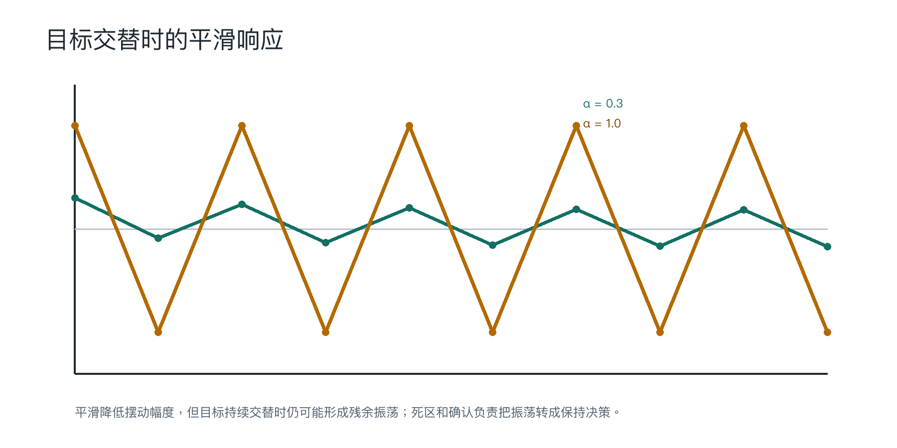

# 第 13 章 自适应控制

第 12 章交出“排得稳”的日计划：时段边界之内，方案固定。本章回答边界之内怎么应变——自适应控制根据近期交通状态调整周期、绿信比或方案，把理想方案变成“受控调整”，回答“稳住之后怎么应变”。每一步调整都发生在原方案、历史方案、理想方案和安全约束之间；让模型自由生成全新方案，等于丢掉现场基准和安全约束。

S2 的正常东直主阶段需要 30 秒绿灯。17:00，检测器因排队遮挡低估需求，算法降到 24 秒；排队继续增长，17:02 又把需求估计得很高，升到 36 秒；17:04，放行掉一部分车辆后，需求估计骤降，回到 24 秒。每个周期单看都“响应了当前状态”，设备却在相邻周期大幅摆动，驾驶员和协调路口承受不稳定的绿窗。

教训落在自适应控制的核心上：把输入区分成真实需求变化、估计噪声、执行延迟和控制惯性四类成分，分别处理；每周期都追着最新数字跑，只会让输入错误沿闭环越传越快——调整越快，错误传播越快；调整越慢，系统越难跟随真实变化。

本章的写法是“先讲控制上需要什么，再对照现有实现里实际有什么”。有些机制是通用设计，有些只在代码里以另一种形式存在，还有些根本没有实现；把设计意图当成系统行为，是自适应章节最容易犯的错误。

## 13.1 三类输入

一个单点自适应决策通常需要：

- 当前或原方案
- 上一周期或上一时段方案
- 当前需求对应的理想方案

原方案提供现场基准，上一方案提供控制惯性，理想方案提供需求导向。只看理想方案会让系统对噪声过度敏感；只看原方案则失去适应能力。

### 13.1.1 三个方案和一个观测

为避免术语混淆，本书明确区分：

具体见表 13-1。
表 13-1 三个方案和一个观测
| 对象 | 含义 | 是否可直接下发 |
|---|---|---:|
| 已发布基准方案 \(p_0\) | 当前调度审核过的方案 | 是，但要看设备状态 |
| 上一周期实际方案 \(p_{k-1}\) | 设备最近执行的方案 | 通常需要重新校验 |
| 理想方案 \(p^*\) | 当前估计需求下的可行最优候选 | 否，需要平滑和审核 |
| 自适应候选 \(p_k\) | 基准、历史与理想方案经过门控后的结果 | 校验后可下发 |

自适应算法需要知道设备实际执行的是哪个版本，而不是只读取数据库中最后保存的方案。人工控制后，数据库中的自动方案可能仍是最新版本，但设备状态已经切到手动。若算法继续基于 \(p_{k-1}\) 计算，平滑基准就错了。

## 13.2 15 分钟和周期级控制

WaySense 中同时存在分钟级或 15 分钟级方案调整和周期级自适应路径：

- 15 分钟自适应：根据近期流量计算理想周期和阶段绿信时间，再调整原方案。
- 周期级自适应：根据当前周期流态决定下一周期是否修改阶段序列或时间。

两者时间尺度不同。15 分钟决策不应直接逐秒控制设备；周期级决策也不能忽略上层时段的公共周期和协调要求。

### 13.2.1 决策时刻与输入窗口

设当前周期从 \(t_c\) 开始，周期为 \(C\)，决策需要在该周期结束前 \(L_{\mathrm{lead}}\) 秒完成。最晚决策时刻约为：

\[
t_{\mathrm{decision}}=t_c+C-L_{\mathrm{lead}}
\]

输入窗口只能包含在决策时刻之前已经到达的数据。若 15 分钟窗口要到 17:15:00 才关闭，但决策在 17:14:58 需要发送，系统不能使用完整 15 分钟窗口。它可以选择提前截断窗口、沿用上一窗口、增加预测，或把生效时间推迟到下一周期。

这个约束在代码中体现为：

```text
window_end <= decision_time
decision_time + encode_time < target_effective_time
target_effective_time < t_c + C
```

不满足时，算法应返回“数据或时间窗不足”，而不是用未来数据补当前周期。

### 13.2.2 现有实现里有哪几条自适应路径

WaySense 的自适应不是一个入口，而是三条互不相同的路径：

- **分钟级**：入口 `/lightflow/singlenodeadptive`（`apiserver.py`），实现 `MinuteSingleNodeAdaptive`（`minute_single_adaptive.py`），15 分钟一次，可调用。
- **周期级**：入口 `worker_main.py`，实现 `CycleSingleNodeAdaptive`（`cycle_single_adaptive.py`），每周期一次，可调用，含门槛、一致性确认和动量外推。
- **SDK/适配侧**：入口 `/lightflow/cycleadptive`（`apiserver.py`），实现 `SingleAdaptive.adaptive_single`（`althms/adaptive_single.py`），每周期一次，入口当前不可用，见 13.7.2。

三条路径的周期来源、候选方案集合和防抖方式都不同。讨论系统行为时需要指明是哪一条，不能笼统地说“系统的自适应会……”。把分钟级的规则套到周期级，或把 SDK 侧的设计当成线上行为，都会得出错误结论。

## 13.3 理想方案

理想方案由候选相序、关键流量比、周期模型和绿信比分配得到。它回答：

```text
如果不受历史方案惯性限制，当前需求最需要什么周期和绿灯分布？
```

但理想方案仍受最小绿、清空时间、设备范围和相序兼容约束。

### 13.3.1 理想方案也应当是完整方案

若算法只返回阶段比例 `{A:0.5,B:0.3,C:0.2}`，它还不是完整方案。系统还需要：

```text
cycle
green ratios
clearance intervals
stage order
min / max green
coordination requirements
plan version
```

理想比例与当前模板的纯绿总和不一致时，不能直接把比例乘到阶段总时长。正确步骤是先确定新周期，再扣除清空时间得到纯绿预算，再按比例做整数分配和最小绿修复。

一个常见的错误是：

```text
ideal cycle = 100 s
template total = 90 s
apply proportions to template -> still 90 s
```

代码没有报错，结果却并没有真正采用新周期。自适应响应看似运行，实际只是把旧周期内部的绿灯重新分配。接口和测试需要同时检查目标周期是否被应用。

## 13.4 平滑调整

`althms/adaptive_single.py` 的阶段时长分配确实使用 0.7/0.3 的加权：

```python
value = int(0.7*item[1] + 0.3*stage_flow_dict[key]
            * sum(stage_percent_org.values()) / sum(stage_flow_dict.values()))
```

但要注意两点。第一，这是**阶段时长**的加权，不是“周期平滑”；系数硬编码，不在配置里。第二，这个入口当前在到达该行之前就因未定义变量抛 `NameError`（13.7.2），所以它描述的是代码意图，不是线上行为。真正在跑的周期级路径（`cycle_single_adaptive.py`）不做这种比例混合，而是按三个周期的流量选方案，再用门槛和一致性确认决定是否切换。

这不是唯一策略。核心原理是限制单次调整幅度，使相邻方案保持连续性。

SignalLab 实现一般化函数：

```python
blended = blend_target_ratios(
    original_ratios,
    target_ratios,
    target_weight=0.3,
)
```

权重越大，响应越快；越小，稳定性和回差越强。

### 一个数值例子

原方案三个阶段的纯绿为 28、21、17 秒，总纯绿 66 秒。原比例为：

```text
A = 28/66 = 0.4242
B = 21/66 = 0.3182
C = 17/66 = 0.2576
```

理想比例为 `A=0.5`、`B=0.3`、`C=0.2`。使用目标权重 0.3：

```text
A = 0.7 * 0.4242 + 0.3 * 0.5 = 0.4470
B = 0.7 * 0.3182 + 0.3 * 0.3 = 0.3127
C = 0.7 * 0.2576 + 0.3 * 0.2 = 0.2403
```

重新分配 66 秒纯绿后，SignalLab 的整数化结果为 29、21、16 秒。百分比没有超出设备范围，但最终方案仍需重新构造清空时间和完整周期。

这个例子说明平滑系数没有绝对对错，它只决定系统在需求变化与方案稳定性之间移动多少。

### 13.4.1 平滑后的误差和稳定性

设原比例向量为 \(r_0\)，目标为 \(r^*\)，平滑目标为：

\[
r_k=(1-\alpha)r_0+\alpha r^*
\]

步长向量为：

\[
\Delta r_k=\alpha(r^*-r_0)
\]

\(\alpha=1\) 时一步到达目标，\(\alpha=0.3\) 时只移动目标差的 30%。如果目标在相邻周期来回跳动，输出仍会跟着跳动，只是幅度缩小。因此平滑只降低摆动，不保证稳定。还需要不感带、回差、冷却和连续确认（见图 13-1）。



### 13.4.1.1 单次混合与递归滤波

上面的式子固定从同一个原方案 \(r_0\) 混合，因此每次独立计算的结果只接近目标，不会在多个周期中继续累积移动。生产自适应也可能把上一周期实际方案作为下一次的起点，此时递推变为：

\[
r_k=(1-\alpha)r_{k-1}+\alpha r^*
\]

误差 \(e_k=r_k-r^*\) 满足：

\[
e_k=(1-\alpha)e_{k-1}
\]

所以：

\[
e_k=(1-\alpha)^k e_0
\]

当 \(0<\alpha<1\) 时，误差按指数衰减。达到初始误差 5% 所需周期数近似为：

\[
N_{95\%}=\left\lceil \ln 0.05 / \ln(1-\alpha) \right\rceil
\]

\(\alpha=0.3\) 时约 9 个周期，\(\alpha=0.5\) 时约 5 个周期。这个结果只描述目标固定时的平滑动态；若交通目标和检测噪声也在变化，实际响应会更复杂。

若目标在 \(r^*+A\) 与 \(r^*-A\) 之间每周期交替，递归一阶滤波器达到稳态后，输出摆动半幅为：

\[
Y=\frac{\alpha A}{2-\alpha}
\]

\(\alpha=0.3\) 时，输出幅度约为目标摆动的 17.6%；\(\alpha=1\) 时不再平滑，输出完全跟随交替目标。平滑降低了幅度，却没有消除振荡，也没有判断摆动是真实交通变化还是检测误差。

实现需要明确自己使用单次混合还是递归滤波。如果页面每次从“原方案”混合，而设备和调度链路又实际把上一个候选作为新父版本，两种语义叠加后，响应速度和可复现性都会与设计不符。

### 13.4.2 不感带与回差

设阶段 \(j\) 的新旧整数绿时差为 \(d_j=g_j'-g_j\)。只有在至少一个关键阶段满足：

\[
\max_j|d_j|\ge D_{\mathrm{change}}
\]

时才允许切换。\(D_{\mathrm{change}}\) 是不感带（deadband）：输入变化小于这个门槛时保持原方案，避免每个周期都因 1 秒舍入变化下发命令。

回差（hysteresis）可以给升级和降级使用不同门槛。例如：

```text
switch up when q >= up_threshold for 3 consecutive decisions
switch down when q <= down_threshold for 5 consecutive decisions
keep unchanged between thresholds
```

两个门槛之间形成回差区，避免需求在边界附近时反复切换。连续次数和使用同一个信号窗口还是不同窗口，也需要明确。

不感带和回差会把连续控制器变成带离散事件的混合系统。输出在门槛附近可能停留在两个状态之一，系统需要保存“当前是否在等待确认”“连续满足次数”“上次应用周期”等内部状态。只在一次请求函数里计算新旧差值，无法实现连续确认。

最小状态机可以写成：

```text
stable
  -> candidate (change >= deadband)
  -> stable (next sample falls back inside deadband)
  -> cool_down (confirmed change applied)
  -> stable (cooldown elapsed)
```

状态机还要定义缺失样本、设备离线、人工切换和周期编号重置。未定义事件不能默认清除计数器后继续应用。

### 13.4.3 现有实现里的三种近似机制

现有实现没有本章定义的连续确认状态机，但 `cycle_single_adaptive.py` 里有三种相近机制。

**一、相序切换门槛**。只有新方案节省的绿灯浪费超过阈值，才允许切换：

```python
threshold = max(1, num_overlap_differ) * basic_overlap_stage_min_green
if baseline_green_waste - best_green_waste >= threshold:
    return best_plan
return baseline_plan
```

**二、跨周期一致性确认**。当前周期和上一周期（或上两个周期）都指向同一个新相序，才真正切换：

```python
if best_N_plan.stage_phases == best_plan_1.stage_phases != cycle_N_plan.stage_phases:
    return best_N_plan
```

**三、流量动量外推**。用最小二乘拟合近期流量，按相关系数决定外推权重：

```python
beta_1 = max(0.5, abs(r_value))
part_1 = beta_1 * (slope * (len(y) + 1) + intercept)
part_2 = sum([(1 - beta_1) ** (len(y) - index + 1) * value
              for index, value in enumerate(y)])
return np.clip(round(part_1 + part_2), 0, 50)
```

这三种机制的效果类似不感带和确认，但语义不同：门槛比较的是“绿时浪费”，确认比较的是“相序字符串”，动量处理的是输入序列。它们都不保存“连续满足次数”和“冷却截止时间”这两个状态，因此不能宣称系统实现了本章 13.4.2 的状态机。

## 13.5 平滑之后的候选重新过全量约束

平滑后的比例还要换成整数秒，并重新检查：周期是否闭合、最小绿和最大绿是否满足、相序是否兼容、设备是否支持这些阶段。常见错误是只检查周期总和，忽略最小绿；SignalLab 的 `apply_green_proportions` 会重建完整方案并调用 `validate_plan`。

## 13.6 控制惯性

除比例权重外，还可以使用：

- 最小变化阈值
- 连续多个周期满足条件才切换
- 高峰和平峰的不同响应速度
- 锁定周期或绿信比一段时间
- 对方案切换设置冷却时间

这些机制减少摆动，但也会延迟响应。工程上需要在“及时”和“稳定”之间做可解释选择。

### 13.6.1 一个五周期防抖状态机

继续用 S2 的三个阶段，假设每周期理想 A 绿时为：

```text
cycle 1: 32
cycle 2: 33
cycle 3: 31
cycle 4: 36
cycle 5: 37
```

设置不感带 3 秒、连续 2 个周期确认、冷却 4 个周期：

具体见表 13-2。
表 13-2 一个五周期防抖状态机
| 周期 | 理想值 | 相对当前 30 | 状态 | 输出 |
|---|---:|---:|---|---:|
| 1 | 32 | +2 | 小于不感带 | 30 |
| 2 | 33 | +3 | 达到不感带，等待确认 | 30 |
| 3 | 31 | +1 | 确认中断 | 30 |
| 4 | 36 | +6 | 连续第一次满足 | 30 |
| 5 | 37 | +7 | 连续第二次满足 | 33 或平滑后的候选 |

若第 5 周期还在冷却期，输出仍可能是 30。冷却时间限制了短时间内再次改变，但也意味着需求持续增长时响应会延迟。运营配置需要知道这些取舍。

平滑和回差可以叠加：先平滑得到候选差值，再根据不感带和连续条件决定是否应用。若先应用门控、再平滑，决策次数和实际变化的关系会不同；实现中需要固定顺序并测试。

本节列的是设计选项，不是现状。现有实现里实际存在的只有 13.4.3 的三种机制；连续次数计数、冷却截止时间和锁定周期都没有对应实现。

## 13.7 自适应控制状态

系统应明确当前处于：

```text
fixed
adaptive
manual
offline
degraded
```

只有设备在线、控制模式允许、数据置信度足够、当前方案有效且通信正常时，自动调整才可执行。

### 13.7.1 自动控制失效时的保持逻辑

如果数据在周期中途变得不可用，系统通常应保持已下发方案直到一个新的合法候选产生，而不是立即生成全红或零周期。保持逻辑至少需要：

```text
last_effective_plan
last_effective_time
expiry_time
reason_held
next_retry_time
```

若保持时间超过设备本地控制的安全范围，应由设备或现场预设接管。云端不能假设网络中断后仍能每分钟更新设备状态。

恢复时先同步当前实际方案和阶段，再判断数据库中的候选是否仍基于同一父版本。断线期间人工调整过方案，旧的自动候选需要失效。

### 13.7.2 生产 `althms` 路径的阅读位置

`althms.adaptive_single.SingleAdaptive` 是三条路径里设计最完整、但当前不可用的一条。它把自适应拆成几个可检查步骤：

```text
flow_switch
  -> stage demand and saturation
cycle_opt
  -> bounded cycle candidate
pattern_selected
  -> same-sequence candidate filtering
split_opt_saturation
  -> compare maximum stage saturation
split_assign
  -> 0.7 original + 0.3 flow-based allocation
  -> minimum-green repair
```

读这段代码时，要区分配置默认值、候选搜索和最终修复。0.7/0.3 是这段代码里的硬编码权重，不是交通理论常数；分周期阈值来自 `althms/settings.json`，也不保证在所有城市都适用。生产路径还可能包含分钟级、周期级和协调级不同入口，不能把其中一个路径的平滑规则复制到另一个时间尺度。

这条路径目前还不是可用的线上实现：入口在候选池变量绑定处失败，不能把这里的 0.7/0.3 当成线上行为。它的价值在于把自适应拆成可检查的步骤，而不是提供一套可以直接照搬的实现。

### 13.7.3 自适应输出证据

每次调整应提供：

具体见表 13-3。
表 13-3 自适应输出证据
| 字段 | 用途 |
|---|---|
| `base_plan_version` | 从哪里开始调整 |
| `observed_plan_version` | 设备上一个周期实际执行什么 |
| `window_start/end` | 使用了哪些需求观测 |
| `confidence` | 关键输入是否足够 |
| `ideal_cycle` / `ideal_green` | 未平滑前的目标 |
| `blended_green` | 平滑后的中间结果 |
| `final_green` | 修复后的执行候选 |
| `change_reason` | 需求变化、回差、冷却或人工触发 |
| `rejected_candidates` | 哪些相序和约束不兼容 |

没有这些证据，“自适应”会变成一个无法解释、无法复现的黑箱。

## 13.8 本章实验

1. 使用原比例 `{A:0.5,B:0.3,C:0.2}` 和目标 `{A:0.7,B:0.2,C:0.1}`，把目标权重从 0.1 调到 1.0。
2. 把平滑结果转成整数绿灯，验证周期和最小绿。
3. 设计连续三个周期都超过阈值的切换规则。
4. 模拟输入置信度下降，阻止自动下发。
5. 用 `32,33,31,36,37` 这组理想绿时实现不感带和连续确认，比较启用和不启用回差的切换次数。
6. 让目标比例在 A 与 C 之间每周期交替，测试平滑权重 0.3 和 1.0 下的输出摆动幅度。
7. 构造一个模板周期 90 秒、理想周期 100 秒的请求，确认算法是否真的改变周期，而不只是改变内部绿时。

**生产代码对应关系（第 26 章 自适应入口与源码证据）**

- 13.7.2 的五步骨架在 26.4～26.7 有完整源码。
- `plan_pool`/`planpool` 的 `NameError` 在 26.7。
- `flow_switch` 搭接重复缩放在 26.5，`split_assign` 周期偏离在 26.6。
- 教学层跑通数值例子，生产层同名入口停在 `NameError`。

## 13.9 小结

第 12 章把 96 个窗口排成日计划，这一章回答边界之内怎么应变：理想方案给出方向，原方案提供惯性，安全约束划定可行范围；平滑、不感带、回差、冷却和连续确认抑制摆动，证据字段让调整可解释、可复现。这些机制都建立在完整方案校验之上——转回整数时间后，五项约束仍要逐项重验。

这套受控调整有一个隐含前提：输入可信、设备在线、方案合法、通信正常。前提垮掉时，再漂亮的候选也失去执行资格——S2 的 24/36 秒摆动提醒过，错误输入沿闭环传播，平滑系数挡不住。设备离线、数据过期、方案未校验、控制模式被人工切换时，自动化在哪里停下来、谁来接管，是第 14 章配时安全与故障降级的主题。


## 练习

1. 高平滑权重和低平滑权重各有什么风险？
2. 为什么周期级自适应仍需公共周期约束？
3. 设计一个“控制模式从自动切到人工”的降级流程。
4. 解释平滑后不重新校验最小绿会产生什么问题。
5. 平滑降低摆动幅度为什么不等于消除振荡？
6. 设计一个自适应控制器，要求在输入恢复后至少连续两个合法周期才能退出降级。
7. 说明为什么自适应算法应读取“设备实际执行方案”，而不仅是数据库最新方案。
8. 写出一个测试，验证冷却期内不会重复下发，但冷却结束后仍能继续响应。

