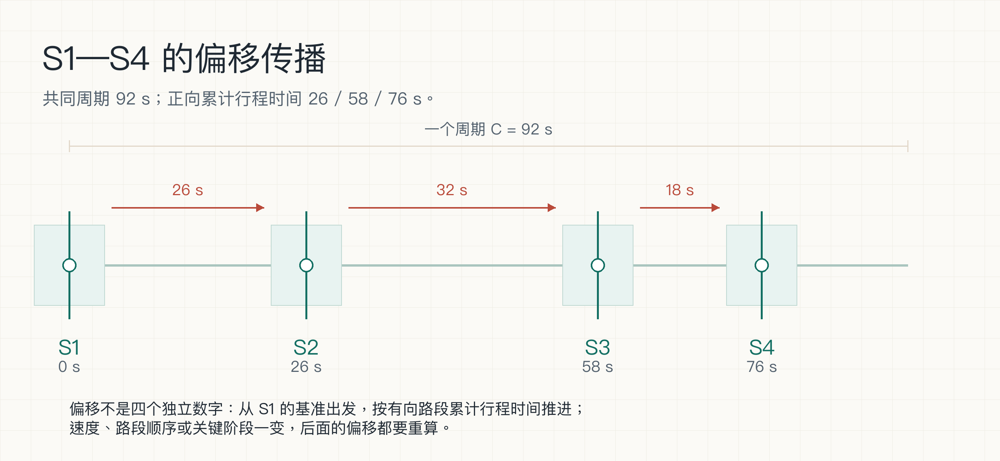

# 第 16 章 公共周期与相位差

第 15 章把“哪些路口放进同一个时间结构”圈成了可复核的边界，本章回答边界内的第一个共同决定。协调的本质是让车辆到达下游路口时遇到绿灯——理论行程时间决定基本偏移，公共周期决定偏移能否重复保持。

先看 S1-S4 的实际数字。四个单点在 36 km/h 协调速度下的自然周期分别约为 80、92、76、88 秒。若各路口继续按自己的周期运行，一个从 S1 出发的车队可能第一次在 S2 遇绿，下一次关系就发生漂移。

这个 92 秒并不陌生——15.4.2 里比例 ρ 的分母正是它。四个自然周期里它最大：S2 保持不动，S1 从 80 拉到 92，S3 从 76 拉到 92，S4 从 88 拉到 92，每个路口都要为统一节奏重新分配绿时。协调的第一步因此落在周期上：先决定是否接受共同周期、各路口为它牺牲多少，再轮到偏移。

## 16.1 公共周期

若路口周期不同，同一相对绿窗在每个周期都会改变。协调前通常需要把所有路口调整到：

- 相同公共周期
- 或公共周期与半周期的倍率关系

`common_cycle_s` 提供最小规则：

```python
cycle = common_cycle_s((80, 91, 76), even=True)
# 92
```

同一个输入，生产实现给出的是 90：它先取最大值 91，再执行 `(91 // 2) * 2` 向下取偶。教学实现向上取偶，生产实现向下取偶，差 2 秒，而且 91→90 已经压缩了 S2 的自然周期。

“取最大值保证不压缩”只对“取最大值”这一步成立，对“向下取偶”不成立。生产若坚持向下取偶，方案报告需要列出被压缩的路口和压缩量，不能把 90 当作“没有路口被压缩”的公共周期。

生产实现有两条互不调用的公共周期路径，16.1.3 会分别给出代码。不同路口原本的周期可能被增加或减少，因此需要重新检查阶段时间、最小绿和非协调方向饱和度。

### 16.1.1 取最大值之后还有五项检查

`common_cycle_s` 的最小实现取所有周期最大值，这是为了保证没有路口被压缩到低于其原有总周期。真实选择还要看：

- 最大自然周期是否超过设备或策略上限。
- 公共周期能否被半周期、倍周期或设备协调单位整除。
- 所有路口的清空时间和最小绿是否仍可满足。
- 调整后非协调方向是否进入长期过饱和。
- 相位差和设备显式周期字段的精度要求。

若 S2 的自然周期 92 秒已经接近容量，把 S1 从 80 拉到 92 秒会延长 S1 的等待；若公共周期改为 46 秒半周期，则需要证明设备协调语义真的支持半周期关系。不能把代码中“最大值加偶数”当成普遍规范。

设路口 \(i\) 在周期 \(C\) 下的最大阶段饱和度为 \(x_i(C)\)。公共周期需要满足：

\[
x_i(C)\le x_i^{\max},\qquad
C_{\min}\le C\le C_{\max}
\]

并满足周期与阶段时间的一致性。如果 92 秒下 S3 的支路饱和度为 1.02，就不能只因为它是最大自然周期就自动接受。可以继续寻找更合适的公共周期，或把 S3 从该协调组中分离。

### 16.1.2 周期变化的全局影响

周期改变会同时改变容量、清空时间占比和绿时分配。对一个阶段，在阶段总时长保持近似比例时：

\[
c_j(C)=S_j\frac{g_j(C)}{C}
\]

若 \(g_j(C)\) 增长慢于 \(C\)，容量反而下降。周期从 80 秒增加到 92 秒，阶段纯绿可能从 30 秒增加不到 30.75 秒，饱和度会变化。每次公共周期调整都应重新计算所有阶段，而不是只把总周期字段改成一个更大数字。

### 16.1.3 生产里有两套公共周期

书到这里需要说清一件事：WaySense 里的“公共周期”有两套互不调用的实现。它们对同一组路口可能给出不同周期。

数解法路径在 `green_wave/green_wave.py`：

```python
max_cycle = max([plan.cycle for plan in plans if plan])
max_cycle = (max_cycle // 2) * 2
...
if orig_cycle >= 2 / 3 * max_cycle:
    ...  # 分支体省略
```

规则是“取最大周期、向下取偶；高于 2/3 的路口抬到公共周期，低于 2/3 的压到半周期”。这条路径里，公共周期是先算出来的。

MaxBand 路径把公共周期写成决策变量（`maxband.py`）。下面是模型约束和代码的混合示意，不是可直接运行的 Python：

```text
z >= 1 / C_max
z <= 1 / C_min
...
cycle = round(1 / z)
if any(dc) and cycle % 2 != 0:
    cycle += 1
```

变量 `z` 就是 `1/C`。周期上下界先由用户配置和关键路口邻域取交（`maxband.py`）：

```python
C_min = max(C_min, critical_cycle + cycle_down)   # cycle_down = -5
C_max = min(C_max, critical_cycle + cycle_up)     # cycle_up = 20
```

再被 `C_min=80`、`C_max=220` 夹住。也就是说，实际窗口是 `[max(80, crit-5), min(220, crit+20)]`。

三条后果：

1. 同一条干道走数解法和走 MaxBand 可能得到不同公共周期，因为两套实现不共享结果。
2. 在 MaxBand 里，“公共周期”是输出而不是输入。把它当成输入去解释带宽结果，会把因果说反。
3. 目标函数是带宽比例最大化，不是带宽秒数最大化。周期只通过 `z` 与速度、绿窗约束改变可行域；把“比例乘周期”当成目标，会误以为周期越大越优。求解结果常落在 `C_max` 边界，但这需要看约束是否 active，不能当作数学必然。

如果现场要求“公共周期不得超过 150 秒”，这个限制需要进入 `C_max`；否则优化确实可能把周期推到配置允许的上限。报告应同时给出 `C_min`、`C_max`、求解器状态和约束是否真正卡住，而不是只写一个周期数字。

### 16.1.4 三种公共周期来源

如表 16-1 所示。
表 16-1 三种公共周期来源
| 来源 | 谁决定 | 优点 | 失效条件 |
|---|---|---|---|
| 人工指定 | 运营/设计人员 | 稳定、可解释、审批简单 | 需求变化后不再合适 |
| 数解法 | 最大周期 + 2/3 法则 | 简单、可复算 | 只看周期，不看带宽与方向 |
| LP 决策变量 | 优化器 | 与带宽目标一致 | 周期会贴上限，需要显式约束 |

16.1.3 已经说明前两种在现有实现里并存。第三种是 MaxBand 路径：周期不是输入，而是优化结果的一部分。

三者不能混着解释。看到“公共周期 150 秒”时，要问它是人工配的、数解法算的，还是 LP 在 `C_max` 约束下推出来的；三种来源对应三种责任，也对应三种失败方式。

## 16.2 理论行程时间

路段长度为 `d`，速度为 `v`，理论行程时间为：

```text
travel time = d / v
```

SignalLab 的 `CorridorSegment` 使用 km/h 输入并转换为 m/s：

```python
segment = CorridorSegment(
    from_site_id="A",
    to_site_id="B",
    length_m=180,
    speed_kmh=36,
)

segment.travel_time_s  # 18 seconds
```

## 16.3 相位差传播

如果关键路口绿灯开始时刻为 `o_A`，下游绿灯应在车队到达时开始：

```text
o_B = (o_A + travel_time) mod common_cycle
```

SignalLab：

```python
downstream_offset_s(30, segment, cycle_s=90)
# 48
```

`mod common_cycle` 保证偏移落在周期内。负偏移也应归一化到同一周期。

### 16.3.1 S1-S4 的累计偏移

使用 36 km/h、10 m/s 和三段长度：

具体见表 16-2。
表 16-2 S1-S4 的累计偏移
| 方向 | 路段 | 长度/m | 行程时间/s | 从 S1 累计时间/s |
|---|---|---:|---:|---:|
| 正向 | S1-S2 | 260 | 26 | 26 |
| 正向 | S2-S3 | 320 | 32 | 58 |
| 正向 | S3-S4 | 180 | 18 | 76 |

三段行程时间的累计关系见图 16-1。



若 S1 的关键阶段绿灯开始偏移为 0，理想正向偏移为：

```text
S1 = 0
S2 = 26
S3 = (26 + 32) mod 92 = 58
S4 = (58 + 18) mod 92 = 76
```

若 S1 的偏移改为 10 秒，下游变为 36、68、86 秒。偏移不是四个独立数字，而是由上游基准和累计行程时间传播得到。

反向使用有向速度和反向路段顺序。即使同一路段正反向速度都为 36 km/h，从 S4 到 S1 的累计时间仍是 76 秒；若道路方向速度不同，正反向时间需要分开计算。

### 16.3.2 模周期中的偏移组

在公共周期 \(C\) 下，所有偏移都属于整数模 \(C\) 的加法群。对正向路径，从基准路口 1 到路口 \(i\) 的偏移可以写成：

\[
o_i=\left(o_1+\sum_{e=1}^{i-1}t_e\right)\bmod C
\]

这里的“模”用于表示周期相位，不表示车辆行驶时间被缩短。若累计时间超过一个周期，车辆在一个周期后到达，仍对应相同的相对绿窗。

给所有路口同时增加相同偏移 \(k\)：

\[
o_i'=(o_i+k)\bmod C
\]

所有两两差值都保持不变，因此相对绿窗和带宽不变；所有偏移一起平移时，组内相对关系也不变。它不意味着修改全局偏移没有工程影响：实际绝对绿灯可能与其他系统、公交优先或跨子区边界一致；只是在本子区内部，所有路口一起平移不改变协调几何。

全局平移还可以用来让基准路口的绝对绿灯落在期望时刻，而不改变内部带宽。转换时需要把“相对协调结果”和“绝对设备方案”分开保存：前者描述组内关系，后者才能下发到设备。

### 16.3.3 速度误差如何变成偏移误差

行程时间 \(t=d/v\) 对速度变化敏感。若设计速度为 \(v_0\)，实际速度变为 \(v_0-\Delta v\)，行程时间的一次近似为：

\[
\Delta t\approx\frac{d}{v_0^2}\Delta v
\]

若速度使用 km/h，距离使用米，代码要先统一单位。更直观地说，固定距离下速度下降 10%，行程时间约增加 11.1%。S1-S2 的理论 26 秒可能变为约 28.9 秒，2.9 秒的差异或许小于绿灯窗，但跨过多个路段后会累积。

这就是偏移方案需要记录设计速度、允许速度范围和来源的原因。设备只保存一个相位差，无法说明它对应哪条速度曲线。

## 16.4 理论行程时间只提供起点

实际协调还需要考虑：

- 排队清空时间
- 相位在周期中的位置
- 绿闪和黄灯
- 左转保护
- 车辆速度分布
- 路口间停车和出入口

理论行程时间只提供起点。MaxBand 等算法会加入绿灯窗口、速度范围和清空约束。

### 16.4.1 有效偏移的三种修正

理论偏移至少还要经过三类修正：

1. **绿灯窗口修正**：绿窗不是无限长，偏移要使到达点落在绿灯中心或可接受区间。
2. **清空和启动修正**：下游绿灯开始前需要完成冲突方向清空，车辆到达时间也要考虑起动损失。
3. **排队修正**：上游路口排队可能延迟实际出发，路段出入口可能改变平均速度。

不能把 26 秒理论行程时间直接当成“设备偏移 26 秒就完美”。需要把偏移放到具体关键阶段的绿窗和周期零点上，再通过时空图复核。

## 16.5 协调阶段

偏移需要落在协调阶段的绿灯上。绝对相位差方案通常保存关键阶段、协调位置和高低周期偏移。

若方案把协调阶段从第二位移到第三位，原偏移不能直接复用。系统需要先找到新的关键阶段，再计算绿灯开始时刻。

## 16.5.1 单路段数值算例

设共同周期 `C=100` 秒，路段长度 200 米，协调速度 36 km/h，即 10 m/s。

```text
travel time = 200 / 10 = 20s
```

若上游绿灯开始偏移为 30 秒：

```text
offset_down = (30 + 20) mod 100 = 50s
```

因此下游绿灯开始晚 20 秒，而不是统一设置为 50 秒这一绝对值。改变上游偏移或速度，下游偏移随之改变。

若下游绿窗长度为 40 秒，上游绿窗长度也是 40 秒，且周期为 100 秒，把下游偏移设为 20 秒可以让正向轨迹完全覆盖 40 秒绿窗。多辆车的启动和排队会缩短有效窗口，因此实际车队可能只覆盖其中一部分。

### 16.5.2 偏移数字需要带定义

假设 S2 的关键阶段在当前方案中是第 2 阶段，绿灯从周期起点后 30 秒开始。平台保存了 `offset=26`，这个字段若表示关键阶段绿灯开始，则设备实际相位可能已经与理论基准错位；若表示周期起点偏移，则还要加上关键阶段在周期中的位置。

至少需要固定：

```text
cycle_zero_definition
key_stage_id
key_stage_green_start_in_cycle
offset_definition
positive_direction
```

只保存 `phaseOffset=26` 不够。不同厂商可能把偏移解释为周期起点、绿灯起点、绿灯结束或相对上游的相位差。接口字段名需要带语义，文档和测试也应证明符号方向。

## 16.6 双向协调

双向协调需要同时满足正反方向行程时间。道路间距和速度固定时，上下行绿窗可能冲突。

基本关系是：

```text
travel_forward + travel_reverse
  relative to cycle and green windows
```

当双向需求差异过大时，单向优先可能比强行双向绿波更合理。带宽权重是运营决策，不是道路几何自动得出的结果。

使用 SignalLab 的两路口、100 秒周期、20 秒行程时间和两个 40 秒绿窗，可以得到：

具体见表 16-3。
表 16-3 双向协调
| 下游偏移/s | 正向带宽/s | 反向带宽/s | 解释 |
|---:|---:|---:|---|
| 0 | 20 | 20 | 双向折中 |
| 10 | 30 | 10 | 正向优先 |
| 20 | 40 | 0 | 完全服务正向 |
| 80 | 0 | 40 | 完全服务反向 |

这张表解释了协调优化的本质：一个偏移同时改变两个方向的带宽，不可能让两个方向都无限增长。

### 16.6.1 带宽的区间表达

设上游绿窗 \(W_u=[a_u,a_u+G_u]\)，下游绿窗 \(W_d=[a_d,a_d+G_d]\)，同向行程时间为 \(t\)。车辆从上游出发的时间区间，要能同时落在上游绿窗并经过 \(t\) 秒到达下游绿窗。正向可通行出发区间是两者的循环交集：

\[
B_f=
\left|
W_u\cap\left(W_d-t\right)
\right|
\]

这里的长度按周期取模，跨周期边界的区间需要拆成两段再计算。反向同理，只是使用反向绿窗和反向行程时间。

在两路口、周期 100 秒、行程 20 秒、两个绿窗都为 40 秒的例子中：

- 下游偏移与上游相同，即 \(\Delta=0\)：正向出发区间最多覆盖 20 秒，反向也覆盖约 20 秒。
- \(\Delta=20\)：正向区间覆盖 40 秒，反向为 0。
- \(\Delta=10\)：正向约 30 秒，反向约 10 秒。
- \(\Delta=80\)：正向为 0，反向为 40 秒。

这说明带宽不是“绿窗越大越好”的单变量结果，偏移决定了同一容量在两个方向之间如何分配。

### 16.6.2 速度范围与宽容度

实际车辆速度不是单一值。设正向速度范围为 \([v_{\min},v_{\max}]\)，对应行程时间 \(t_{\max}\) 和 \(t_{\min}\)。若要求一个速度带内都能通过，出发区间需要满足更严格的交集：

\[
B_{f,\mathrm{speed}}=
\left|
W_u\cap\left(\bigcap_{t\in T}(W_d-t)\right)
\right|,
\qquad T=[t_{\min},t_{\max}]
\]

速度范围越宽，可保证的带宽越窄。运营要求“在 ±10% 速度范围内保持 20 秒带宽”与要求“固定设计速度 20 秒带宽”是两个不同问题。算法和验收报告需要说明使用哪一种。

### 16.6.3 中心绿窗和有效覆盖

若只要求一辆代表车辆通过，偏移只需让它进入绿窗。车队到达带有时间分布，工程上常希望把代表到达点放在绿窗内更稳健的位置。设上游出发分布的中心时刻为 \(m_u\)，下游绿窗为 \([s_d,s_d+G_d]\)，行程时间为 \(t\)，相对位置：

\[
\xi=\frac{(m_u+t-s_d)\bmod C}{G_d}
\]

\(\xi\) 接近 0 表示到达刚进入绿灯，接近 1 表示接近绿灯末端。\(\xi\) 本身不能决定好坏：上游车队晚到、下游排队和车辆速度分布都会改变风险。良好的验收应同时展示中心轨迹、速度上下界轨迹和可用带宽，而不是只写“偏移匹配行程时间”。

当两条轨迹分别贴着绿灯起点和终点时，中心轨迹可能仍落在绿窗内，但对出发波动很脆弱。工程上需要的不只是是否存在一条可行轨迹，还要有可接受的速度容差和出发容差。

## 16.7 偏移归一化

工程实现中需要统一：

- 以什么时间点为周期 0 点
- 偏移代表绿灯开始还是绿灯结束
- 偏移取绝对时间还是相对相邻路口
- 正方向是从上游到下游还是相反

一个约定不一致，就会让符号正确但传输方向错误的偏移进入设备。

### 16.7.1 从相对偏移到设备字段

设上游关键阶段绿灯开始为 \(g_1\)，下游关键阶段绿灯开始为 \(g_2\)，相对理论偏移为 \(t\)。若设备保存的是关键阶段绿灯开始的绝对偏移，可以使用：

\[
o_2=(o_1+t+\Delta_{\mathrm{stage}})\bmod C
\]

其中 \(\Delta_{\mathrm{stage}}\) 是下游关键阶段相对周期零点的位置修正。若设备保存的是绿灯结束偏移，则：

\[
o^{\mathrm{end}}=(o^{\mathrm{start}}+g_{\mathrm{green}})\bmod C
\]

转换函数应成对实现：

```python
def green_start_to_end(offset_start, green, cycle):
    return (offset_start + green) % cycle


def green_end_to_start(offset_end, green, cycle):
    return (offset_end - green) % cycle
```

测试需要覆盖负模、跨周期和 `green=cycle` 的极端情况。`green=cycle` 通常意味着没有其他阶段，不应被当作普通协调方案处理。

### 16.7.2 多路口偏移的版本一致性

一条走廊的偏移集合需要引用同一公共周期、同一关键阶段和同一拓扑版本。如果 S1 使用 90 秒周期、S2 使用 92 秒，单个偏移数字可能看起来合法，但相对关系无法稳定重复。若 S3 的关键阶段在 17:00 方案中改变，S2-S4 的偏移都需要重新计算或重新审核。

偏移方案可以通过以下最小记录校验：

```text
subarea_id
common_cycle_s
topology_version
key_site_id
key_stage_map
offset_definition
offset_version
plan_versions[]
```

其中 `plan_versions[]` 列出参与路口实际引用的方案版本。任一路口换版后，旧偏移集合只能作为历史记录，不能自动继续下发。

## 16.8 本章实验

1. 保持速度不变，把 180 米改为 360 米，观察行程时间。
2. 把 36 km/h 改为 18 km/h，观察偏移。
3. 让上游偏移 80 秒、行程 18 秒，验证 8 秒结果。
4. 交换正反方向速度，比较双向绿窗。
5. 对 S1-S4 以 0、26、58、76 秒偏移运行正向扫描，再以 76、58、26、0 累计时间运行反向扫描，记录两向带宽。
6. 把 S1-S4 的正向速度从 36 km/h 改为 30 km/h，重算三段行程时间和累计偏移。
7. 把偏移定义从绿灯开始改为绿灯结束，验证转换前后绿灯窗口完全一致。
8. 让一个路口使用 90 秒周期、其余使用 92 秒，检查验收器是否拒绝该协调组。
9. 证明所有偏移同时增加 \(k\) 不改变组内两两偏移，并说明绝对设备时间为何仍需重新生成。

## 16.9 小结

公共周期建立重复时间基准，理论行程时间建立基本偏移，关键阶段把偏移映射到信号方案。92 秒从四个自然周期的最大值中来，取偶方向造成的 2 秒差背后是两套互不调用的生产路径；26、58、76 秒的累计偏移全部能从有向路段数据复算；全局平移不改带宽，速度误差沿走廊累积，偏移数字离开定义就失去意义。相位差计算需要固定方向和单位约定。

到这里，偏移仍是逐段手算的产物。真实走廊要同时照顾正反两个方向、一段速度范围和每个路口的绿窗位置，手算很快就不够用了。第 17 章把偏移扩展成 MaxBand 优化；本章 16.6 那张偏移—带宽表，就是它要优化的对象。

## 练习

1. 为什么协调需要检查公共周期？
2. 理论行程时间的偏移还需要哪些现场修正？
3. 正反方向偏移冲突时可以采用哪些策略？
4. 说明“绿灯开始偏移”和“绿灯结束偏移”互换时的转换关系。
5. 为什么公共周期取最大值之后仍可能出现支路过饱和？
6. 对 S1-S4 推导从 S4 到 S1 的累计反向行程时间，并说明正反向速度不同时如何修改。
7. 写出一个循环区间交集函数，要求正确处理跨越周期边界的绿窗。
8. 说明带宽、周期和路段行程时间之间的量纲关系，为什么不能直接把米数和秒数相加。

