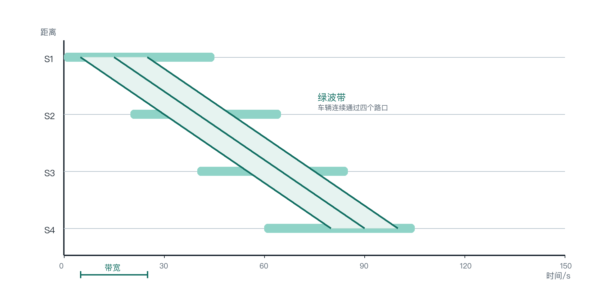

# 第 18 章 时空图与协调方案验收

第 17 章的 MaxBand 在比例空间里交出一组漂亮的数字：偏移、带宽、求解状态。带宽比例 0.2 乘上 92 秒周期，报告里写下 18 秒——数字本身无可挑剔，路口上是否真有一条连续绿波，报告证明不了。协调方案最终要回到可观察的时间—空间关系。

时空图把时间放在横轴、路口空间位置或距离放在纵轴，用于检查车辆沿干线通过的绿窗是否连续；它不仅用于展示，也能作为约束校验和方案验收工具。

一张好看的时空图可能隐藏错误。四个路口的绿灯都画在图上，车辆轨迹却只在 S1-S2 连续，到 S3 已经落红——只要色带被错误地按平均速度连接，图上仍可能出现看似完整的色带。验收必须落到每一条轨迹在每个路口的相位索引上，只画两条斜线远远不够。

这一章把图变成可执行证据：给定时空坐标、相位差和绿灯窗口，程序能判断某条轨迹是否连续通过；改变一个偏移，程序输出哪些出发时刻失效；扫描结果跨周期边界时既不漏掉也不重复。这就是路线图说的“第 18 章用时空图验证结果”。

## 18.1 读图方法

在单向平面中：

```text
time ->
distance
  |
```

每个路口在周期内有一段绿灯状态。车辆轨迹的速度斜率决定它何时到达下一个路口。

绿波带是能在所有协调路口保持通行的轨迹集合。带宽越宽，车辆对速度和出发时间的容忍度越大。

设空间位置为 \(d\)，设计速度为 \(v\)，从基准出发时刻 \(t_0\) 出发的轨迹为：

\[
t(d)=t_0+\frac{d}{v}
\]

在图中，速度是轨迹斜率的倒数，空间距离是纵轴。不同速度对应不同斜率。只有一条轨迹表示理想车辆，不表示车辆都能通过。一个 20 秒带宽意味着出发时间在 20 秒范围内的车队可以沿该设计速度连续通过，而不是“有 20 秒绿灯”。

若图中相邻路口的绿窗在时间上相接，但车辆行程时间使到达点落在窗口之外，图上看似相邻的颜色块仍然不能组成绿波（见图 18-1）。



## 18.2 从方案构造扫描对象

`/gettimespace` 的输入包含：

- `RoadList`：上下游节点、长度、正反协调速度
- `CrossList`：路口、周期、相位差、关键阶段和阶段列表

系统先找到协调阶段绿灯，再将每个路口的状态展开到周期时间轴。

## 18.3 逐秒扫描

WaySense 的 `GreenWaveBand` 在一个最大周期内逐个时间点检查：

1. 从基准时刻出发。
2. 按路段距离和速度累积到达时间。
3. 判断该时刻各路口是否在绿灯内。
4. 收集连续通过的时间段。

正向输出 `BandUp`，反向输出 `BandDown`。

逐秒扫描透明、易验证，适合展示和中小规模问题。更复杂的协调优化可以直接求解带宽，但最终仍可用扫描复核。

### 扫描算法

```text
for departure_time in one_cycle:
    current_time = departure_time
    for each intersection in corridor order:
        current_time += travel_time_to_this_intersection
        if current_time is outside intersection green:
            break
    if all intersections green:
        mark departure_time as passing
collect consecutive passing intervals
```

反向扫描使用反方向速度和相反路口顺序。不要把正向结果简单反转，除非道路速度和时间基准完全对称。

### 18.3.1 扫描的时间索引

逐秒扫描把周期离散为 \(0,\ldots,C-1\) 秒。对第 \(k\) 个出发时刻，计算：

\[
\tau_i(k)=\left(k+t_i-\phi_i\right)\bmod C
\]

其中 \(t_i\) 是从基准点到第 \(i\) 个路口的累计行程时间，\(\phi_i\) 是绿灯开始偏移。只有对全部 \(i\)：

\[
0\le\tau_i(k)<G_i
\]

才认为出发时刻 \(k\) 能连续通过。这里的 \(C\) 是公共周期，\(\phi_i\) 的零点与 \(t_i\) 的基准必须一致。

连续通过集合可能跨过 \(C-1\) 到 0 的边界。例如 \(k=88,89,90\) 和 \(k=0,1\) 可能属于同一条环状带。若扫描后只检查一次线性数组，会把跨边界带拆成两个短片段，低估带宽。

### 18.3.2 从逐点扫描到区间事件

逐秒扫描容易理解，却不是唯一算法。对每个路口，允许的出发时刻满足：

\[
(k+t_i-\phi_i)\bmod C<G_i
\]

把不等式反解，得到一个循环出发区间：

\[
k\in
\left[\phi_i-t_i,\;\phi_i-t_i+G_i\right)_C
\]

也就是说，每个路口对“哪些出发秒能够通过”给出一个区间。整条走廊的通过集合是所有区间的交集。

把每个循环区间拆成最多两个普通区间，再为起点增加覆盖计数 1、终点减少 1。按事件位置排序后扫描，计数等于路口数 \(N\) 的每个线性段都属于公共通过集合。若零秒附近和周期末尾附近都有公共段，它们需要合并成同一条循环带。复杂度从 \(O(CN)\) 降为 \(O(N\log N)\)。

SignalLab 同时保留两个函数：

```python
green_band_width_s(...)         # 逐秒扫描，适合教学和调试
green_band_width_sweep_s(...)   # 区间事件，适合较快验收
```

测试用普通区间、跨界区间、小数行程时间和错误偏移比较两者结果。双实现的意义不是重复代码，而是用不同推理路径交叉验证同一边界。若优化器改变，扫描器和事件器仍提供独立判据。

### 18.3.3 优化解回到扫描器复核

逐秒扫描的复杂度约为 \(O(C\times N)\)，其中 \(N\) 是路口数。对于 100 秒周期和 4 个路口，只需要 400 次判断，适合验收和暴力枚举。对于大规模子区、速度连续变量和多时段问题，直接枚举每个整数秒可能不够，需要线性规划或混合整数模型。

优化的结果仍应回到扫描器复核。MaxBand 可能输出一个理想偏移和一个带宽，但设备阶段和显式周期取整后，实际可实现带宽可能变小。把优化解、取整解和设备执行解分开验证，可以避免把模型理想值当作现场效果。

### 18.3.4 时间分辨率与验收边界

逐秒扫描隐含一个设备分辨率假设：偏移和绿灯至少按 1 秒执行。如果设备只接受 5 秒步长，1 秒扫描得到的 23 秒带宽可能无法在设备上原样实现。验收应使用设备可执行的步长重新扫描，或明确区分“连续模型值”和“设备可实现值”。

设候选出发时刻集合为 \(D_{\mathrm{pass}}\)。带宽不是集合元素总数，而是其中最长的环状连续区间长度：

\[
B=\max\left\{
b-a:
[a,b)\subseteq D_{\mathrm{pass}}
\text{ 在循环时间轴上连续}
\right\}
\]

因此同一个方案可能有很多可行出发秒，却没有较长连续带。例如车辆每隔 10 秒刚好遇到绿窗，但中间的出发时刻失败，平均通过数不低，绿波带仍可能很窄。图形展示和自动验收都必须关注连续性。

扫描步长 \(\Delta\) 改变后，结果不是简单的除法。绿灯起点、偏移和行程时间在上升沿附近会产生不同的离散步长误差。凡是改变步长、取整方式或周期归一化方式，都应重新扫描，并用边界测试验证。

绿色窗口扩大不会让已通过的出发时刻消失，因此在固定偏移、速度和离散步长下，带宽对绿窗长度单调不减。偏移变化没有这种单调性：它可以把带的一部分移到另一段循环区间，也可能因取整使相邻通过秒断开。优化搜索不能只依赖“偏移每增加 1 秒效果平滑”的直觉。

### 18.3.5 生产时空扫描的离散边界

生产 `pretreatment.service.green_wave_band.CrossInfoTwoway.is_timepoint_in_green` 使用：

```python
timepoint = (timepoint - self._offset) % self._cycle
return timepoint <= self._green_light_time
```

若绿灯时长为 40 秒，局部时刻 40 也返回真，得到 41 个边界秒。解析器返回的带又是闭区间 `[first,last]`。教学实现使用左闭右开区间，生产扫描使用闭边界，二者不能直接比较。第 27 章给出完整生产函数和前端口令修正方案。

同一入口在 `Plan` 解析异常时会构造内置三路口示例继续计算。请求格式错误因此可能得到一个正常外观的时距图。生产验收必须区分响应来自请求方案还是 fallback 示例。

### 18.3.6 三种扫描实现

如表 18-1 所示。
表 18-1 三种扫描实现
| 实现 | 做法 | 优点 | 失效条件 |
|---|---|---|---|
| 逐秒扫描 | 每个整数秒判断是否能连续通过 | 简单、与设备秒级执行一致 | 周期长、路口多时计算量上升 |
| 区间事件 | 把绿窗和行程时间转成区间，求交集 | 快、可解释边界 | 实现复杂，边界闭合容易写错 |
| 解析计算 | 直接由绿窗和行程时间求带宽 | 最快 | 只适用于结构简单的场景，难以处理搭接和取整 |

18.3.2 已经给出逐秒与区间两种实现的交叉验证。验收时不要把“两种算法结果相同”当成绝对证明：它们可能共享同一个错误假设，例如都忽略相位差取整误差。

## 18.4 环绕周期

时间在周期中循环。绿窗可能跨越周期边界：

```text
cycle end
| green start
|          green end
|__________|
```

判断时必须先取模。直接比较未归一化的时间点，会把跨越边界的合法绿窗误判为红灯。

### 18.4.1 循环区间的实现难点

一个跨越周期的绿窗可以从 \(a\) 到 \(C\)，再从 \(0\) 到 \(b\)。对每个轨迹时刻 \(\tau\)，判断是否在绿窗内可以使用：

```python
def in_circular_interval(value, start, end, cycle):
    value %= cycle
    start %= cycle
    end %= cycle
    if start < end:
        return start <= value < end
    return value >= start or value < end
```

这个函数采用左闭右开区间。若设备把终点也定义为绿，必须统一加一或改变边界约定。不同阶段连续相邻时，恰好在边界的秒数应该属于哪个阶段必须明确，否则统计会重复。

周期扫描至少测试三种情况：普通不跨界窗口、跨界窗口和窗口长度为整个周期。只测试 `[0,40)` 无法发现跨周期错误。

## 18.5 带宽与平均速度

时空图上的车辆轨迹不是单一斜率。实际速度有分布，因此带宽要能容忍一定速度变化。

MaxBand 可以在速度上下限内选择轨迹，适合优化。固定速度扫描适合验收，因为运营人员需要看到设计速度下的结果。

### 18.5.1 速度敏感性

对每个速度 \(v\)，可以计算一条轨迹对应的带宽。若只报告最优速度下的带宽，运营人员会误以为整个速度范围都同样顺畅。应同时报告：

```text
design_speed_band
min_speed_band
max_speed_band
speed_range_used
```

一个方案可能在设计速度下带宽 30 秒、在 ±10% 速度范围内降到 8 秒。这不是算法错误，而是方案对速度波动很敏感。验收要求需要明确是指设计速度还是整个速度带。

速度不确定性还来自排队和出入口。图中直线假设车辆匀速、无停车；实际轨迹可能在路段中分段加速或停靠。时空图适合验证信号时间结构，不能替代微观仿真的所有车辆行为。

## 18.6 验收内容

协调方案验收至少包括：

- 公共周期一致
- 各路口偏移合法
- 关键阶段存在
- 正反方向绿窗可解释
- 带宽满足最低运营要求
- 非协调方向满足最小绿
- 设备阶段编号与方案一致

带宽为正不代表方案可以下发。安全与设备约束仍然优先。

### 18.6.1 S1-S4 的可复现算例

沿用公共周期 92 秒、各路口关键阶段绿灯 40 秒、偏移 `0,26,58,76`，累计行程时间 `0,26,58,76`：

```python
width = green_band_width_s(
    cycle_s=92,
    offsets_s=(0, 26, 58, 76),
    travel_times_s=(0, 26, 58, 76),
    green_duration_s=(40, 40, 40, 40),
)
```

结果为 40 秒。每个从 S1 绿灯起点后的出发时刻，到达 S4 时都仍在对应绿灯窗口内。正向完整覆盖 40 秒。

如果把 S2 的偏移从 26 秒改为 50 秒，其他不变，正向带宽降为 16 秒。原因是 S2 的绿窗与到达轨迹错开了 24 秒，车辆在 S2 处损失了一段可用出发时间。这个改变表明：一个局部偏移错误会压缩整条走廊的有效带。

若用同一组绝对偏移反向扫描，并要求 S4→S3→S2→S1 全部连续，反向带宽可能为 0。双向都重要时，需要为两个方向重新选择偏移和可能不同的绿窗，不能把单向上行最优方案直接复制为双向方案。

### 18.6.2 带宽的正负和单位

带宽单位是秒，不能写成 veh/h。每秒出发车辆数还需要乘以到达流率才能换算成流量；而带宽与饱和流率、车辆间距和车队密度共同决定可服务车辆数。带宽从 40 秒降到 16 秒意味着出发时间容忍度下降，不一定意味着通行能力按同样比例下降。

带宽也可能为零。零表示在当前扫描模型中没有连续通过的出发时刻，不表示车辆都停在同一个位置。它可能是偏移完全错位，也可能是扫描基准、方向或绿窗单位设置错误。验收报告应把零带与输入异常区分开。

为了避免单一数字误导，验收结果至少同时保存 `cycle_s`、`offsets_s`、`travel_times_s`、`green_duration_s`、`band_s` 和每个通过时刻对应的阶段。只保存 CSV 图形或截图，无法在下一版方案中复现。

### 人工数值算例

两个路口周期都是 100 秒，绿灯 40 秒。车辆从第一个路口到第二个路口需要 20 秒。

当下游相位差为 20 秒时，正向车队可以完整通过 40 秒绿波。反向车队则与绿灯错开，带宽接近零。把下游偏移改为 0 秒，双向带宽约为各 20 秒。

这个结果说明：

- “通过全部路口”比“每个路口都有绿灯”要求更强。
- 单向带宽最大化可能直接牺牲反向。
- 时空图是验收协调策略的直观证据。

## 18.7 本章实验

1. 用两个路口、100 米路段和 36 km/h 速度构造时空带。
2. 改变第二个路口偏移 5 秒，观察带宽变化。
3. 让路段更长或速度更低，观察轨迹斜率。
4. 检查跨越周期边界的绿窗，确保扫描结果不丢带。

运行 `signal-lab/examples/experiment_coordination.py`，改变下游偏移并记录正向带宽。再加入反向扫描，验证表中的双向权衡。

再做 S1-S4 实验：

1. 固定各路口 40 秒绿窗，使用偏移 `(0,26,58,76)`，记录正向带宽。
2. 仅把 S2 偏移改为 50，记录带宽减少量。
3. 把 S3 的绿灯从 40 秒改为 30 秒，观察带宽受哪个瓶颈限制。
4. 对 `(0,26,58,76)` 和 `(0,50,58,76)` 分别输出每个出发时刻的失败路口索引，写成表。
5. 构造一个绿窗从 88 秒跨到 8 秒的例子，验证扫描不会把连续带拆错。
6. 用速度 30、36、45 km/h 三组行程时间扫描，比较设计速度带和速度范围带。
7. 对同一组输入分别调用逐秒扫描和事件扫描，检查结果完全一致；再构造一个首尾相连的循环带，确认事件扫描会把两端合并。
8. 把扫描步长从 1 秒改为 5 秒，设计新的循环索引器，并比较同一方案的模型带宽与设备可实现带宽。

## 18.8 小结

时空图把公共周期、行程时间、相位差和绿窗放在同一个几何框架中，既能解释算法，也能验证算法输出。第 17 章的 MaxBand 在比例空间里选择偏移和带宽，本章的扫描器把这些数字放回时间—空间平面逐秒检验：跨周期边界的绿窗先取模再判断，跨零点的连续带要合并计数，零带宽与输入异常分开报告，模型值、取整值和设备可实现值分开验证。

到这里，第四部分的协调链条完整闭合：子区圈定协调边界（第 15 章），公共周期与相位差定下时间基准（第 16 章），MaxBand 在约束中搜索双向方案（第 17 章），时空图交出验收证据（本章）。方案过了验收，接下来的问题是谁把它送到路口——第五部分从第 19 章的 Java 编排与 Python 算法服务边界开始，回答“平台如何把方案变成命令”。

**生产映射（第 27 章 生产区域协调：子区、MaxBand 与时空图）**

- 27.4 的 `pretreatment/service/green_wave_band.py` 用 `calc_green_wave_band_two_way` 在一个最大周期内按距离/速度累计旅行时间。
- `CrossInfoTwoway.is_timepoint_in_green` 以 `(timepoint - offset) % cycle <= green_light_time` 做闭边界判断，40 秒绿灯给出 41 个边界秒（18.3.5）。
- 生产层区间输出 `[first, last]` 为闭区间，首尾环绕段不合并、返回两个区间；教学层左闭右开并合并跨界带。
- `/gettimespace` 入口在 Plan 解析异常时构造内置三路口示例继续扫描（18.3.5）。

## 练习

1. 为什么逐秒扫描适合验收但不一定适合大规模优化？
2. 速度分布如何影响带宽的实际含义？
3. 设计一个自动验收规则，检查 `BandUp` 与 `BandDown`。
4. 说明带宽正数之外还必须检查哪些约束。
5. 推导轨迹公式 \(t(d)=t_0+d/v\)，并解释为什么速度越高斜率越小。
6. 为什么带宽零不能直接证明所有车辆拥堵？
7. 写出一个循环数组的连续带展开算法，要求正确处理从周期末尾到开头的片段。
8. 设计一个协调验收器，输出公共周期、偏移、正反向带宽、瓶颈路口和失败原因。
