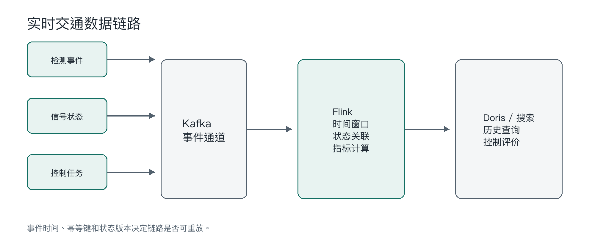

# 第 20 章 Kafka、Flink 与实时数据链路

第 19 章的请求—响应链路解决“一次计算”的来路与回处；平台的另一半在事件流里——方案下发之后，路口的每一次状态变化、每一辆车的过车记录，都在持续涌入。交通控制系统中的状态不断变化：车辆检测、信号阶段、控制模式、周期和下发任务。Kafka 提供事件通道，Flink 负责持续关联和计算，Doris 或搜索系统提供查询和长期保存。本章讨论事件语义、时间顺序和状态一致性，组件安装从简。

阅读本章前，手边应有第 8 章 8.7 节“一致性确认键”的约定，未读请先回看约 2 页——本章的排序键、去重键都要与它一致。

Kafka 与 Flink 的组件语义分别参考 [16] 和 [17]（见图 20-1）。



一个典型故障足以显示链路语义的重要性。S4 在 17:00:10 上报阶段 B，网络延迟使消息 17:02:40 才被 Flink 消费；同一路口 17:00:20 的新状态已经先到。若消费者按到达顺序覆盖，最终状态会回到更旧的 17:00:10——第 14 章 S4 掉线时，是降级状态机在守着这个路口；现在 S4 恢复了上报，守着它的换成了事件时间。更大的问题是，使用处理时间窗口时，这条迟到事件会被算到 17:02 的指标，而不是它实际发生的 17:00。

Kafka 解决“消息如何传输”的问题，Flink 的状态和事件时间语义解决“消息如何在时间上被解释”的问题。系统设计需要明确这两层各自的保证，不能把组件自动提供的能力当成业务正确性。

## 20.1 事件语义优先于表语义

消息队列中的一条车辆数据是某个时刻发生的事件。信号阶段、控制模式和周期消息也一样。

消费者需要根据事件时间构造状态。它们不能假设消息总按发送顺序到达。

WaySense 的集成服务为实时控制模式、周期、阶段和交通流定义了不同 topic。不同类型事件的频率、体积和语义不同，因此需要独立处理。

### 20.1.1 事件最小契约

进入实时链路的事件，需要明确：

```text
event_id
event_type
site_id
device_id
event_time
ingested_at
source
source_version
payload_schema_version
sequence
payload
```

`event_id` 用于幂等，`event_time` 用于窗口和状态顺序，`ingested_at` 用于延迟监控，`sequence` 在设备时间粒度过粗时补充顺序。`source_version` 用于区分厂商适配器版本，避免新解析规则错误解释历史事件。

若同一 topic 混放阶段、周期和控制模式事件，消费者需要按 `event_type` 分支，并确认未知类型不会落入默认的成功状态。未知类型应进入隔离区或告警，而不是被静默忽略。

### 20.1.2 Topic 与业务边界

Topic 划分可以按事件类型，也可以按区域或租户。划分过细会增加关联复杂度，划分过粗会让互不相关的流量互相影响。一个可维护的设计至少保证：

- 高吞吐车辆事件与控制状态事件不共享同一个小分区容量。
- 同一路口的顺序相关事件有稳定分区键。
- 数据类型有可识别的 schema 和版本。
- 生产、测试和回放数据不写入同一生产 topic。

Topic 名不是契约，事件 schema 才是。重命名 topic 应通过配置和迁移完成，不能让消费者根据名称猜测字段语义。

## 20.2 实时阶段

阶段事件通常包含：

- 路口和设备
- 周期开始和结束
- 当前阶段开始和结束
- 当前已走时间
- 方案编号
- 控制模式和来源
- 阶段列表

阶段状态需要与信号方案关联，才能把阶段 ID 映射到车道、流向和饱和度。

### 20.2.1 阶段事件只是瞬时切片

一条阶段事件可能只表示“当前阶段为 B，开始于 17:00:10”。它不一定告诉你 A 何时结束、B 的完整时长或是否跨周期。Flink 计算阶段级指标时，需要借助信号方案或相邻事件构造时间区间。

若设备在阶段 B 中重复上报状态，消费者不能每次都创建新的 B 阶段记录。应使用 `(site_id, cycle_start, stage_id, stage_start)` 或设备提供的稳定阶段 ID 去重。

阶段状态与路口状态的粒度也不同。一个周期内当前阶段持续变化，周期事件可能在周期开始时只发送一次。把两类事件放在同一最新值缓存里，会让周期信息被阶段事件覆盖。应分别保存：

```text
latest_cycle_state
latest_stage_state
latest_mode_state
latest_vehicle_flow
```

它们的关联键和时间窗口不同，不能用一个 `last_message` 代表整个路口。

### 20.2.2 当前 Flink 聚合的真实语义

生产 `AutomobileAggregationFunction.add` 只在 `real_flag == null` 或 `real_flag == 1` 时把过车数加一。`real_flag == 0` 的模拟或调整数据不进入原始车道流量。

1 分钟车道作业按 `(bind_id, lane_id, camera_serial)` 分区，使用 `exit_time` 作为事件时间，并用 `forBoundedOutOfOrderness` 和 `withIdleness` 推进水位线。窗口关闭后，如果 Python 补全开关开启且流量为 0 或超过上限，`AutomobileLaneProcessWindowFunction` 会调用 `getLaneFlowFill`。补全失败时，原代码会把 `-1` 改成 0、把超限值截成配置上限后继续输出。

这意味着 `flow=0` 至少有三种来源：

```text
真实零过车
补全失败后的安全占位
超限调整后的截断值
```

只检查数值无法区分，需要同时查看 `sourceFlow`、`adjustFlow`、`adjust_cost_time`、`traceId` 和补全开关。第 25 章给出完整窗口方法。

## 20.3 Broadcast state

WaySense 的 Flink 启动代码为新状态和信号方案广播流建立状态描述。广播状态适合保存变化频率较低、需要被所有事件处理器共同使用的维度：

- 路口静态信息
- 车道与流向映射
- 阶段与车道关系
- 当前信号方案

检测事件与广播状态关联后，才能计算车道级、方向级和阶段级指标。

### 20.3.1 广播更新与数据事件的时间关系

广播状态不是“自动最新”的魔法。若一个 10:00 的车辆事件在 10:15 才处理，而广播中的方案在 10:05 更新，直接使用当前广播状态会把 10:00 事件关联到 10:05 的新阶段映射。

严格的事件时间关联需要保存方案和拓扑版本的有效期：

```text
effective_from
effective_to
topology_version
plan_version
```

对于严格历史重算，可以根据事件时间查询对应版本；对于实时监控，可以只使用当前广播，但需要标记“版本可能与事件时间不一致”。在没有历史版本的情况下，系统不能声称完全可复现的事件时间关联。

广播状态还应支持版本切换缓冲。新方案从 17:00 生效，但设备可能直到 17:00:20 才切换到新周期。若 17:00:05 的旧周期事件被新方案阶段映射解释，阶段 ID 可能不存在或含义改变。切换窗口内的关联要么使用设备实际方案 ID，要么标记未知。

## 20.4 事件时间

事件时间处理需要：

- 从事件中读取采集时间
- 定义窗口和水位线
- 处理迟到事件
- 区分处理时间与采集时间

如果只用服务器处理时间，网络重传或积压会把历史状态写入当前窗口。

### 20.4.1 水位线和窗口关闭

设事件时间为 \(t\)，允许迟到时间为 \(L\)。Flink 水位线 \(W\) 可以理解为“系统认为事件时间已经推进到 \(W\)”的进度声明；窗口 \([a,b)\) 在 \(W\ge b+L\) 时关闭（20.4.3 给出同一条件）。20.4.1 里的“\(W-L\)”描述的是迟到容忍边界，不是另一个水位线定义。窗口关闭不表示现实世界不再产生旧事件，而是系统选择在某个时刻结束等待。

一个 5 分钟窗口 \([10:00,10:05)\) 在 10:10 收到 10:04 的事件，若水位线已超过窗口结束加允许迟到时间，该事件可能被丢弃或进入侧输出。系统需要记录：

```text
window_start
window_end
watermark
allowed_lateness
late_event_count
recomputed_window
```

`late_event_count` 是判断数据质量的重要线索。若某路口的阶段指标大量来自关闭后回填，展示时应标记重算版本。

水位线不是设备时钟，也不是处理时间。设备时钟漂移会让事件时间整体偏移；网络积压会让水位线推进缓慢；上游分区没有数据会让水位线停滞。监控面板需要分别展示处理延迟、事件延迟和事件时间进度。

### 乱序状态示例

假设设备状态事件到达顺序为：

```text
cycle-12 (event time 10:02:10)
cycle-10 (event time 10:00:10)
cycle-11 (event time 10:01:10)
```

按到达顺序覆盖会先更新到 12，再错误回退到 10，最后回到 11。正确策略是比较同一路口的设备时间或单调版本，只允许更新状态前进。

水位线只能帮助窗口计算，不能自动解决业务状态的“最新版本”问题。

### 20.4.2 排序键与状态版本

对同一路口的控制状态，排序键可以是：

\[
k_{\mathrm{state}}=(\mathrm{site},\mathrm{device},t_e,s)
\]

其中 \(t_e\) 是事件时间，\(s\) 是设备或适配器序列。只有新键严格大于已存键时才覆盖；相同键且内容不同应记录冲突。

这条规则解决的是状态回退，不解决指标关联。车辆事件和阶段事件的排序键不同，二者不能互相覆盖。实时指标应按事件时间窗口聚合，再与当时的阶段窗口相交。

若同一路口的消息被分成不同 Kafka 分区，状态更新不能保证按事件时间到达消费者。可以使用稳定路口键保证顺序，或在状态表中使用条件更新：

```sql
UPDATE signal_state
SET payload = :payload, event_time = :event_time
WHERE site_id = :site_id
  AND event_time < :event_time;
```

条件更新失败时表示已有更新状态，应记录这次消息被拒绝，不能把数据库无变化当作消息处理成功。

### 20.4.3 水位线、窗口完成和结果确定性

水位线 \(W\) 是系统对事件时间进度的判断。水位线需要单调推进：

\[
W_k=\max\left(W_{k-1},W'_k\right)
\]

若某个上游分区停止产生事件，水位线可能被阻塞。若不同分区有不同水位线，下游窗口通常按最小值推进。这个机制保证系统不会因为一个分区推进过快而过早关闭窗口，但会引入等待。

窗口 \([a,b)\) 在允许迟到 \(L\) 后，只有满足：

\[
W\ge b+L
\]

才通常认为可以最终关闭。关闭后的迟到事件可能进入侧输出、触发重算或丢弃，具体策略需要记录。所谓“窗口完成”是流处理系统对已等待时间的声明，不是现实世界保证不会再有旧事件。

相同输入和相同事件时间语义应得到相同结果，但处理时间窗口、依赖当前状态的更新和非确定性顺序会破坏可复现性。评价重算应使用事件时间窗口和版本化配置；实时告警可以使用处理时间，但不能用同一处理时间窗口证明控制效果。

### 20.4.4 三种时间语义怎么选

流处理里有三种“时间”，选错一种，窗口就会错位：

具体见表 20-1。
表 20-1 三种时间语义怎么选
| 时间语义 | 优点 | 失效条件 | 适用 |
|---|---|---|---|
| 处理时间 | 最简单、延迟最低 | 积压或重放时窗口整体漂移 | 监控、告警 |
| 事件时间 | 结果可重放，与到达顺序无关 | 需要水位线和迟到策略 | 指标、评价、控制输入 |
| 摄入时间 | 兼顾顺序和简单 | 依赖上游写入时间可信 | 设备时间不可信时的折中 |

WaySense 的两个作业就是不同取舍的例子：1 分钟车道作业用 60 秒窗口、30 秒水位线；5 分钟路口作业用 300 秒窗口、水位线 0、允许迟到 0。后者意味着水位线几乎立即推进，迟到事件很可能被丢弃。对实时看板可以接受，对需要复算的评价窗口就不合适——这也是为什么 15 分钟数据要靠下游重新求和，而不是直接信 5 分钟作业的结果（25.9）。

选择标准不是“哪个更准”，而是**这个结果要不要被重放和审计**。要，就需要用事件时间并保留迟到与重算记录；不要，处理时间更便宜。

## 20.5 状态关联

一个阶段级指标通常需要：

```text
阶段事件
  + 当前方案
  + 车道流量
  + 控制模式
  + 设备状态
```

任一维度延迟都会影响结果。系统需要定义等待策略和缺失策略，而不是对空值默认为零。

### 20.5.1 流连接策略

至少存在三种关联：

具体见表 20-2。
表 20-2 流连接策略
| 关联 | 流与维表 | 时间语义 | 失真来源 |
|---|---|---|---|
| 广播连接 | 车辆事件 + 版本化拓扑 | 事件有效版本 | 广播切换边界 |
| 区间连接 | 车辆事件 + 阶段区间 | 事件落在区间内 | 阶段开始/结束缺失 |
| 维表连接 | 事件 + 静态路口信息 | 当前版本 | 维表更新和迟到事件 |

若阶段开始事件丢失，下游指标不能把整个 5 分钟窗口都算作未知阶段，也不能把所有车辆分配给最近阶段。可以标记 `stage_unresolved`，保留方向流量，但不计算阶段饱和度。

对时间窗口连接，边界采用左闭右开可以减少重复。若阶段 A 结束和阶段 B 开始同一时刻，车辆事件应属于 B，除非设备协议明确规定过渡状态。这个约定需要与第 8 章的一致键保持一致。

### 20.5.2 状态 TTL 与恢复

实时状态需要过期，避免无效设备永久占用内存。TTL 太短会在网络抖动时丢失上下文，太长会保留已经失效的方案。

TTL 至少要考虑：

- 设备正常上报频率；
- 最长网络重连时间；
- 方案最长有效周期；
- 评价窗口允许的迟到时间；
- 故障恢复后的历史回放需求。

状态过期后，下游应得到“未知”而不是零。Flink 作业从 checkpoint 恢复时，还要检查恢复的数据版本是否与 Kafka offset、维表和输出表一致。状态恢复成功不等于业务世界已恢复，可能需要先同步设备当前状态。

## 20.6 幂等

消息系统通常承诺至少一次投递，应用需要把重复消息转成幂等写入。对于流量累加表，如果没有唯一键，同一事件重放会直接制造虚假流量。

一个事件标识可以由以下字段组成：

```text
siteId + laneId + eventTime + sequence
```

具体键需要由设备和上游协议保证唯一，不能只使用随机生成的消费端 ID。

### 20.6.1 至少一次、幂等和输出事务

Kafka/Flink 的端到端语义取决于 source、状态后端和 sink 的组合。即使配置了 checkpoint，外部数据库写入仍可能重复。应用层需要：

1. 为每条事件生成稳定业务键。
2. 聚合结果使用幂等 upsert 或可重放版本。
3. 下游只消费带版本和完成标记的结果。
4. 回放时把输出写入同一逻辑版本，不产生第二套“历史”数据。

对阶段统计，若写入方式是把 `count = count + 1` 执行两次，重复消息仍会造成双倍结果。使用 `event_id` 去重表或写最终窗口快照更可靠。选择哪种方式取决于查询模式，而不是只看吞吐。

### 20.6.2 从“只处理一次”到“只产生一次效果”

“精确一次”（exactly-once）通常描述在框架事务边界内，输入、状态和输出共同提交的保证。它不等于现实世界的效果只发生一次。例如控制命令已经发到设备，但提交结果前节点崩溃；恢复后重放仍可能再次发送。只在数据库事务里保证一次，无法约束外部信号机。

端到端可靠更新需要：

1. 输入事件有稳定业务键；
2. 状态更新幂等；
3. 外部命令有幂等键；
4. 设备或网关记录命令是否已应用；
5. 恢复时先查询结果，再决定重发；
6. 无法确认时进入显式待核对状态。

对交通控制而言，“最多一次失败并明确告警”通常比“系统声称 exactly-once，但设备可能执行两次”更可审计。设计文档应描述副作用语义，而不是只写组件名称。

### 20.6.3 现有实现的幂等现状

上面是设计要求。现有实现的实际写入不是这样。

离线数仓 MySQL 侧（`pretreatment/database/model/mysql_base_model.py`）是纯 `INSERT`：

```python
sql = f"INSERT INTO {table_name} ({fields}) VALUES({values})"
...
cls.__db__.cursor.executemany(sql, batch_data)
```

没有 `ON DUPLICATE KEY UPDATE`，主键 `id` 由 `uuid5(uuid1() + random())` 生成（`mysql_base_model.py` 的插入实现）。`Aggregate` 重复执行就是重复行。幂等完全依赖下游按时间栅格过滤再聚合，只能容忍少量重复，不是数据库约束。

Doris 侧（`DorisSinkUtils.java`）关闭了两阶段提交：

```java
executionBuilder
    .setLabelPrefix("doris_sink_" + db + "_" + tableName + "_"
        + operateType + UUID.randomUUID().toString().replaceAll("-", ""))
    .setStreamLoadProp(properties)
    .disable2PC()
```

label 前缀里带每次构建 sink 时新生成的 UUID，同一窗口重放时 label 不同，Doris 的 label 级去重因此失效。1 分钟作业的行 `id` 又是窗口关闭时新生成的雪花号（`AutomobileLaneProcessWindowFunction.java`），即使表是 `UNIQUE KEY(id)` 也无法合并重放行。

结论：当前链路是至少一次投递，再靠统计上能容忍少量重复，不是幂等写入。书里列出的稳定业务键、upsert、版本化输出，是缺口清单，不是现状描述。

## 20.7 写入 Doris

实时指标通常按路口、时间、阶段和流向分区。写入层需要：

- 与数据模型一致的唯一键
- 事件时间和接收时间
- 数据来源与估价标记
- 分区和保留策略

`offline-dw-flinkjob-parameter-java` 中定义了阶段、周期、方向、流向和路口等实时表结构，说明同一阶段状态会被转换为多种评价粒度。

### 20.7.1 指标表需要哪些时间列

一张可追溯的实时指标表至少保留：

```text
event_window_start
event_window_end
processed_at
data_source
estimated
confidence
topology_version
plan_version
late_event_count
```

`event_window_start/end` 用于业务解释，`processed_at` 用于延迟和重算，`plan_version` 用于解释阶段映射。没有 `estimated` 与 `confidence`，用户无法知道指标是否来自补全。

Doris 的明细表、聚合表和查询视图可能有不同保留策略。明细用于事后核对，聚合用于看板，二者不能互相替代。聚合表删除原始事件后，无法验证某一分钟的饱和度为何变化。

### 20.7.2 实际指标表里没有质量列

`dws_mgr_tp_automobile_lane_1mi` 只有 `flow`、`source_flow`、`adjust_flow` 三类数值列，没有 `confidence` 或 `estimated`。Doris 查询层（`pretreatment/dorisDb.py`）只取 `site_id / lane_id / approach_direction / movement / flow / create_time / lane_direction`，质量信息在这里彻底丢失。

后续组装 `DirectionFlow` 时不传 `Confidence` 和 `Estimated`（`task_agg.py`、`task_optimization.py`），对象回落到 dataclass 默认值 `Confidence=1`、`Estimated=False`。因此算法输入端看到的“置信度 1”不是测出来的，是默认值。

这意味着 20.7.1 那张表在当前实现里缺了一半。做评价或自动控制门控时，不能把 `confidence=1` 当成“数据可信”，只能当成“链路没有传这个字段”。第 25 章给出完整传播链。

## 20.8 数据链路验证

验证至少包括：

1. 单条事件能否得到预期窗口。
2. 重复事件是否幂等。
3. 乱序旧事件是否被拒绝或正确落入历史窗口。
4. 广播方案更新是否影响后续事件。
5. 设备缺失时指标是否标记不可用。
6. 同一事件回放两次，输出表行数和值是否保持不变。
7. 广播方案在窗口中途切换，旧事件是否使用旧映射或明确标记未知。
8. checkpoint 恢复后，状态、offset 和输出版本能否对应。

## 20.9 本章实验

1. 画出一个阶段事件的完整处理链路。
2. 为阶段事件设计唯一键。
3. 模拟乱序事件，定义状态更新规则。
4. 设计一个“方案版本变化”时的广播状态切换流程。
5. 用 S1-S4 的周期与阶段事件构造一段乱序序列，输出每个路口最终状态和拒绝事件。
6. 设计一个阶段指标的幂等键，要求包含路口、周期、阶段和事件序列。
7. 说明为什么处理延迟低不等于指标结果正确。
8. 设计一个迟到事件侧输出表，使工程师能重算窗口并解释版本变化。

## 20.10 小结

实时数据链路的核心是事件时间、状态关联、幂等和缺失语义这四件事，Kafka 或 Flink 的 API 只是承载它们的工具。没有这些约束，指标会持续产生，却无从可靠解释。本章把第 19 章立起的服务边界向前推了一层。边界之内是请求与响应，边界之外是持续涌来的事件流：事件最小契约让每条消息可识别，排序键让状态只进不退，水位线让窗口有确定的关闭时刻。20.6.3 节则如实记下“至少一次投递、靠统计上容忍少量重复”与幂等写入之间的缺口。

这套链路语义随后支撑两件事：第 21 章的下发状态机在它之上建立命令生命周期，第 25 章的生产数据链路用它解释每张实时表从事件到指标的完整旅程。

## 练习

1. 为什么事件时间不能直接用处理时间替代？
2. 广播状态适合哪些维度，为什么？
3. 设计阶段指标的幂等键。
4. 方案切换期间旧周期和新周期如何避免混算？
5. 解释事件时间、处理时间和水位线三者的区别。
6. 为什么广播状态的当前值不一定适合关联迟到事件？
7. 设计一个状态回退防护，要求相同事件键内容冲突时告警。
8. 说明至少一次投递、幂等写入和业务一致性的关系。

