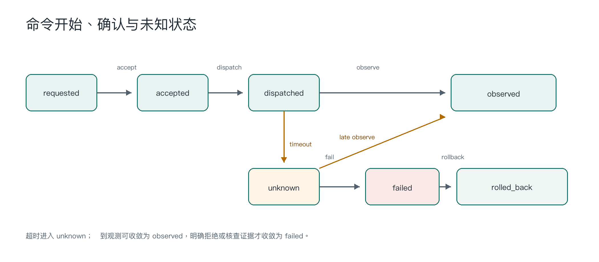
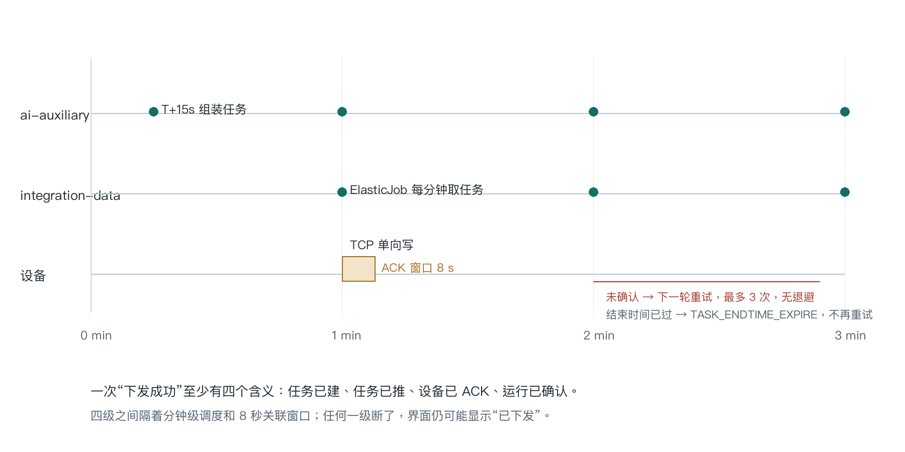

# 第 21 章 方案下发、确认与回滚

第 20 章的事件链路回答“路口正在发生什么”；控制回路还剩最后一环——把算好的方案送进真实设备，这是本章的话题。方案下发是控制系统中风险最高的路径：算法错误的后果是产生一个差方案，命令错误的后果是把错误方案发送给真实设备。第 19 章立起的服务边界在这里接受第一次检验：Java 控制服务如何组织一次下发，Python 算法服务的结果如何进入命令，命令又如何穿过设备网关抵达信号机。

阅读本章前，第 8 章的设备接口与第 19 章的服务边界应已在手边，状态机与幂等设计的基本概念是本章的外部技能；本章对应的生产实现见第 28 章。一个现场场景贯穿全章：17:00 向 S1-S4 下发统一协调方案。S1 的设备在 17:00:03 接受，S2 在 17:00:07 接受，S3 返回离线，S4 的命令已经发送但没有实时状态。此时数据库里可以同时出现“批次部分成功”“S1/S2 已生效”“S3 未执行”“S4 未知”。如果页面只有一个 `status=FAILED`，事故分析将无法知道哪个路口已经改变。

本章把“命令事实”拆成可验证的状态：21.1 建立命令状态机，21.2 区分发送成功与方案生效，21.3 处理幂等，21.4 给失败原因分层，21.5 讨论部分成功与补偿式事务，21.6 定义回滚。回滚之所以单列一节，是因为它本身就是一个需要重新计算和确认的新控制动作。

## 21.1 命令生命周期

SignalLab 使用以下状态：

```text
requested -> accepted -> dispatched -> observed
                      \-> unknown -> observed / failed / rolled_back
                      \-> failed -> rolled_back
```

含义分别是：

- `requested`：平台已接收请求
- `accepted`：平台受理并创建设备任务（**不代表设备已接受**）
- `dispatched`：命令已发送到设备网关
- `observed`：运行状态回读确认符合预期（设备 ACK 是这一步的证据之一）
- `unknown`：超时或通信失败，尚不能判断设备是否执行
- `failed`：设备明确拒绝，或已有证据证明执行不一致
- `rolled_back`：恢复动作完成

这七个状态是命令生命周期的**最小模型**，不是生产链路的全部事实。生产上至少要区分五层：平台受理、任务创建、命令发送、设备 ACK、运行确认。本模型把“设备 ACK”放进 `dispatched → observed` 的证据里，而不是单列一个状态；21.3 的时间轴会把它们分开记录。读状态字段时先分清：这个 `accepted` 是平台受理还是设备接受。两者混用，会让“已下发”看起来比实际更确定（见表 21-1）。

表 21-1 命令生命周期
| 当前状态 | 事件 | 下一状态 |
|---|---|---|
| requested | accept | accepted |
| requested/accepted | fail | failed |
| accepted | dispatch | dispatched |
| dispatched | observe | observed |
| accepted/dispatched | timeout | unknown |
| unknown | observe | observed |
| unknown | fail | failed |
| unknown | rollback | rolled_back |
| dispatched | fail | failed |
| observed/failed | rollback | rolled_back |

不在这张表中的转移应被拒绝。例如尚未发送的命令不能直接观察到运行状态（见图 21-1）。



超时不能直接等于失败。设备可能在网络断开前已经应用命令，只是响应没有回到平台。把超时写入 `unknown`，允许迟到观测把状态推进到 `observed`，或由人工、设备日志和后续确认把状态确定为 `failed`。若把 `unknown` 直接标成失败，系统可能对已经生效的路口重复发送或错误回滚。

### 21.1.1 状态机的四条不变量

实现命令状态机时，应固定以下性质：

1. 终态不能无事件地回到活动状态。
2. `observed` 需要引用实际方案版本、周期和阶段证据。
3. `failed` 需要包含可分类的失败原因和发生位置。
4. 所有状态变化保留前状态、事件、时间和操作者。
5. `unknown` 需要在超时后进入，并带有不确定原因和下一次核对时间。

设状态转移函数为 \(\delta(s,e)\)。对非法事件，函数应返回错误，不修改原状态。下面的代码展示了最小实现：

```python
def apply(command, event, failure_reason=None):
    key = (command.status, event)
    if key not in TRANSITIONS:
        raise InvariantViolation(
            f"invalid command transition: {command.status} + {event}"
        )
    if event is CommandEvent.FAIL and not failure_reason:
        raise InvariantViolation("failure transition requires a reason")
    return replace(command, status=TRANSITIONS[key])
```

这段代码的危险在于 `replace` 只保存当前状态，不保存历史。生产系统还需要追加事件日志或审计表，确保重试和回滚可追踪。状态机对象可以简洁，证据记录不能省。

### 21.1.2 状态时间与顺序

命令事件也可能重复或乱序。设备接受事件比发送事件先被平台消费，不能表示命令在现实中先被接受。命令服务需要：

```text
command_id
event_seq
event_time
received_at
state
reason_code
```

对同一命令，按 `event_seq` 或明确的设备序列更新；没有序列时，使用状态机允许的转移和业务时间窗口。重复 `observe` 事件应幂等，不重复生成成功记录。旧命令的状态不能覆盖用同一路口新命令的状态。

命令与运行状态是两条流，不能都用同一个 `updated_at` 字段决定顺序。例如新命令创建时间晚，但旧方案的最后一次观测也晚，这不表示旧方案比新命令更新。比较命令链要用命令版本和批次，比较运行链要用事件时间。

### 21.1.3 一次批量下发的时间轴

把状态机放到一条时间轴上，才能看清“下发”其实是几段独立的调度（见图 21-2）。



如表 21-2 所示。
表 21-2 一次批量下发的时间轴
| 时间 | 发生什么 | 证据 |
|---|---|---|
| T+0 | 业务写入控制历史（目标方案、时段、来源） | `ControlHistory` |
| T+15s | ai-auxiliary 定时任务组装下发任务；AI 模式把开始时间改为当前时刻，结束时间截到 `now+15min` | `DownloadPlanTask.java`；`SitePlanSendCmdHelper.java` |
| T+15s | 写 `ControlBatch`，再经 Feign 调 integration-data 建任务；本地事务包住两次插入，不包设备执行 | `DownloadPlanServiceImpl.java` |
| 之后每分钟 | integration-data 的 ElasticJob 处理待下发和待回滚任务 | `DownloadPlanTaskJob.java` |
| 推送前 | 取批锁和路口锁，TTL 各 1 秒 | `AbstractSplitPlanTaskService.java` |
| 推送 | 单向往设备写 TCP；写入 Redis 关联键，等设备 ACK，窗口 8 秒 | `VendorAControlServiceImpl.java` |
| 8 秒内 | ACK 到达，按 `noPlan + 1` 反查任务 | 同上 |
| 超 8 秒 | 关联键过期，迟到的 ACK 找不到任务，被静默丢弃 | 同上 |
| 未确认 | 下一轮调度重试；上限 3 次，无退避 | `AbstractSplitPlanTaskService.java` |
| 结束时间已过 | 直接判失败，错误码 `TASK_ENDTIME_EXPIRE` | `AbstractSplitPlanTaskService.java` |

这条时间轴解释了一个常见混淆：系统里的“下发成功”至少有四个不同含义——任务已创建、任务已推送、设备已回 ACK、运行状态已确认。四者之间隔着分钟级调度和 8 秒关联窗口，一个环节断了，界面仍可能显示“已下发”。

三个实现细节决定了它有多脆：

1. **锁的返回值被丢弃。** `downloadLock` 返回失败时，调用点没有检查，继续往下执行（`VendorASplitPlanTaskHandleService.java`）。并且拿锁后若中途 `return`，解锁不会执行，只能等 1 秒 TTL 自然过期。
2. **厂商由批次里第一个路口决定。** 同一批次所有路口按 `siteList.get(0)` 的厂商走同一个处理服务（`AbstractSplitPlanTaskService` 的组装逻辑）。子区里混装不同厂商时，非首个路口会被错误协议处理。
3. **回滚失败会无上限重试。** ai-auxiliary 侧的 `rollbackTask` 在失败分支里循环重试，没有次数上限，会阻塞调度线程。

这些不是可以忽略的实现细节，它们决定“命令状态机”在真实系统里能不能闭合。

## 21.2 为什么“发送成功”不等于“方案生效”

很多设备协议返回的成功只表示命令格式被接受。实际切换可能延迟，也可能被本地控制模式覆盖。

系统需要在新方案预期生效后读取：

- 当前控制模式
- 当前方案编号
- 周期
- 当前阶段
- 批次或操作标识（设备支持时）

只有状态匹配，才进入 `observed`。

### 21.2.1 目标、命令、确认和观测

四个层次的字段可以写成：

四个层次的字段如表 21-3 所示。

<!-- pagebreak -->
表 21-3 目标、命令、确认和观测
| 层次 | 示例 | 由谁产生 |
|---|---|---|
| 目标方案 | `site-S2-plan-v42`, cycle 92 | 业务发布 |
| 命令 | `command-17`, batch 17:00 | 命令服务 |
| 设备接受 | accepted at 17:00:04 | 厂商网关 |
| 运行观测 | v42, stage B, cycle 92 at 17:00:37 | 设备适配器 |

目标版本正确不代表设备接受；设备接受不代表实际执行；实际执行也不代表交通改善。联调时逐层保存证据，出现问题时才能把错误定位到协议、设备、时钟或运行状态。

如果设备协议不返回方案版本，平台只能使用周期、阶段和模式做弱确认。弱确认的字段应带 `confirmation_strength=weak`，并限制自动控制范围。不能用一个模糊的“在线”状态冒充强确认。

### 21.2.2 生效时间窗口

命令需要目标生效时间 \(t_s\)。在 \(t_s\) 之前看到旧方案是正常，在 \(t_s\) 后的有限窗口 \(W\) 内可能仍在切换，超过后仍不一致才应告警：

\[
\begin{aligned}
P_{\mathrm{consistent}}(t)
= (\mathrm{observed\ version}= \mathrm{target})\\
\quad \land(t_s\le t\le t_s+W)\land P_{\mathrm{fresh}}
\end{aligned}
\]

窗口长度取决于设备周期、切换延迟和状态上报频率。命令已发送但观测时间早于生效时间，不应立即判失败；设备状态时间晚于生效时间很久仍显示旧方案，也不应继续等待无限期。

## 21.3 幂等

`CommandLedger.submit` 以 `command_id` 去重：

```python
first, created = ledger.submit(command)
again, created_again = ledger.submit(command)
```

第二次提交返回原命令。这样网络重试不会制造多个业务命令。

command ID 与 batch ID 不同：一个批次可以包含多个路口的命令，每个路口命令仍需独立状态。

### 21.3.1 幂等键与方案内容

幂等键不应只使用 `command_id`，因为不同调用者可能生成不同 ID 却表达同一个业务请求。更稳定的键可以由：

```text
idempotency_key = (
    site_id,
    target_plan_version,
    command_type,
    intended_effective_time
)
```

如果人工重复点击“下发”得到相同键，返回原命令；如果目标版本或生效时间不同，生成新命令并记录取代关系。相同键但方案内容摘要不同，应该报警，因为系统对“同一个请求”的定义发生了冲突。

幂等不能把失败的命令永久锁住。失败后选择重试，应创建同一业务键的新尝试，或保留尝试序号。审计需要知道第一次失败和第二次成功是同一意图，而不是两个独立控制动作。

## 21.4 失败原因

失败原因应可分类：

- 权限不足
- 方案未校验
- 设备离线
- 协议编码失败
- 设备拒绝
- 超时
- 运行状态不一致
- 回滚失败

只记录“下发失败”无法支持恢复和统计。

### 21.4.1 失败原因需要定位到层

建议把失败分成：

回滚状态如表 21-4 所示。

<!-- pagebreak -->
表 21-4 失败原因需要定位到层
| 层 | 错误示例 | 是否可重试 |
|---|---|---:|
| 输入 | 方案版本不存在、周期非法 | 否，修正后重新请求 |
| 权限 | 操作员无下发权限 | 否，授权后重新请求 |
| 调度 | 目标时间已过、与下一计划冲突 | 视策略 |
| 协议 | 字段编码失败、设备不支持 | 否，需适配或换方案 |
| 网络 | 超时、连接中断 | 是，有限次退避 |
| 设备 | 拒绝、正在手动、灯组故障 | 视设备状态 |
| 观测 | 接受了但状态不符 | 是，先确认再处置 |
| 存储 | 命令已发但数据库写入失败 | 是，需防止重复发送 |

“超时”只说明没有及时收到响应，不能说明设备没有执行。对非幂等命令，盲目重试可能造成重复控制。设备协议和命令语义决定重试是否安全，框架超时本身不提供这个答案。

## 21.5 部分成功

批量下发可能出现：

```text
S1 observed
S2 failed
S3 observed
```

系统需要定义批次策略：

- 整体成功才提交
- 部分成功后回滚全部
- 保留成功路口并重新计算子区
- 失败路口保持原方案并告警

不同策略对交通影响不同，需要与子区协调语义一致。

一个可审计的批次记录应包含：

具体见表 21-5。
表 21-5 部分成功
| 层级 | 字段 |
|---|---|
| 批次 | batchId、创建人、目标子区、策略 |
| 命令 | commandId、siteId、planVersion、状态 |
| 设备 | 接受时间、失败原因、最后一次观察 |
| 回滚 | rollbackCommandId、目标版本、完成时间 |

只有三层信息完整，才能解释“批次失败”发生在哪个路口、哪个版本和哪个阶段。

### 21.5.1 批次聚合算法

单路口状态映射为：

```text
PENDING
ACCEPTED
OBSERVED
FAILED
UNKNOWN
```

批次状态可以定义：

\[
\mathrm{batch}=
\begin{cases}
\mathrm{observed}, & \text{所有路口 OBSERVED}\\
\mathrm{partial}, & \text{部分 OBSERVED 且存在失败/未知}\\
\mathrm{failed}, & \text{全部失败}\\
\mathrm{unknown}, & \text{期限已到但没有任何成功或失败证据}\\
\mathrm{waiting}, & \text{仍在期限内}
\end{cases}
\]

这只是一个聚合视图，不决定恢复策略。S2 是关键路口，S2 失败与一个边缘右转路口失败，业务影响不同。批次策略可以配置为“关键路口失败即整体回滚”“非关键失败允许保持并告警”。

恢复决策需要等待窗口。设备响应在 17:00:20 超时，可能只是网络慢；在下一个周期前仍有机会收到状态。系统应区分“暂时未知”和“确认失败”，避免过早回滚造成二次扰动。

### 21.5.2 分布式下发是一次补偿式事务

多路口下发跨越数据库、命令服务、厂商网关和信号机，不能假设存在覆盖所有设备的原子事务。更合适的模型是补偿式事务：每个路口先执行可追踪的局部命令，失败时通过回滚、拆分协调组或重新计算来抵消已经产生的影响。

设批次 \(B\) 包含路口集合 \(S\)。每个路口有目标版本 \(v_s\)、命令结果 \(r_s\) 和回滚动作 \(c_s\)。批次成功条件不是“每个 `send` 调用返回 200”，而是：

\[
\forall s\in S:\;
\mathrm{observed}(s,v_s)
\land P_{\mathrm{consistent}}(s)
\]

如果只有部分路口满足，系统需要选择下一次全局状态，而不是尝试把分布式系统恢复到一个不存在的“全未发生”时间点。已经执行的设备不会因为平台数据库回滚自动恢复，需要产生新的补偿命令并再次确认。

补偿动作本身可能失败，所以审计模型要允许：

```text
forward_failed
compensation_requested
compensation_observed
compensation_failed
manual_required
```

这是承认设备世界无法被平台事务回滚。控制系统的责任是让每个已知影响都有去向。

生产 `integration-data.ControlServiceImpl.downloadPlanTask` 用 `@Transactional` 包住绿信比任务和相位差任务两次本地插入。设备发送在后续 `processDownloadTask()` 与 `processOffsetTask()` 中执行，不在同一事务内。事务回滚只能撤销平台任务记录，不能撤销已经送达设备的命令。

AI 模式还会把计划结束时间向后延 2 分钟，避免推荐算法尚未下发时被旧调度提前回滚。这个调整修改了调用者请求的生效窗口，响应类型却是 `Void`。可审计接口至少应返回调整后的时间、调整原因和最终任务集合。第 28 章给出完整下发方法。

### 21.5.3 切换期间的协调风险

在 S1、S2 已使用新偏移、S3 仍使用旧周期时，车辆通过 S2-S3 的到达关系可能比新旧全局方案都差。局部成功不是局部安全。恢复策略应检查相邻路段和关键阶段的错位，而不只看各路口自身是否合法。

如果无法在一个短窗口恢复，优先选择：

1. 保持已成功路口并按实际状态重新计算局部协调；
2. 回滚到上一已验证全局方案；
3. 将失败段拆出协调组并进入固定方案；
4. 人工接管关键路口。

每次方案变更都要生成新版本、命令和确认证据。不能在页面上直接改显示值来掩盖设备不一致。

## 21.6 回滚

回滚是一个新命令，不是简单删除记录。它需要引用明确的旧版本，并重新经过校验、发送和确认。

回滚失败也需要告警和人工处理入口。

### 21.6.1 回滚的版本依赖

回滚目标可能包含方案、相位差、调度和设备能力。假设旧方案 `v41` 使用 90 秒周期，当前拓扑已经改成 92 秒公共周期。即使 `v41` 记录仍存在，设备可能不再接受其阶段时间。回滚器要重新检查：

- 旧方案是否还存在；
- 当前拓扑是否还能兼容旧方案；
- 设备是否支持旧方案的阶段；
- 周期能否闭合；
- 最小绿是否满足；
- 与相邻路口的协调是否仍成立。

只恢复单个方案而不恢复相邻偏移，会制造“路口合法但协调错误”。回滚也应至少记录目标子区、各路口版本和恢复后的公共周期。

### 21.6.2 回滚完成条件

回滚完成不是 `rollback request sent`。至少满足：

```text
observed plan version == rollback_target
observed cycle == target cycle
observed stage sequence == target sequence
control mode is compatible
state is fresh
neighbor offsets remain compatible
```

如果设备拒绝回滚，系统进入人工处理和安全模式；如果回滚命令成功但状态仍是新方案，继续观察并告警。回滚的失败本身需要再次通知和升级，不能悄悄回到“当前方案正常”。

### 21.6.3 三种下发组织方式

同样是“把方案送到设备”，有三种组织方式，代价完全不同：

具体见表 21-6。
表 21-6 三种下发组织方式
| 方式 | 延迟 | 失败可见性 | 重试安全性 | 实现复杂度 |
|---|---|---|---|---|
| 同步 RPC | 秒级 | 只能看到调用结果 | 差：超时后不知道设备是否执行 | 低 |
| 两级流水线（本系统） | 分钟级 | 任务状态 + ACK + 运行观测 | 中：可重试，但需幂等 | 高 |
| 设备主动拉取 | 取决于设备轮询 | 平台不知道设备何时取走 | 好：设备自己控制 | 中 |

本系统选两级流水线，不是因为延迟低，而是因为信号机协议大多是“单向写 + 异步 ACK”：同步调用只能证明命令发出，不能证明设备执行。把“建任务”和“推设备”分开，设备离线时任务能留在待下发状态，恢复后继续推。

代价就是 21.1.3 那张时间轴上的那些东西：8 秒 ACK 窗口、3 次重试、两层 Redis 锁、批次状态和回滚状态两套字段。这些是这种组织方式的代价。

## 21.7 本章实验

1. 用 SignalLab 状态机模拟一个完整成功流程。
2. 在 `dispatched` 后触发失败并回滚。
3. 尝试从 `requested` 直接观察，验证非法转移。
4. 为三个路口批次设计部分成功策略。

建议模拟：

```text
S1: observed
S2: failed after timeout
S3: observed
```

比较“全部回滚”和“保留 S1/S3、重新计算子区”两种策略。前者一致性更强，后者可能减少二次扰动，但需要重新定义协调基准。

扩展实验要求：

1. 设置 S1 成功、S2 超时、S3 接受未观测、S4 离线，输出批次聚合状态。
2. 让 S2 在超时后 10 秒又收到 observed，验证迟到的成功事件如何处理。
3. 让回滚命令重复发送，验证幂等和原有失败证据保留。
4. 让旧方案与当前拓扑不兼容，验证系统进入安全模式而不是强制回滚。
5. 记录每个命令的 `target version`、`observed version`、`event time` 和 `confirmation strength`。

## 21.8 小结

方案下发需要拥有独立于算法和运行监控的状态机：命令 ID、批次、方案版本、失败原因和回滚目标是可追踪控制的基础。第 20 章的事件链路回答“路口正在发生什么”，本章的命令状态机回答“平台让路口发生了什么、每一步有没有记录”——两条链在设备侧汇合，缺一条，分析都只能在猜测中进行。

这套命令状态模型还向下承接两章：第 22 章的前端工作流要把命令生命周期如实呈现给操作者，第 23 章的控制效果评价要先靠它区分“已生效”与“未生效”的时段，再谈指标。服务边界、命令生命周期、运行监控三者就此连成一条线。

## 练习

1. 设备接受命令和方案生效之间还缺哪些确认？
2. 为什么回滚也要经过完整状态机？
3. 子区部分失败时应如何判断是否保持协调？
4. 设计命令状态与实时运行状态的关联键。
5. 为什么 accepted 和 observed 需要分开保存？
6. 证明一个命令在 `requested` 状态直接接收 `observed` 时不应更新成功。
7. 设计一个批次聚合函数，输入四个单路口状态和当前时间，输出等待、部分、成功或失败。
8. 说明回滚为什么可能比原下发更容易失败，并列出需要重新校验的对象。

