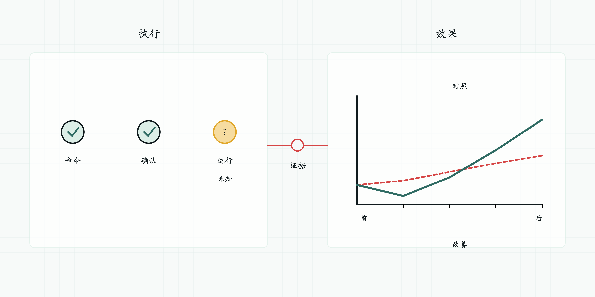

# 第 23 章 控制效果评价

第 22 章把执行证据摆上桌面之后，下一个问题自然浮现：执行了，然后呢？方案下发成功只能证明系统执行了计划，交通是否因此得到改善，需要单独证明。控制评价的任务是把交通需求、控制方案、设备状态和运行结果放进同一时间框架，让“执行了”与“改善了”各自拿出证据——这两件事的证明材料、证明方法和失效方式都不同，混在一起，评价就失去了立场。

设想 S2 的新方案在 17:00 生效（这正是第 21、22 章跟随的下发现场）。17:05，平均速度从 26 km/h 升到 30 km/h，页面给出“提升 15.4%”。但在 17:02，东直检测器恢复，之前被低估的需求开始计入速度与流量计算；同时上游一个小事故结束。速度上升可能来自控制，也可能来自需求变化、事故消散或检测恢复——四个候选原因摆在同一张时间轴上，把全部变化归因于方案，评价就失去了工程价值。本章后面评价窗口与对照设计（23.5、23.6 节）都会回到这条时间轴。

评价的第一步是证明执行发生了，第二步是定义需要比较的反事实：如果同一时间、同一需求、同一外部事件下仍运行旧方案，世界会是什么样。真实世界通常给不出这个反事实的完整观测，所以必须用对照窗口、需求匹配、事件排除和不确定性来说明结论的强度。本章依赖第 5～8 章建立的数据口径与第 21 章的命令状态模型，外部技能是基础统计概念——窗口、对照与置信度。

执行证据与效果证据的关系如图 23-1 所示。



## 23.1 评价层次

评价可分为：

- 方案合规：约束是否满足
- 执行合规：命令是否生效
- 交通性能：延误、速度、排队和溢出
- 运营价值：稳定性、可解释性和人工工作量

四层需要分别报告。

### 23.1.1 四层证据链

如表 23-1 所示。
表 23-1 四层证据链
| 层级 | 核心问题 | 失败后能否评价效果 |
|---|---|---:|
| 方案合规 | 方案本身是否合法 | 不能，先修复方案 |
| 执行合规 | 目标版本是否在目标时段运行 | 通常不能，除非另行估算 |
| 交通性能 | 速度、排队、溢出是否变化 | 可以，需说明数据质量 |
| 运营价值 | 稳定性、人工工作量、可解释性是否改善 | 可以，需更长窗口 |

执行合规不是时间点检查。一个方案可能 17:00 生效、17:06 被人工接管，17:20 又恢复。评价窗口必须知道实际持续区间，而不是只看命令曾经成功一次。

### 23.1.2 合规与效果分开报告

合法方案可能降低通行效率；违法方案也可能暂时让某个方向畅通。安全约束与交通目标必须分别报告。一个方案有冲突相位，即使速度指标很好，也不能被评价为可接受的工程方案。

反过来，设备执行成功只证明命令到达。它对控制效果没有直接方向性。评价报告可以第一行写“执行 96%”，但不能因此写“交通改善 96%”。

## 23.2 路口指标

WaySense 控制评价页面展示：

- 路口评级
- 流量
- 饱和度
- 绿灯利用率
- 均衡度
- 溢出次数
- 拥堵时长

这些指标的时间窗口和来源必须固定。例如流量增加可能代表需求增长，也可能代表检测改善，不能直接判定为控制失败。

### 23.2.1 指标的原始定义

流量 \(q\) 的单位通常是 veh/h 或窗口车辆数；容量 \(c\) 的单位必须与需求一致。饱和度：

\[
x=\frac{q}{c}
\]

平均速度通常应按车辆或流量加权，而不是对检测点速度做简单算术平均：

\[
\bar{v}_w=\frac{\sum_i q_i v_i}{\sum_i q_i}
\]

若 \(q_i\) 的单位是车辆数、\(v_i\) 是 km/h，结果仍是 km/h。对没有流量权重的检测点直接平均，可能让空车道上的高速度放大整条路段速度。

排队和溢出需要定义阈值：

\[
\mathrm{spill}_t=
\mathbb{I}\left(Q_t\ge Q_{\mathrm{capacity}}\right)
\]

`Q_capacity` 是路段可容纳排队估计。没有渠道长度和车辆长度参数，不能用“排队大于某个数”代替溢出。`spill_t` 的持续时间比次数更能说明严重性。

绿灯利用率可以概念化为：

\[
u_g=\frac{\text{绿灯期间被有效使用的通行时间}}
{\text{可用绿灯时间}}
\]

低利用率可能代表绿灯过长，也可能代表检测漏计、下游封锁或车队尚未到达。单独看低值不能直接判定方案差。

### 23.2.2 指标的时间对齐

流量、速度、排队和阶段状态可能来自不同粒度和时区。评价前必须统一到时间窗口：

```text
flow_window
speed_window
signal_window
event_window
```

如果速度按 1 分钟、流量按 15 分钟、阶段按周期，窗口开始和结束不一定对齐。应使用交集或事件时间聚合，而不是把不同结束点的值强行配对。

检测器恢复或补全改变了指标分母，也会改变评价。报告应包含：

```text
raw_observed_rate
imputed_rate
average_confidence
critical_direction_confidence
```

否则“控制改进了饱和度”可能只是分母被补全提高了（见表 23-2）。

表 23-2 指标的时间对齐
| 指标 | 主要含义 | 常见误判 |
|---|---|---|
| 路口评级 | 综合服务水平 | 不同评级口径混用 |
| 饱和度 | 需求与容量关系 | 把检测占有率当饱和度 |
| 绿灯利用率 | 绿灯是否被需求使用 | 把低利用率直接当成方案差 |
| 均衡度 | 进口之间服务差异 | 忽略某一关键方向需求 |
| 溢出次数 | 排队超过空间 | 未确认检测与拓扑上限 |
| 拥堵时长 | 低速度或高排队持续 | 事故和需求变化未剔除 |

## 23.3 子区指标

子区评价包括：

- 正反向平均行程速度
- 正反向平均通行流量
- 溢出频率
- 正反向拥堵时长占比

协调算法追求绿波，但上下游需求和事件可能改变车辆到达模式。评价需要同时看带宽和实际通行。

### 23.3.1 协调指标的边界

一条子区干线的平均速度可能掩盖局部恶化。例如 S1-S3 速度提高，S4 上游拥堵加剧，整体加权平均仍可能上升。评价应同时报告：

- 每个路口的最大饱和度和排队；
- 每条连接路段的正反向速度；
- 干线与支路的差异；
- 子区边界路段的溢出；
- 带宽的模型值和实际车队通过率。

协调带宽是模型量，实际通过率是观测量。两者都需要。模型带宽为正但现场入口频繁阻塞，不能证明绿波在实际交通中有效。

正向和反向需求不对称时，应分别报告，不要只给双向平均。平均值可能把“正向改善 30 秒、反向恶化 35 秒”包装成小幅变化。

## 23.4 模型内代理指标

离线算法还会计算：

- 绿灯利用率
- 延误代理
- 最大排队代理
- 合规性

SignalLab 的 `SiteEvaluation` 从需求和容量计算饱和度：

```python
SiteEvaluation(
    movements=(
        MovementEvaluation("east-through", 540, 1800, 27, 90),
    )
)
```

当饱和度为 1.0 时，系统进入容量边界；大于 1.0 时应标记过饱和方向。

代理指标适合比较候选，但不能替代现场结果。

### 23.4.1 饱和度边界算例

对 S2 的东直，设需求 \(q=540\) veh/h、饱和流率 \(S=1800\) veh/h、有效绿 \(g=27\) 秒、周期 \(C=90\) 秒：

\[
c=1800\cdot\frac{27}{90}=540\text{ veh/h}
\]

\[
x=\frac{540}{540}=1.0
\]

系统应把该方向标为容量边界。若推荐方案把有效绿降到 25 秒，容量变成 500 veh/h，而需求仍为 540 veh/h：

\[
x=\frac{540}{500}=1.08
\]

这 8% 不是一个抽象分数，而是每个周期平均未服务约 `0.08*500*90/3600 = 1` 辆车，排队可能持续增长。若下游已接近溢出，1 辆车/周期的累积会造成明显影响。

如果检测把需求低估为 486 veh/h，饱和度会显示 0.90，给出“有余量”的假象。评价应把关键输入置信度和完整率与饱和度一起展示。

代理指标至少应保存输入快照。否则当历史流量或饱和流率被修订后，无法重现当时的推荐评分。

评价结果可以表示为：

```text
score = f(plan, demand, capacity, constraints, objective_weights)
```

其中输入变化就可能改变分数。系统不能只保存最终 `score`，还要保存 `f` 的版本和参数。

### 23.4.2 代理目标和真实目标

优化器常用平均延误、饱和度或带宽作为目标，但现场可能更重视最长排队、溢出时间和公平性。设方案 A 的全局平均延误低，方案 B 的最大排队更短：

```text
A: mean delay 20 s, max queue 90 m
B: mean delay 23 s, max queue 55 m
```

如果路段容量只有 70 米，A 的平均优势可能伴随溢出，B 更安全。评价应把多个目标和硬边界一起报告，而不是用一个综合评分掩盖排队风险。

代理目标的权重、单位和归一化方法必须版本化。即使输入不变，权重调整也会改变“最佳方案”。这不是可复算性的细节，而是评价结论的一部分。

## 23.5 实验设计

评估控制策略至少需要：

- 控制组和对照组
- 相同或可调整的天气、日期和事件
- 切换前后稳定期
- 足够长的样本窗口
- 置信度和缺失数据说明

“实施后拥堵下降了 10%”不是因果结论，除非能排除需求下降、事故消失或检测变化。

### 23.5.1 反事实与基础因果记号

设 \(Y_i(1)\) 是路口在控制方案 1 下的结果，\(Y_i(0)\) 是同一时间在旧方案下的结果。真实因果效应是：

\[
\tau=Y_i(1)-Y_i(0)
\]

现实只能观察到其中一个，另一个是反事实。实施前后差：

\[
D_{\mathrm{before/after}}=
Y_{\mathrm{after,control}}-
Y_{\mathrm{before,baseline}}
\]

只有在没有其他变化时，它才接近控制效应。实际评价需要检查：

- 需求是否变化；
- 数据和检测是否变化；
- 事故、施工、天气、活动是否变化；
- 相邻路口是否同时改变；
- 驾驶员是否还处于适应期。

### 23.5.2 双重差分

有对照路口或对照时段时，可以使用双重差分：

\[
\hat{\tau}_{DD}=
\left(Y_{T,1}-Y_{T,0}\right)-
\left(Y_{C,1}-Y_{C,0}\right)
\]

其中 \(T\) 是实施组，\(C\) 是对照组，下标 1/0 是实施后/前。它假设如果没有干预，两组趋势在控制后仍保持相似。这个假设需要解释，不能因为有公式就自动成立。

例如 S2 实施新方案，S1/S3 保持原方案。若 S1/S3 也进入相同晚高峰增长，S2 相对它们的变化更容易解释。若 S1 同时做了渠化改造，对照就不干净。

### 23.5.2.1 效应、噪声和最小可操作差异

双重差分给出的是一个估计值，不是真实效应的确定性刻度。即使四条均值都存在采样误差，估计值也可能受随机交通波动影响。报告中至少应给出效应区间或重复窗口稳定性；只有两个窗口各一个平均值时，不应把它当作高精度结论。

设第 \(b\) 个独立重复窗口的效应估计为 \(\hat\tau_b\)。若共有 \(B\) 个重复，样本均值和标准误可以写成：

\[
\bar\tau=\frac{1}{B}\sum_{b=1}^{B}\hat\tau_b,
\qquad
\mathrm{SE}(\bar\tau)=
\frac{s_\tau}{\sqrt B}
\]

样本量很小或分布明显偏斜时，正态区间可能不合适。可以对独立时段做 bootstrap，或者报告完整分布和置信方法的限制。交通分钟数据通常有自相关，逐分钟随机重采样会低估不确定性；应使用按日或按小时块的重采样，至少不能把每分钟当作独立样本。

统计显著也不等于运营重要。设业务认为平均延误改善少于 3 秒不值得增加方案切换和设备维护，则 2 秒的“显著改善”仍不应成为推广结论。评价应在查看结果前定义最小可操作差异，并同时报告点估计、区间和阈值。

同时比较多个方向、多个指标和多个时段会增加偶然出现“显著结果”的机会。报告应区分预先指定的主指标和探索性指标。探索性发现可以生成下一轮实验假设，不能直接作为已证实效果。

### 23.5.3 需求匹配和时间匹配

也可以按需求、星期、天气和事件匹配历史时段。匹配后要报告样本量和剩余差异。若控制窗口的东直需求为 900 veh/h，而历史基线只有 600 veh/h，直接比较速度会混合需求效应。

匹配不是筛选到“结果好看”的样本。匹配变量、方法和排除规则要在查看结果前确定，并保存排除记录。

### 最小对照设计

一个可执行的评价方案至少包含：

```text
baseline window
transition window
control window
```

并记录：

- 每个窗口的计划方案版本
- 实际运行方案版本
- 需求量和检测完整率
- 天气、事故、施工和大型活动
- 评价指标的分布而不只是均值

如果控制窗口的需求显著变化，可以使用需求归一化、匹配时段或同日期对照，但必须说明方法限制。

### 23.5.4 三种评价设计

如表 23-3 所示。
表 23-3 三种评价设计
| 设计 | 需要的对照 | 能回答的问题 | 失效条件 |
|---|---|---|---|
| 前后对比 | 无 | 变化了多少 | 需求、天气、检测、事故中一项变化，就可能污染 |
| 双重差分 | 平行趋势的对照路口/片区 | 扣除共同趋势后的净效应 | 平行趋势不成立；对照组被同时干预 |
| 仿真对照 | 校准过的微观/宏观模型 | 反事实下会怎样 | 模型误差直接变成结论误差 |

前后对比最便宜，也最容易被误当成因果。双重差分要求“没有干预时两组走势相同”，这个假设必须用干预前的数据检验，而不是口头声明。仿真能构造反事实，但它的可信度取决于标定和验证；没有现场数据校准的仿真，只能算情景推演。

三种设计不是互斥的：可以先做前后对比发现异常，再用双重差分检验，最后用仿真解释机制。报告里必须写清楚用了哪一种、假设是什么、哪些证据不足。

## 23.6 评价窗口

方案切换本身会产生过渡。窗口应考虑：

- 指令生效延迟
- 排队消散
- 交通行为适应
- 下一时段的交通变化

直接比较切换前后各 5 分钟，可能主要反映过渡过程。

### 23.6.1 三个窗口的边界

```text
baseline: [16:20,16:50)
transition: [16:50,17:05)
control: [17:05,17:35)
```

边界应覆盖：

- 命令下发到设备实际生效的延迟；
- 排队从旧方案状态过渡到新状态；
- 评价事件时间而不是页面刷新时间；
- 晚到数据补齐的时间。

如果控制窗口结束前事故或施工开始，必须截断或把事件作为协变量。窗口不是越长越好，长时间窗口会混入多个控制版本和外部变化。

### 23.6.2 数据质量门槛

可以为关键方向定义：

\[
P_{\mathrm{eligible}}=
P_{\mathrm{complete}}\land P_{\mathrm{confidence}}\land P_{\mathrm{fresh}}
\]

不满足时，评价报告可以给出描述性结果，但结论应写“证据不足”。不要因为算法输出了完整表格就把缺失质量隐藏为零值。

需要注意，当前生产链路的 `Confidence` 在算法输入端恒为默认值 `1`（第 25.10 节），`Estimated` 恒为 `False`。因此这条门槛里的 `P_confidence` 实际上不可计算。评价时能用的替代证据是完整率、原始行数、补全标记 `cam_imp` 和源表字段；如果这些也拿不到，报告只能写“数据质量无法判定”。

## 23.7 可解释报告

每个评价结果应能展开到：

```text
时间窗口
  -> 路口和方向
  -> 需求与容量
  -> 控制方案
  -> 数据质量
  -> 运行指标
  -> 异常事件
```

只有这样，运营人员才能判断指标变化是否来自控制。

### 结果报告模板

如表 23-4 所示。
表 23-4 结果报告模板
| 区块 | 内容 |
|---|---|
| 研究问题 | 哪个方案、什么场景、希望改善什么 |
| 数据范围 | 时间窗口、路口、检测完整率 |
| 控制方案 | 原方案和实施方案版本 |
| 执行情况 | 下发、生效、持续时长 |
| 指标结果 | 均值、分布和异常 |
| 混杂因素 | 需求、事故、天气、施工 |
| 结论 | 支持、反对或证据不足 |

报告必须允许“证据不足”这一结论。不能因为做了控制实验就默认必须宣称有效。

### 23.7.1 均值和分布

只报告平均速度会掩盖拥堵时段。至少展示中位数、分位数、最大值或超标持续时间。对两个方案可以比较：

```text
mean speed
p10 speed
max queue
fraction of time saturated
spill minutes
```

分布比较还能发现“平均改善但尾部恶化”。交通控制中的溢出、事故风险和排队回溢往往由尾部状态决定。

### 23.7.2 结论强度

报告可以把结论分为：

```text
supported: 执行完整，数据完整，效应一致且量级有意义
conditional: 有改善，但存在混杂或样本不足
insufficient: 数据或执行证据不足
contradicted: 结果与目标相反
```

这不是让报告变得含糊，而是说明哪些结论能用于继续自动化、哪些只能作为观察。事实、推断和推荐应分别写清楚。

## 23.8 本章实验

1. 为两个路口方案计算最大饱和度和过饱和方向。
2. 构造需求不变、周期变化的前后对比。
3. 构造检测器在切换期间失效的场景，判断评价是否可信。
4. 设计一个包含控制组、实施组和过渡窗口的评价方案。
5. 用 S2 的需求 900 veh/h、有效绿 27 秒、周期 90 秒计算容量和饱和度，再比较有效绿 24 秒的情形。
6. 构造“平均速度上升但最大排队也上升”的数据，写出一个更完整的验收结论。
7. 用双重差分公式计算一组合成前后、对照数据，并明确指出需要验证的平行趋势假设。
8. 让关键检测器在控制窗口失效 30%，说明哪些结论必须降级。

## 23.9 小结

回到章首那条时间轴：17:05 的速度上升在对照设计面前才敢说“改善”。控制评价需要把合规、执行和交通效果分开——第 21 章的命令状态模型提供了执行证据，第 22 章的前端把它呈现出来，模型内指标用于候选比较，现场指标用于效果判断，因果结论需要实验设计和数据质量支撑。

单个路口的评价方法至此齐备。第 24 章把检测、周期、绿信比、偏移、命令和评价连接成一条完整走廊——四路口案例将从检测数据一路走到效果报告，把前十二章的零件装成一台能跑的机器。

## 练习

1. 为什么“方案生效”不能直接算“控制有效”？
2. 评价协调方案时为什么必须同时看带宽和行程速度？
3. 设计一个切换前后对照方案。
4. 说明检测器故障如何影响饱和度评价。
5. 为什么流量和速度需要相同时间窗口才能比较？
6. 证明饱和度大于 1 时并不一定立即导致无限排队，但持续大于 1 会形成排队增长。
7. 设计一个报告表，把方案合规、执行合规、交通性能和运营价值分开。
8. 解释“证据不足”为什么是有效结论，而不是分析失败。

