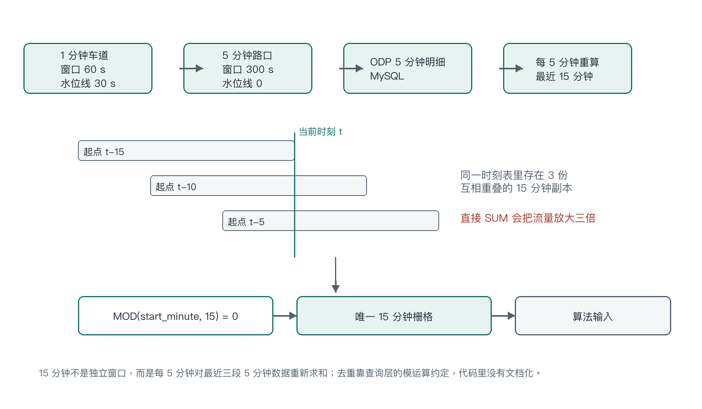

# 第 25 章 生产数据链路：从过车事件到路口指标

前六部分使用按时钟周期和路口对象抽象出来的模型，便于逐步验证公式。第 24 章的四路口案例走的也是这条教学链路。但生产系统并没有从这些教学对象开始运行，而是从设备过车事件开始，依次经过 Kafka、Flink、SDK 流量处理、补全、车道映射和指标聚合。本章离开简化模型，直接阅读 WaySense 当前实现。

本章以 WaySense 工程中的实现为例。代码片段保留完整的函数或方法主体，删去的只有无关 import、日志配置和其他方法；路径、类名、字段名和运算符保持原样，内部系统名统一改为 offline-dw/离线数仓。阅读时先看类型和单位，再看公式。

## 25.1 两条数据路径

生产系统至少有两条进入算法的路径：

```text
过车事件
  -> Kafka dwd_parameter_automobile_rt
  -> Flink 1 分钟车道聚合
  -> dws_mgr_tp_automobile_lane_1mi
  -> Flink 5 分钟路口聚合
  -> dws_mgr_tp_automobile_approach_dir_5mi
  -> Java 业务查询与算法输入
```

另一条是离线 SDK：

```text
历史车道观测
  -> DataReader 聚合
  -> Evaluator 异常识别
  -> DirectionFlowTool 车道映射与空间补全
  -> DirectionFlow
  -> 单点或子区优化
```

两条路径不能混用语义。Flink 路径负责实时指标生产，`flowprocess` 路径提供批量处理和算法 SDK。页面查询到的 `DIRECTION_FLOW` 也可能来自数仓查询层，而不是重新运行 `DirectionFlowTool`。

## 25.2 车道观测聚合的完整入口

`algo-server/flowprocess/main.py` 中的 `FlowprocessTool.aggregate_data` 是 SDK 聚合入口。完整实现如下：

```python
class FlowprocessTool:

    @staticmethod
    def aggregate_data(flow_data: List) -> List:
        cross_data_dict = DataReader.fetch_flow_data(
            flow_data=flow_data,
            filter_key_list=[
                "LaneNo",
                "Volume",
                "QueueLen",
                "Estimated",
                "Confidence",
            ],
        )
        cross_traffic_data = DataReader.merge_flow_data(
            cross_traffic_data_dict=cross_data_dict,
            by_key_list=["CrossID", "LaneNo"],
            cal_param={"Volume": "sum", "QueueLen": "mean"},
        )
        return cross_traffic_data
```

这段代码只规定 `Volume` 求和、`QueueLen` 求平均，输出窗口的 `StartTime`、`EndTime` 和 `Interval` 由 `DataReader` 的分组结构携带。调用者不能仅凭这个函数体推断输出窗口长度，必须继续阅读 `DataReader.fetch_flow_data` 和 `merge_flow_data`。

这里还把 `Estimated` 和 `Confidence` 列保留在候选字段中。生产数据并不只有数值，来源和质量字段是同一记录的一部分。

## 25.3 车道到转向的完整映射函数

`flowprocess/direction_flow_tool/flow_tool.py` 的 `DirectionFlowTool.convert_to_movement_data` 同时完成窗口对齐、异常值替换和混合车道拆分。完整函数如下：

```python
@staticmethod
def convert_to_movement_data(
    cross_traffic_data: Dict,
    start_time: datetime,
    end_time: datetime,
    abnormal_idx: Dict,
    digital_cross: DigitalIntersections,
    cross_id_list: List = None,
    time_interval: int = 900,
) -> Dict:
    direction_flow_ret = []
    lane_data_ret = []
    if cross_id_list is None:
        cross_id_list = set(
            cross_info[0] for cross_info in digital_cross.movement_lanenum.keys()
        )
    for cross_id in tqdm(
        cross_id_list,
        desc=f"Mapping Lane Traffic Data To Direction {cross_id_list}",
    ):
        cur_time = start_time
        while cur_time < end_time:
            try:
                cur_time_end = cur_time + time_interval * timedelta(seconds=1)
                struct_time_suf = cur_time.strftime("%Y-%m-%d")
                struct_time_interval_order = int(
                    (cur_time.minute + cur_time.hour * 60) / (time_interval / 60)
                )
                dict_key = (cross_id, struct_time_suf, struct_time_interval_order)
                if dict_key in cross_traffic_data:
                    for lane_data in cross_traffic_data[dict_key]:
                        lane_data = check_data_type(
                            data=lane_data,
                            check_types={"LaneNo": str, "Volume": int},
                        )
                        if (
                            dict_key in abnormal_idx
                            and lane_data["LaneNo"]
                            == abnormal_idx[dict_key]["LaneNo"]
                        ):
                            lane_data["Volume"] = abnormal_idx[dict_key]["ewm"]
                            lane_data["Estimated"] = True
                            lane_data["Confidence"] = 0.85
                        lane_data_ret.append(lane_data)
                    for (
                        cross_direction_movement,
                        lane_nums,
                    ) in digital_cross.movement_lanenum.items():
                        filter_lane_infos, lane_nums_list = [], []
                        if cross_direction_movement.CrossID != cross_id:
                            continue
                        for lane_data in cross_traffic_data[dict_key]:
                            lane_data = check_data_type(
                                data=lane_data,
                                check_types={"LaneNo": str, "Volume": int},
                            )
                            lane_no = lane_data["LaneNo"]
                            if (cross_id, lane_no) not in digital_cross.lane_information:
                                continue
                            lane_direction_movement = digital_cross.lane_information[
                                (cross_id, lane_no)
                            ]
                            for mv, lane_num_coef in Movement.mapping_to_standard_movement(
                                lane_direction_movement["Movement"].value
                            ):
                                if (
                                    cross_direction_movement.Direction
                                    == lane_direction_movement["Direction"]
                                    and cross_direction_movement.Movement.value == mv
                                ):
                                    filter_lane_infos.append(
                                        int(lane_num_coef * lane_data["Volume"])
                                    )
                                    lane_nums_list.append(lane_num_coef)
                        sum_lane_nums = (
                            sum(lane_nums_list) if len(lane_nums_list) > 0 else 0.05
                        )
                        if sum_lane_nums > 0.1:
                            mv_standard = (
                                lane_nums["LaneNums"]
                                * sum(filter_lane_infos)
                                / sum_lane_nums
                            )
                        else:
                            mv_standard = -1
                        confidence = 1 if mv_standard >= 0 else 0
                        direction_flow_ret.append(
                            {
                                "StartTime": cur_time.strftime("%Y-%m-%d %H:%M:%S"),
                                "EndTime": cur_time_end.strftime("%Y-%m-%d %H:%M:%S"),
                                "CrossID": cross_id,
                                "Direction": cross_direction_movement.Direction,
                                "Movement": cross_direction_movement.Movement,
                                "Interval": time_interval,
                                "Volume": mv_standard,
                                "Estimated": False,
                                "Confidence": confidence,
                            }
                        )
                else:
                    all_direction_movements = [
                        cross_direction_movement
                        for cross_direction_movement in digital_cross.movement_lanenum.keys()
                        if cross_direction_movement.CrossID == cross_id
                    ]
                    direction_flow_ret.extend(
                        [
                            {
                                "StartTime": cur_time.strftime("%Y-%m-%d %H:%M:%S"),
                                "EndTime": cur_time_end.strftime("%Y-%m-%d %H:%M:%S"),
                                "CrossID": cross_id,
                                "Direction": dr_mv.Direction,
                                "Movement": dr_mv.Movement,
                                "Volume": -1,
                                "Confidence": 0,
                                "Estimated": False,
                                "Interval": time_interval,
                            }
                            for dr_mv in all_direction_movements
                        ]
                    )
                cur_time += timedelta(seconds=1) * time_interval
            except KeyError as e:
                glob_logger.warning(e)
                import traceback

                traceback.print_exc()
    return lane_data_ret, direction_flow_ret
```

这个函数比教学代码多出四种真实语义。

第一，缺失方向流量写为 `Volume=-1`、`Confidence=0`，而不是 0。零流量和缺失流量在后续补全分支中必须区分。

第二，混合车道按 `Movement.mapping_to_standard_movement` 返回的系数拆分。代码先令 `lane_num_coef * Volume` 经过 `int()`，再求和。两辆车按 1/2、1/2 拆，每份截断为 1，合计 2，恰好守恒；但四辆车按 1/3、1/3、1/3 拆，每份 1.333 截断为 1，合计 3，少 1 辆；两辆车按三份拆，0.667 截断为 0，合计 0，少 2 辆。整数截断不是守恒变换，损失方向取决于车辆数和系数。

第三，没有匹配车道时令 `sum_lane_nums=0.05`，再通过 `sum_lane_nums > 0.1` 输出缺失。这个分支避免除零，但如果上游拓扑错误一直存在，查询层只会看到低置信度结果，无法从输出中直接区分“该方向本来没有车道”和“映射配置错误”。

第四，异常替换只处理每个窗口中的一个 `LaneNo`。`abnormal_idx[dict_key]` 是单层字典，构造时同一窗口的多个异常车道会互相覆盖。函数本身没有再次验证异常索引是否完整，因此阅读覆盖率时必须回到 `Evaluator.get_abnormal_data_index`。

还有一处质量字段的断点。车道层在替换异常值时写入 `Estimated = True`、`Confidence = 0.85`（`flow_tool.py`），但生成方向流量记录时又硬编码 `"Estimated": False`，`Confidence` 只按结果是否存在取 1 或 0（`flow_tool.py`）。也就是说，车道层的“这行是估算的”标记没有传递到方向层；到了 25.10 的算法链路，质量字段还会再被默认值覆盖一次。读质量字段时必须区分它在哪一层产生、在哪一层丢失。

映射循环的渐近复杂度约为 \(O(T \cdot L \cdot M)\)，其中 \(T\) 是时间窗口数，\(L\) 是单个路口车道数，\(M\) 是标准流向量。函数在外层每次时间步都重新遍历全部方向流向，实际常数还会随路口数和标准流向数增加。对 96 个 15 分钟窗口尚可接受，扩展到分钟级和大地图后，缓存拓扑索引和向量化分组会成为必要优化。

## 25.4 异常检测的完整实现

`flowprocess/evaluation/data_quality_evaluation.py` 的时间异常检测先用 EWMA 形成均值，再计算残差方差：

```python
@staticmethod
def calculate_variance(dps, moving_average):
    variance = 0
    count = 0
    for index in range(len(dps)):
        if moving_average[index] is None:
            count += 1
            continue
        variance += (dps[index] - moving_average[index]) ** 2
    variance /= (len(dps) - count)
    return variance
```

这段函数直接暴露一个重要边界：当所有基线值都是 `None` 时，`count` 等于 `len(dps)`，分母为 0，Python 会抛出 `ZeroDivisionError`。这不是“方差为 0”，而是没有样本可估方差；调用方必须先检查有效样本量，并设置最小样本门槛（例如少于 3 个有效点就不做 3σ 判断）。完整检测方法如下：

```python
@staticmethod
def anomaly_detection_by_lane(
    cross_traffic_data_dict,
    start_time: datetime,
    end_time: datetime,
    time_interval,
    parameter_name="Volume",
    choose_span=4,
    cross_id_list=None,
):
    merged_df_concat = []
    if cross_id_list is None:
        cross_id_list = set(
            cross_info[0] for cross_info in cross_traffic_data_dict.keys()
        )
    start_time_stamp = start_time.timestamp()
    end_time_stamp = end_time.timestamp()
    merged_df_list = []
    for _cross_id in cross_id_list:
        merged_data = []
        for current_time in np.arange(
            start_time_stamp, end_time_stamp, time_interval
        ):
            current_datetime = datetime.fromtimestamp(current_time)
            dict_key = (
                _cross_id,
                current_datetime.strftime("%Y-%m-%d"),
                int(
                    (current_datetime.minute + 60 * current_datetime.hour)
                    / (time_interval / 60)
                ),
            )
            if (
                dict_key in cross_traffic_data_dict
                and len(cross_traffic_data_dict[dict_key]) >= 1
            ):
                filtered_data = cross_traffic_data_dict[dict_key]
                for lane_info in filtered_data:
                    lane_info.update(
                        {
                            "start_time": current_time,
                            "end_time": current_time + time_interval,
                            "CrossID": _cross_id,
                            "Confidence": 1,
                            "Estimated": False,
                        }
                    )
                    merged_data.append(lane_info)
        if len(merged_data) == 0:
            continue
        data_final = pd.DataFrame(merged_data)
        data_final["start_time_date"] = data_final.apply(
            lambda x: time.strftime(
                "%Y-%m-%d %H:%M:%S", time.localtime(x["start_time"])
            ),
            axis=1,
        )
        data_final["weekday"] = data_final.apply(
            lambda x: datetime.fromtimestamp(x["start_time"]).weekday(),
            axis=1,
        )
        data_final["hours"] = data_final.apply(
            lambda x: datetime.fromtimestamp(x["start_time"]).hour,
            axis=1,
        )
        lane_set = set(data_final.loc[:, "LaneNo"])
        for _lane_no in lane_set:
            filter_df = data_final[data_final.loc[:, "LaneNo"] == _lane_no]
            if len(filter_df) > 0:
                filter_df = filter_df.sort_values(by=["start_time"])
                filter_df["ewm"] = (
                    pd.Series.ewm(
                        filter_df.loc[:, parameter_name], span=choose_span
                    )
                    .mean()
                    .astype(int)
                )
                filter_df["error"] = filter_df.apply(
                    lambda x: abs(x["ewm"] - x[parameter_name]), axis=1
                )
                var = calculate_variance(
                    dps=list(filter_df.loc[:, parameter_name]),
                    moving_average=list(filter_df.loc[:, "ewm"]),
                )
                filter_df["time_wrong_finder"] = filter_df.apply(
                    lambda x: x["error"] > 3 * var, axis=1
                )
                merged_df_list.append(filter_df)
                filter_erro = filter_df[
                    filter_df.loc[:, "time_wrong_finder"]
                ]
                if len(filter_erro) > 0:
                    filter_erro_choose = filter_erro.loc[
                        :,
                        [
                            "CrossID",
                            "LaneNo",
                            "start_time_date",
                            parameter_name,
                            "ewm",
                        ],
                    ]
                    glob_logger.info(
                        "==== Time Series Anomaly Detection ====  {} {} ".format(
                            "\n", filter_erro_choose.to_string(index=False)
                        )
                    )
                merged_df_concat = pd.concat(
                    merged_df_list, ignore_index=True
                )
    Evaluator.anomaly_param_by_lane(output_results_df=merged_df_concat)
    return merged_df_concat
```

代码使用 EWMA 偏差 `abs(x - ewm)`，却与残差平方方差 `3 * var` 比较；量纲分别是车辆数和“车辆数的平方”。这不是标准三倍标准差判断，阈值解释必须按实现本身理解。代码也没有把 `WrongFinder` 的物理矛盾结果并入 `get_abnormal_data_index`，后者只选择 `time_wrong_finder == True`，且同一窗口只保留最后一个异常车道。

这些发现不是要否定已有系统，而是说明代码精读必须看到实现和理论之间的差异。书中后续实验会复现这些边界，而不是用理想公式替代真实行为。

## 25.5 实时 Flink 聚合的完整算子

1 分钟车道流由 `AutomobileAggregationFunction` 做累加。它的完整 `add` 方法为：

```java
@Override
public Lane1MinParameter add(
    Automobile value,
    Lane1MinParameter accumulator
) {
    Long curFlow = accumulator.getFlow();
    this.copyProperties(value, accumulator);

    if (value.getReal_flag() == null || value.getReal_flag() == 1) {
        accumulator.setFlow(curFlow + 1);
    }
    return accumulator;
}
```

算子本身没有按时间判断，时间窗口由作业定义。`Automobile2Lane1MinJob.run` 使用以下关键链：

```java
DataStream<Automobile> automobileDataStream =
    env.fromSource(
        createOfflineDwKafkaSource(
            getOfflineDwKC().getDwdParameterAutomobileRtTopic(),
            Automobile.class
        ),
        WatermarkStrategy
            .<Automobile>forBoundedOutOfOrderness(
                Duration.ofSeconds(offlineDwJobConfig.getAutomobileWatermarkDelay())
            )
            .withTimestampAssigner(
                (automobile, timestamp) ->
                    DateTimeUtils.getDateTimeMillSec(
                        automobile.getExit_time(),
                        DateTimeUtils.DATETIME_MILL_PATTERN
                    )
            )
            .withIdleness(
                Duration.ofSeconds(offlineDwJobConfig.getKafkaIdleTimeout())
            ),
        "automobile2lane1min"
    )
    .setParallelism(
        customOperatorParallelismConfig.getAutomobile2LaneConsumer()
    )
    .filter(automobileToLaneFilterFun)
    .map(new MapFunction<Automobile, Automobile>() {
        @Override
        public Automobile map(Automobile value) throws Exception {
            value.setAutomobile_feature(null);
            return value;
        }
    })
    .setParallelism(
        customOperatorParallelismConfig.getAutomobile2LaneConsumer()
    );

SingleOutputStreamOperator<Lane1MinParameter> laneMinDS =
    automobileDataStream
        .keyBy(new KeySelector<Automobile, Tuple3<String, String, String>>() {
            @Override
            public Tuple3<String, String, String> getKey(
                Automobile automobile
            ) throws Exception {
                return new Tuple3<>(
                    automobile.getBind_id(),
                    automobile.getLane_id(),
                    automobile.get_camera_serial()
                );
            }
        })
        .window(
            TumblingEventTimeWindows.of(
                Time.seconds(offlineDwJobConfig.getAutomobileWidowSize())
            )
        )
        .aggregate(
            automobileAggregationFunction,
            automobileLaneProcessWindowFunction
        )
        .setParallelism(
            customOperatorParallelismConfig.getAutomobile2LaneConsumer()
        );
```

完整作业还在窗口关闭后调用 `AutomobileLaneProcessWindowFunction.process`。该函数将 `captureStartTime` 设为窗口起点，将 `captureStopTime` 设为 `window.getEnd()-1`，因此输出标签是左闭右闭时间串，底层的 Flink 窗口实际是左闭右开。阅读数据时必须同时理解二者，不能只看字符串。

当补全开关开启且流量为 0 或超过上限，方法会调用 Python `getLaneFlowFill`。补全失败、结果仍超限时，代码把流量改成 0 或配置上限后继续输出；这条路径产生的 0 不是原始观测零流量。

## 25.6 路口转向流量拆分

`CrossIndexProcessFunction.createApproachDirStateMap` 是 5 分钟路口转向流量的核心：

```java
private Map<String, ApproachDirStateItem> createApproachDirStateMap(
    Map<String, LaneStateItem> laneStateItemMap
) {
    Map<String, ApproachDirStateItem> approachDirStateItemMap =
        new HashMap<>();
    for (String laneId : laneStateItemMap.keySet()) {
        LaneStateItem value = laneStateItemMap.get(laneId);
        for (int i = 0; i < value.getDirNum(); i++) {
            String approachKey =
                value.getApproachId() + value.getLaneDirection().charAt(i);
            ApproachDirStateItem approachDirStateItem =
                approachDirStateItemMap.get(approachKey);
            BigDecimal laneDirFlow =
                BigDecimal.valueOf(value.getFlow())
                    .divide(
                        BigDecimal.valueOf(value.getDirNum()),
                        CommonConstant.FLOW_PRECISION,
                        BigDecimal.ROUND_HALF_UP
                    );
            if (approachDirStateItem == null) {
                Set<String> laneSet = new HashSet<String>();
                laneSet.add(laneId);
                approachDirStateItem =
                    ApproachDirStateItem.builder()
                        .crossId(value.getSiteId())
                        .nodeId(value.getNodeId())
                        .crossName(value.getNodeName())
                        .approachId(value.getApproachId())
                        .approachDirection(
                            Integer.valueOf(value.getApproachDirection())
                        )
                        .dir(
                            String.valueOf(
                                value.getLaneDirection().charAt(i)
                            )
                        )
                        .flow(laneDirFlow)
                        .laneIdSet(laneSet)
                        .build();
                approachDirStateItemMap.put(
                    approachKey,
                    approachDirStateItem
                );
            } else {
                approachDirStateItem.setFlow(
                    approachDirStateItem.getFlow().add(laneDirFlow)
                );
                approachDirStateItem.getLaneIdSet().add(laneId);
            }
        }
    }
    return approachDirStateItemMap;
}
```

这里按 `dirNum` 等分，使用 `BigDecimal` 保留中间小数，最后才转成转向流量。这与 Python SDK 逐份 `int()` 截断不同。同一辆混合车道车辆在两条生产路径上可能得到不同的整数结果，因此比较报表前必须先确认数据来源。

## 25.7 通行能力与饱和度的真实计算

`calculateCapacityAndUpdateMaxFlow` 完整方法展示了容量来源的优先级：

```java
private void calculateCapacityAndUpdateMaxFlow(
    Map<String, LaneStateItem> laneStateItemMap,
    SignalCyclePlan curSignalCyclePlan,
    String nodeId
) {
    Map<Object, Object> laneHeadwayMap = null;
    if (offlineDwJobConfig.getCrossSaturationHeadWayAdjustFlag()) {
        laneHeadwayMap =
            redisTemplate
                .opsForHash()
                .entries(
                    String.format(CacheConstant.LANE_HEADWAY, nodeId)
                );
    }
    for (String laneId : laneStateItemMap.keySet()) {
        LaneStateItem curLaneState = laneStateItemMap.get(laneId);
        BigDecimal laneHeadWay =
            this.getLaneHeadWay(curLaneState, laneHeadwayMap);
        BigDecimal flow =
            BigDecimal.valueOf(
                curLaneState.getFlow()
                    * offlineDwJobConfig.getCapacityCalCycle()
                    / (
                        offlineDwJobConfig.getWidowSize()
                            * curLaneState.getDirNum()
                    )
            );
        BigDecimal capacity = null;
        if (
            redisTemplate.hasKey(
                String.format(CacheConstant.LANE_CAPACITY, laneId)
            )
        ) {
            try {
                capacity =
                    new BigDecimal(
                        redisTemplate
                            .opsForValue()
                            .get(
                                String.format(
                                    CacheConstant.LANE_CAPACITY,
                                    laneId
                                )
                            )
                    );
            } catch (Exception e) {
                log.error("get lane capacity fail:{}", e);
            }
        }

        if (capacity == null) {
            capacity =
                BigDecimal.valueOf(
                    offlineDwJobConfig.getCapacityCalCycle()
                        * offlineDwJobConfig.getCapacityCalLaneGreen()
                        / offlineDwJobConfig.getCrossSaturationHeadWay()
                );
            redisTemplate
                .opsForValue()
                .set(
                    String.format(CacheConstant.LANE_CAPACITY, laneId),
                    capacity.toString()
                );
        } else if (capacity.compareTo(flow) < 0) {
            capacity = flow;
            redisTemplate
                .opsForValue()
                .set(
                    String.format(CacheConstant.LANE_CAPACITY, laneId),
                    capacity.toString()
                );
        }

        if (
            curSignalCyclePlan != null
                && !CollectionUtils.isEmpty(
                    curSignalCyclePlan.getPhaseStageDetailVOList()
                )
        ) {
            capacity =
                new BigDecimal(
                    offlineDwJobConfig.getCapacityCalCycle()
                        * offlineDwJobConfig.getCapacityCalSignalGreen()
                )
                    .divide(
                        laneHeadWay,
                        8,
                        RoundingMode.HALF_UP
                    );
        }
        curLaneState.setCapacity(capacity);
    }
}
```

这个方法产生了三类容量：

1. 没有历史缓存时，使用配置周期乘车道绿灯参数，再除以配置饱和车头时距。
2. 有历史缓存时，取历史容量与当前小时流量的较大值。
3. 有信号方案时，重新使用信号绿灯参数计算容量。

第二类“当前流量进入容量”意味着在无信号方案路径中，容量至少等于当前流量，饱和度通常不会超过 1。它不是理论通行能力，而是历史峰值保护值。报告中如果没有说明是否取到信控方案，就可能把“容量估计”误读成“物理容量”。

## 25.8 数据链路的失败边界

真实代码给出的失败边界至少有：

- 过车事件被 1 分钟窗口聚合，窗口按 `event-time` 和 `watermark` 关闭。
- 补全失败时写入 0 或配置上限，指标层必须保留 `sourceFlow`、`adjustFlow` 等字段才能恢复证据。
- 5 分钟混合车道用小数拆分，离线 SDK 却可能先整数截断。
- 多个异常车道在同一窗口进入单值异常索引时可能互相覆盖。
- 没有信控方案时，容量会回退到历史峰值或配置值，饱和度解释随之改变。

这些边界比“把缺失补成 0 会错”更具体。验收时要在代码中定位到哪一个分支把缺失变成 0，哪一个分支把流量变成容量。

## 25.9 15 分钟窗口是 5 分钟重算出来的

算法输入的 15 分钟流向，不是一套独立的 15 分钟窗口作业产出的，而是每 5 分钟把最近 15 分钟的行重新求和一次（见图 25-1）。



`pretreatment/task_agg.py`：

```python
pd_data = pd1_data.groupby(['Direction', 'Movement']).agg(
    {'Volume': 'sum', 'Occupancy': 'mean'}).reset_index()
...
pd_data["StartTime"] = start_time
pd_data["EndTime"] = end_time
pd_data["Interval"] = 900
```

`Aggregate` 每 5 分钟触发，窗口 `[t-5min, t)`，写入 `Interval=300` 的行；随后把窗口改成 `[t-15min, t)`，读回三段 5 分钟数据求和，写出一行 `Interval=900`。于是表里形成步长 5 分钟的滑动 15 分钟窗：任意时刻都有起点为 `t-15`、`t-10`、`t-5` 的三个重叠窗。

下游靠一个未文档化的约定只保留其中三分之一（`MOD(start_count_minute, 15) = 0`），从而“重建”出互不重叠的 15 分钟栅格。这个约定没有写进表注释或接口文档，只存在于查询 SQL 中。

后果有三条：

1. 同一段 15 分钟在表里有多份重叠副本，直接 `SUM` 会把流量放大三倍。
2. 窗口边界由 `start_count_minute` 的模运算决定，不是由业务定义的左闭右开决定。
3. 绕过这层 SQL 的消费方，会看到一套语义不同的“15 分钟数据”。

## 25.10 质量字段为什么在算法端恒为 1

书的前面部分反复强调 `Confidence` 和 `Estimated`。在当前生产链路上，这两个字段到达算法时恒为默认值。

传播链如下：

```text
Flink 1min 表：只有 flow / source_flow / adjust_flow，无 confidence
  -> Doris 查询只取数值列，质量信息丢失
  -> task_agg.py 组装 DirectionFlow 时不传 Confidence/Estimated
  -> dataclass 默认值 Confidence=1, Estimated=False
  -> 5min 表 confidence=1、estimated=False
  -> 补全后写 cam_imp（0/1），confidence 仍为 1
  -> task_optimization.py 多天求均值时再次不传
  -> 算法 TrafficVolume.Confidence 恒为 1
```

关键代码在 `task_agg.py` 与 `task_optimization.py`：两处构造 `DirectionFlow` 都只传 `Volume`、`QueueLen`、`Interval` 等数值字段，不传质量字段；`algo_sdk_data_struct.py` 的 dataclass 又给了默认值 1/False。

在旧代 SDK 链路里，`Confidence` 有真实取值，但语义是四档离散值：

具体见表 25-1。
表 25-1 质量字段为什么在算法端恒为 1
| 值 | 含义 | 产生位置 |
|---|---|---|
| 1.0 | 有数据（含仅通过量纲检查） | `flow_tool.py` |
| 0.85 | 用指数加权替换过异常值 | `flow_tool.py` |
| 0.7 | 时空守恒模型补的 | `flow_tool.py` |
| 0 | 没有数据 | `flow_tool.py` |

它不是连续概率，却被下游当作概率去比 `0.71`、`0.75` 这些门槛。`cam_imp` 同样是“能否补全”的标志（0/1），不是“这一行是否被补全”：原值直接通过和被平滑过的行都可能是 `cam_imp=1`。

因此，“用置信度过滤低质量数据”在当前实现里做不到。要做，必须先让链路把质量字段一路带到算法输入，而不是在装配时用默认值填上。

## 25.11 小结

这条链路把第 5、6、8、20 章的概念逐一落到生产字段：过车事件、1 分钟聚合、5 分钟路口聚合、补全、车道映射和指标写入。它也暴露了教学模型与生产实现之间最尖锐的差距——质量字段没有真正传到算法输入，`Confidence` 在装配时被默认值填成 1。读生产代码时，先看字段从哪来、在哪一层被丢掉，比先看公式更能解释线上结果。

第 26 章接着看单点优化器：当这些流量进入周期和阶段时长计算，代码里到底有几条路径、各自用什么周期模型、在哪一步把教学公式换成了工程限幅。

## 练习

以下问题同时作为源码实验。

1. 用 3 辆混合车道流量，分别按 Python 的逐份 `int()` 和 Java 的 `BigDecimal` 等分计算，比较总和。
2. 构造同一窗口两个异常车道，验证 `get_abnormal_data_index` 最终保留哪些记录。
3. 给 `calculate_variance` 输入空列表或全 `None` 基线，说明异常边界。
4. 关闭补全开关和开启补全开关，分别写出 0 流量的完整来源字段。
5. 构造没有信号方案的车道，令当前流量超过历史容量，计算容量更新前后的饱和度。
6. 对同一过车事件分别按 `exit_time` 和接收时间分组，比较窗口归属。
7. 解释 `captureStopTime = windowEnd - 1` 与左闭右开窗口并存的展示语义。
8. 为 `ApproachDirStateItem` 增加多车道守恒测试，要求输入流向量之和等于拆分后的总流量。

