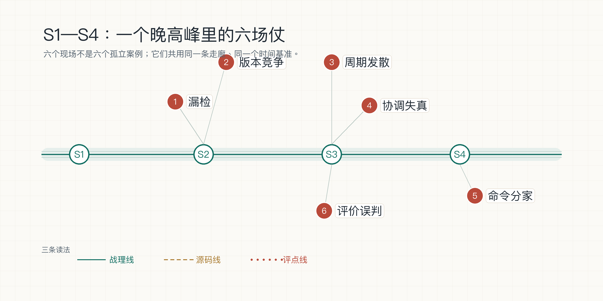

# 前言

交通信号控制系统常常被拆分成两个彼此隔离的世界。

交通工程师讨论延误、停车、饱和度和绿波带宽；软件工程师讨论服务调用、消息队列、方案状态和设备协议。两个世界各自有成熟的知识体系，却缺少一套能同时说明交通、软件和现场执行的系统模型。于是，公式进入代码后可能失去物理含义，平台功能看似齐全，却无法解释控制方案为什么有效；算法在局部指标上看似更优，却可能在最小绿、清空时间、相序兼容和设备执行等环节留下风险。

这本书想做的，就是在两个世界之间搭一座桥。桥的一端是道路空间和车辆运动，另一端是数据对象、算法服务和控制系统。全书围绕一个基本判断展开：交通信号控制不是一组彼此独立的配时公式，而是一个在安全约束下，将交通需求转化为时间方案，通过信号机执行，并根据实际运行结果持续修正的闭环系统。

## 为什么写这本书

从读博士开始，我就一直从事智能交通研究，后来在科研和产业两边都工作过。这些年，我最深的感受，不是算法还不够先进，而是能够把交通工程和计算机系统真正连接起来的人太少。

懂交通的人，往往计算机背景相对薄弱；懂计算机的人，又往往缺少交通工程知识。真正稀缺的，是既能理解两边的专业问题，又能把它们连接起来，最终构建并运行一套完整系统的人。

现有相关教材和技术书籍，大多分别从交通工程或计算机技术的角度展开：一类讲交通流、配时和通行能力，重点停留在公式与仿真；另一类讲编程语言、软件框架和数据库，重点停留在计算机技术本身。少数涉及交叉领域的书籍，多集中于交通数据处理或某类算法的实现，却很少回答一个更实际的问题：

交通工程知识，究竟怎样经过数据、算法、接口、设备和组织流程，最终变成一个能够在现场运行的系统？

学生的情况更为明显。他们对交通信号控制的理解，往往来自仿真软件和几张数据表：会调整参数，会看计算结果，却没有真正接触过真实系统中的时间戳、数据缺口、设备离线、部分成功和失败回滚。等到工作几年、经历过一轮实际项目之后，才慢慢明白：“书上的那个数”和“设备上的那个数”，并不总是一回事。

AI 时代并没有让这件事变得简单。AI 可以快速组织跨学科知识，生成看似完整的方案，但最终仍然需要有人判断：结论依据了什么数据和约束，适用于什么条件，又可能在哪里失效。工程把关人的门槛并没有降低，反而更高了——不仅要看懂 AI 给出的结果，还要能够判断它是否成立，以及如何验证。

这也是我写这本书的出发点：让读者更早接触真实的交通信号控制系统开发，不必等到工作多年之后，才逐渐弄明白这些问题。

## 这本书怎么写

本书通过一个逐步生长的 SignalLab 教学系统，将交通工程知识落实为可运行、可验证的代码。

系统从时间对象和最小绿开始，逐步加入检测流量、冲突关系和流向映射；再扩展到周期与绿信比、S1-S4 四路口走廊、公共周期和相位差；最后连接到方案版本、命令下发、运行状态和效果评价。全书始终围绕同一个系统：每章多讲一个环节，也多一条需要守住的约束。

交通信号控制的学习很容易停留在公式层面：给定流量和饱和流率，计算周期，再把周期分配给各个阶段。公式可以给出一个数字，却不能说明这个数字如何穿过时间、数据、设备和组织边界，最终成为现场真正执行的控制方案。

为了把交通信号控制从公式计算延伸到完整的工程系统，本书将其拆解为六个相互关联的抽象层次：

具体见表 前-1。

表 前-1 六层抽象
| 层次 | 核心问题 | 典型对象 | 失败方式 |
|---|---|---|---|
| 物理层 | 哪些轨迹会冲突，车辆需要多少空间和时间完成清空 | 进口道、车道、冲突点、排队存储 | 绿灯合法但车辆无法清空 |
| 时间层 | 一个周期如何组成，各路口如何共享时间基准 | 纯绿、清空、周期、偏移 | 定义混用、周期不闭合 |
| 表示层 | 同一概念如何在不同系统中保持身份和单位一致 | ID、字段、版本、区间 | 同名异义、缺失被当成零 |
| 算法层 | 如何在约束下选择周期、绿信比和偏移 | Webster、约束优化、MaxBand | 只优化目标，不检查可行性 |
| 执行层 | 方案如何被发送、确认、观测和回滚 | 命令、设备、批次、状态机 | 接受未生效、部分成功被隐藏 |
| 证据层 | 什么样的结果能够支持什么样的结论 | 观测窗口、置信度、对照、日志 | 把相关当因果，把执行当效果 |

每一层都有自己的状态、边界和出错方式。上层算法不能自动修复下层的数据缺失，下层设备执行成功也不能替上层控制决策提供充分证据。书中的案例会尽可能说明：当前结论依赖哪一层信息，又有哪些条件尚未得到验证。

这也意味着，需要练三件事：把交通问题表达为约束和目标；把约束和目标转化为不丢失原有语义的数据结构与代码；通过实验区分“代码按预期运行”“系统按预期执行”和“交通性能得到改善”。只掌握其中一种，系统仍然可能在不同层次的接口处断裂。

本书也讨论 AI 在交通信号控制中的作用。这里所说的“AI 辅助控制”，主要指利用数据分析、优化算法和规则计算生成控制建议，而不是把交通信号控制简化为一个模型训练或推理问题。学习模型可以参与流量预测等环节，但安全约束、方案校核、设备执行和运行闭环，仍然需要明确、可验证的工程机制来保证。

## 怎么读

本书面向三类读者。由于知识背景不同，建议采用不同的阅读路线：

具体见表 前-2。

表 前-2 三类读者的阅读路线
| 读者 | 已有基础 | 建议路线 | 可以暂时跳过 |
|---|---|---|---|
| 交通工程师 | 交通流、配时、交叉口设计 | 导论 → 第 1～18 章 → 第 23～24 章 | 第 19～22 章的框架细节、第 25～28 章的源码实现 |
| 软件/平台工程师 | 服务、消息、数据库 | 导论 → 第 1～4 章 → 第 19～22 章 → 第 25～28 章 | 第 7～8 章的交通流推导、第 16～18 章的优化细节 |
| 研究生/研发人员 | 数学与编程基础 | 按全书顺序阅读，并完成 SignalLab 实验 A0–A4 | 无（建议按顺序完整阅读；第 7、17、20 章可以重点研读） |

建议先读导论《一次计算是怎样发生的》。它以一次真实请求为线索，把时间戳、跨语言调用、数据组装、算法分支和方案下发串联起来。读完之后再回到第 1 章，就能先获得一张系统地图。

之后可以按照章节顺序阅读，也可以根据目录直接进入自己关心的问题。代码较多的章节，可以暂时跳过具体实现细节，但不建议跳过其中的约束条件和失败分析。

书中的实验按照 A0–A4 五个层级组织，从时间与安全、数据与需求、单点控制、协调控制，逐步走向完整系统，具体安排见附录 E。每个实验都建议先作出预测，再运行程序，最后解释结果与预测之间的差异。阅读全书时，可以始终带着导论留下的三个问题：时间以谁为准？状态存在哪里？证据是什么？

## 代码约定

书中的代码块分几类，请按标注理解：

- `python`、`java`、`javascript`、`sql`：源码摘录或可运行示例。除非正文明确说“可直接运行”，否则通常省略了 import、依赖注入、日志和其他方法，不能单独执行。
- `text`：字段契约、伪代码、状态机、公式、输出或数据结构示意，不是代码。
- `bash`：在终端执行的命令。
- `json`：接口载荷示意，字段可能做了简化。

读代码时先看类型、单位和上下文；不要把“示意”当成可运行程序。

## 这本书跟哪几场仗走

这本书从几个现场开始，而不是从定义开始。

S1 到 S4 是一条普通城市干道。某个晚高峰，S2 东进口的检测器漏检，平台看到的流量只有实际的一半；17:00，算法、人工和调度同时想改同一个方案；Webster 周期在接近饱和时突然发散；S3 与 S4 之间一个商业出入口，把原本漂亮的绿波带切断；批量下发时 S4 离线，页面却显示“已下发”；事后评价把“执行了”当成“改善了”。

这六件事，分别对应书里的六场仗；空间关系见图 前-1，章节对应见表 前-3。

表 前-3 六场战例与主要章节
| 战例 | 现场 | 主要章节 |
|---|---|---|
| 漏检 | S2 东进口流量被低估，置信度却是 1 | 第 1、5、6、25 章 |
| 版本竞争 | 17:00 算法、人工、调度同时改方案 | 第 2、21、28 章 |
| 周期发散 | Webster 在近饱和区给出巨大周期，生产代码压到 0.97 | 第 10、11、26 章 |
| 协调失真 | 子区、公共周期、带宽都成立，现场车队却断了 | 第 15～18、27 章 |
| 命令分家 | 设备接受，运行状态仍是旧方案 | 第 21、28 章 |
| 评价误判 | 速度上升，可能只是检测恢复或事故消散 | 第 23、24 章 |

六场仗不是六个孤立案例。它们共用同一个路口、同一条走廊和同一个晚高峰；前面讲兵器，第七部分回到源码，逐场复盘。

读的时候不必六场平均用力。跟着一个案例走，遇到不懂的公式再回查，比从第一页顺序啃到最后一页更有效。

## 边界

本书以中国大陆城市道路交通信号控制工程为背景，主要讨论固定配时与方案优化、单点自适应、子区协调和平台执行。它不是一本涵盖交通信号控制全部理论与技术的完整教材。以下主题没有展开到与本书主线相同的深度：

- 感应控制与半感应控制的完整参数体系；
- 行人相位、行人过街清空与无障碍设计；
- 公交优先和紧急车辆优先；
- 多环（ring-barrier）相位的完整枚举与优化；
- SCATS、SCOOT 类区域自适应系统的在线控制策略；
- 信号机硬件、灯组电气与施工验收。

这些主题只在必要之处作为相关背景或技术边界出现。若要开展深入设计，还需要结合相应的规范、设备手册和专项文献。

交通信号控制直接作用于现实道路，现场部署需要经过设备联调、安全校核、审批和可恢复运行流程。本书中的代码用于解释原理、展示工程实现与验证方法，不能未经审查就直接用于控制真实信号机。
