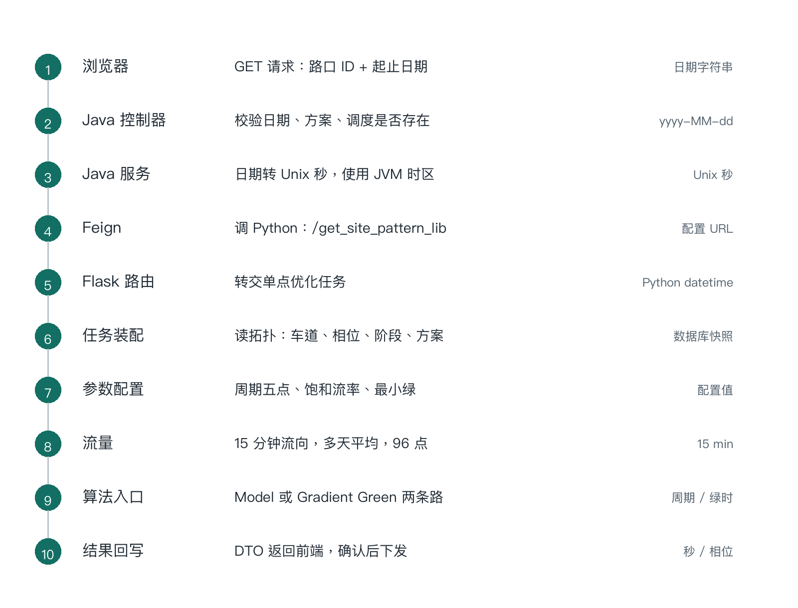

# 导论 一次计算是怎样发生的

早上 08:12，S2 的东进口排队已经越过检测器。交通工程师在平台上选中这个路口，把日期区间设为上周一到上周五，点击“计算”。十几秒后，页面出现一张推荐方案表：几个时段，每个时段一个周期和一串阶段绿时。

这一下点击在系统里到底发生了什么？答案不是“调用算法算了一下”。从浏览器到信号机，这条链路上至少有十个明确的位置：请求、时间戳、跨语言调用、拓扑构建、周期曲线、调度计划、流量数据、算法分支、结果转换、人工确认与下发。一处定义不同，最后展示的“推荐周期”就可能不是算法以为的那个周期，更不是设备将要执行的那个周期。

本导论把这条链路完整走一遍。它不展开全部细节，只负责建立三件事：**一次控制的数据从哪里来、时间以谁为准、哪一步可能失败**。后面二十八章，都是把这里的一跳拆开讲透（见图 0-1）。



## 第一跳 浏览器只发了一个 GET

前端的“计算”按钮最终落到一个普通的 HTTP 请求：

```text
GET /ai_compute_siteplan_by_date
    ?siteId=<路口ID>
    &startDate=2026-08-03
    &endDate=2026-08-07
```

对应 `AiComputeController.java`。接口声明返回 `InterResult<List<AiRecomandSitePlanDto>>`，参数是三个字符串：一个路口 ID，两个 `yyyy-MM-dd` 日期。

这一层几乎不做计算，只做四件事：

1. 日期格式校验，失败返回“时间格式不正确”。
2. 路口 ID 非空校验。
3. 查这个路口有没有控制方案，没有就返回“路口方案不存在”。
4. 查这个路口有没有调度计划，没有就返回“路口关联的调度方案不存在”。

第 3、4 条值得注意：算法还没被调用，系统就先拒绝了“没有方案”和“没有调度”的路口。这不是多余校验，而是因为后面的算法输入依赖这两类对象。**很多“算法报错”其实是接口层就该拦住的输入不完整**。

## 第二跳 日期变成时间戳

算法服务不认识 `2026-08-03`，只认识 Unix 秒。转换发生在 `AiComputeServiceImpl.java`：

```java
Date dateObj = DateUtil.parse(date + " 00:00:00", DateUtil.DATETIME_FORMAT);
Date endDateObj = DateUtil.parse(endDate + " 23:59:59", DateUtil.DATETIME_FORMAT);
Long timestamp = dateObj.getTime() / 1000;
Long endTimestamp = endDateObj.getTime() / 1000;
```

这里有两个容易忽略的细节。

**第一，时区。** `DateUtil.parse` 使用 JVM 默认时区。同一份代码部署在东八区和 UTC 环境，会得到相差 8 小时的时间戳，算法取到的 15 分钟窗口整体平移。系统里“日期”是人的概念，“时间戳”是机器的概念，转换点就是时区进入系统的地方。

**第二，结束时刻写成了 `23:59:59`，而不是次日 `00:00:00`。** 这样结束日当天最后一秒仍在区间内，但区间是闭的。如果下游按“左闭右开”切窗口，最后一秒可能落进一个不完整的窗口。这个细节在后面的事件窗口一章会反复出现：**边界怎么写，决定了跨窗口的车辆算给谁**。

## 第三跳 Feign 把请求送进算法服务

Java 不自己算，它通过 Feign 调 Python 服务。声明在 `IAiCommputeClient.java`：

```java
@FeignClient(value = "ai-compute-client",
  url = "${feign.traffic-algo.url:http://traffic-algo-apiserver...:5002}")
```

具体方法是 `GET /get_site_pattern_lib`，参数 `site_id`、`timestamp`、`endTimestamp`。

这条边界上有三个机制：

- **地址是配置**：默认值是集群内 DNS，本地调试要覆盖 `feign.traffic-algo.url`。书里第 19 章讲 Java/Python 边界，讲的就是这条线。
- **返回值是弱类型**：`FeignAiCompBaseDto` 只有 `status`、`message`、`data` 三个字段，HTTP 200 不代表业务成功，需要再看 `status == "SUCCESS"`。
- **失败处理有缺陷**：`AiComputeServiceImpl.java` 先判断 `null == planContentListData`，进入分支后又直接调用 `planContentListData.getStatus()`。如果 Feign 真的返回 `null`，这里会抛空指针，而不是返回“计算错误”。这是书里要保留的真实缺陷，不是教学假设。

## 第四跳 Flask 路由

Python 侧是一个 Flask 应用。路由在 `pretreatment/apiserver.py`：

```python
@app.route("/get_site_pattern_lib", methods=["GET"])
def get_site_pattern_lib():
    site_id = request.args.get("site_id")
    timestamp = int(request.args.get("timestamp"))
    end_timestamp = int(request.args.get("endTimestamp"))
    result = ts.SinglePointOptimization(
        site_id=site_id, schedule_id=None,
        timestamp=timestamp, end_timestamp=end_timestamp)
    return Response(result, content_type="application/json")
```

注意这里传的 `schedule_id=None`，说明平台“按日期计算”走的是“智能计算”分支，而不是“按调度推荐”分支。两者后面的行为不同，尤其是结果是否落库。

同一个 Flask 应用里还有 `/lightflow/singlenodeopt` 这类路由，参数是 `raw_data` 加 `algo_config`，属于 SDK 调用面。**平台面和服务面是两套入口，走的是同一批算法但不同的组装逻辑**。读代码时如果只看到其中一套，就会误判生产行为。

## 第五跳 先把路口读进来

`SinglePointOptimization` 的第一步不是算流量，而是把路口的静态结构读出来（`task_optimization.py`）：

```python
cross = Cross(db_conn, site_id)
cross_info = cross.query_or_cached_site()
lane_list = cross.get_in_lane_list_extend()
algo_input_data.Topology = Topology(lane_list=lane_list)
cross.query_or_cached_channels()
cross.query_or_cached_phase_stages()
cross.query_or_cached_split_sequences()
cross.query_or_cached_phases()
```

这一步决定了算法“看得见什么路口”：进口车道、相位、阶段、绿信比序列、方案。它们来自 intersection 库，是**组装时的快照**，不是实时状态。算法算的是未来方案，不是当前设备状态。

失败点也在这里：路口不存在、车道为空、相位阶段缺失，都会让后续计算无意义。系统选择在组装阶段返回 `BadRequest`，而不是让算法拿到半个路口。

## 第六跳 周期曲线从哪里来

很多人以为周期是算出来的。在这套系统里，周期的“理想值”先来自一条配置曲线。

`task_optimization.py` 从调度配置库读 `SiteTask`，要求五个点齐全：

具体见表 0-1。
表 0-1 周期曲线的五个配置点
| 配置 | 含义 |
|---|---|
| `min_saturation` / `c_min_cycle` | 低饱和对应的最小周期 |
| `step_saturation_one` / `step_cycle_one` | 第一段拐点 |
| `step_saturation_two` / `step_cycle_two` | 第二段拐点 |
| `main_saturation` / `c_main_cycle` | 主段 |
| `max_saturation` / `c_max_cycle` | 高饱和对应的最大周期 |

它们被组装成 `flow_cycle_labels`，传给算法后按线性插值使用（`flow_cycle_model_type="linear"`）。也就是说：**同样的流量比，不同路口可能得到不同周期，因为曲线是每个路口单独配的**。周期模型不是一个全国统一的公式，而是“公式 + 本地标定”。

这也解释了为什么缺一个点就返回“周期模型参数配置不完整”：插值需要完整的分段。

## 第七跳 调度计划和日计划

算法要用到“现有方案库”作为候选。这些候选不是临时生成的，而是从调度计划里翻出来的（`task_optimization.py`）：

1. 如果传了 `schedule_id`，直接按 ID 取调度计划，再取它引用的日期。
2. 如果传的是时间区间，就逐日查这个路口当天的调度计划；某一天没有计划，直接 `BadRequest`。
3. 按天计划取方案集合，按 `PlanID` 去重，形成 `Signal.Plan`。

这一步的机制含义是：**算法只能在“这个路口已经配置过的方案”里选相序和结构**，它不凭空发明一个阶段序列。想让它考虑新相序，需要先在方案库里有对应候选。

## 第八跳 15 分钟流量

数值输入来自离线数仓的方向流量，粒度为 15 分钟（`task_optimization.py`）：

下面是源码摘录和聚合逻辑的混合示意，不是可运行代码：

```text
for date in traffic_dates:
    traffic_flows.extend(cross.get_direction_flow_opt(start_time, start_time + timedelta(days=1)))
...
group by (CrossID, Direction, Movement, StartTime[11:19])
Volume = sum(values[0]) / len(values[0])
QueueLen = max(values[1])
```

三个细节决定了页面上的流量：

- **多天平均**：同一时段跨多天取平均，而不是求和。它表示“典型日”，不是“总量”。
- **排队取最大**：`QueueLen` 取多天最大值，表示保守估计；平均会掩盖最坏情况。
- **96 点校验**：一天 24 小时除以 15 分钟等于 96。代码用 `len(new_traffic_flows) % 96 != 0` 判断是否缺点。注意它校验的是总行数，不是“每个流向 96 点”，所以多流向时可能漏检——这是真实缺陷，后面数据章会展开。

还有一条硬规则：**当天数据不接受**。`task_optimization.py` 里有一段直接返回“暂不支持当天数据（数据不完整）计算”，代码注释把这段标为临时修复。原因是当天还没过完，96 点必然缺；系统选择拒绝，而不是用半天数据推算全天。

## 第九跳 算法入口有两条路

组装完成后调用 `SingleNodeOptNew`。这个函数不是一套算法，而是路由（`single_opt.py`）：

```python
if pwl_gmin is None:
    return SingleNodeOptModel(...)      # 模型优化
else:
    return SingleNodeOptNaive(...)      # 梯度绿灯
```

决定走哪条路的，不是接口参数，而是这个路口有没有配置 `pwl_gmin`（分段最小绿）。有配置时还会把周期上下限直接设为 `flow_cycle_labels` 的最小值和最大值。

默认参数也藏在这里：`num_cluster=5`、`dist_limit=3`、`cycle_step=4`。平台路径没有显式传 `num_cluster`，所以用的是 5；SDK 路由的默认值是 3。**同一个路口，从平台点和从 SDK 调，可能得到不同的时段划分**。

算法输出按“时段”组织，每个时段包含 `CrossID`、`StartTime`、`EndTime`、`Cycle`、`Stages`、`PlanID`。阶段时间经 `to_output(rm_greenflash=True)` 输出，绿闪被去掉——设备侧会有自己的绿闪定义。这又是一个定义问题：书里说“阶段时长”时，需要说清含不含绿闪。

## 第十跳 结果回到平台，然后呢

算法结果经 Java 转成 `AiRecomandSitePlanDto` 返回前端，只做展示。真正让方案生效还要经过：

1. 人工确认推荐方案；
2. 保存到方案库（产生新版本）；
3. 绑定调度计划；
4. 下发到设备（`/service/control_service/download/plan` 或批次接口）；
5. 通过实时阶段、周期、控制模式确认“设备真的在执行”。

这四本账需要分开记：**计算出的方案、保存的方案、下发的命令、设备正在执行的方案**。第 21 章会给出状态机，第 22 章会讲前端如何显示它们。

还有一件事要记住：算法并不直接控制信号机。算法只产出候选，人工和调度决定它是否成为命令，设备决定它是否成为现实。

## 这次计算里的数字，分别是什么来源

如表 0-2 所示。
表 0-2 这次计算里的数字，分别是什么来源
| 数字 | 本次取值 | 来源 | 代码位置 |
|---|---|---|---|
| 15 分钟窗口 | 96 点/天 | 数据链路约定 | `task_optimization.py` |
| 周期五点 | 路口单独配置 | 配置值（需标定） | `task_optimization.py` |
| 饱和流率 | 按路口/时变表 | 配置值 | `task_optimization.py` |
| 最小绿梯度 | 可配置 | 配置值 | `single_opt.py` |
| 时段数 | 5（平台默认） | 算法默认值 | `single_opt.py` |
| 绿闪 | 输出时去掉 | 设备定义 | `single_opt.py` |
| 决策日期区间 | 用户选择 | 人的输入 | 控制器参数 |

这张表是本书的一个基本要求：**一个数字出现时，最好能交代它来自规范、配置、实测还是假设**。现场工程师最先追问的也是这个。

## 如果中间某一跳失败

如表 0-3 所示。
表 0-3 如果中间某一跳失败
| 失败位置 | 用户看到 | 系统状态 | 安全后果 |
|---|---|---|---|
| 日期格式 | “时间格式不正确” | 未调用算法 | 无 |
| 无方案/无调度 | “路口方案不存在” | 未调用算法 | 无 |
| Feign 超时 | 计算错误/空指针 | 算法可能已算完 | 结果丢失，不产生命令 |
| 当天数据 | “暂不支持当天数据” | 拒绝 | 不产生方案 |
| 96 点缺失 | “部分缺失数据” | 拒绝 | 不产生方案 |
| 算法异常 | `FAILED` + traceback | 无结果 | 不产生方案 |
| 设备接受但未执行 | 页面显示“已下发” | 状态不一致 | **最危险** |

最后一行是本书反复强调的分界：**错误可以被拒绝，假成功不能**。后面的命令状态机、评价和记录，都是围绕这一点展开的。

## 全书的地图

这次点击把全书串了起来：

- 第一、二部分解释“路口怎么被描述、数据怎么进来”；
- 第三部分解释“周期和绿时怎么算出来”；
- 第四部分解释“多个路口怎么协调”；
- 第五部分解释“命令怎么安全到达设备”；
- 第六部分解释“怎么判断它有没有用”；
- 第七部分回到生产源码，逐段核对上面每一跳的真实实现和缺陷。

读这本书时，建议始终带着三个问题：

1. **时间以谁为准？** 人的日期、JVM 时区、Unix 秒、15 分钟窗口、周期相位、设备时钟，不是同一个东西。
2. **状态存在哪里？** 内存、数据库、消息、设备，各有各的版本。
3. **证据是什么？** 接口成功、设备接受、运行观测、效果改善，是四级完全不同的证据。

## 留给后面章节的问题

- 为什么事件窗口通常是左闭右开，而不是双闭？
- 为什么周期曲线是五个点，而不是一个公式？
- 为什么当天数据不能算，而昨天可以？
- 为什么同一个算法入口会有两条实现路径？
- 为什么“下发成功”不等于“方案生效”？

这五个问题分别对应第 5、10、12、13、21 章。导论只回答它们为什么会出现在同一条链路上。
